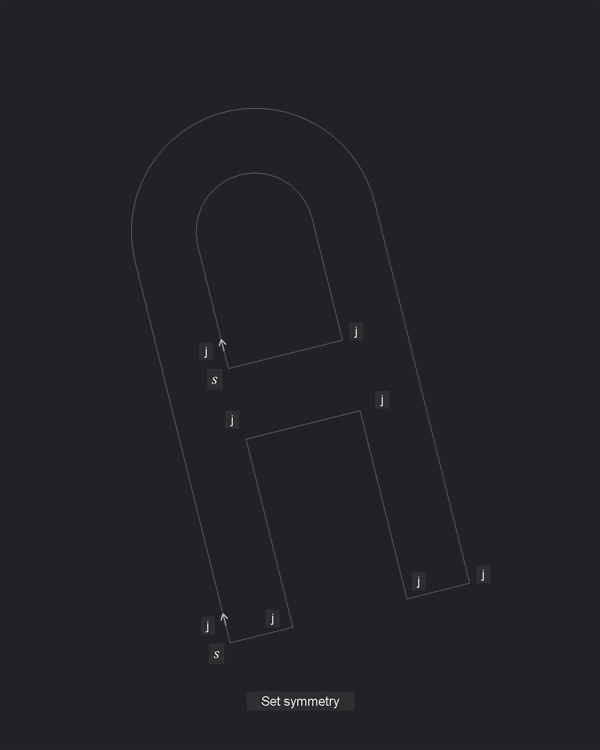

# Autostitch

Autostitch lays out stitching holes and slits on leatherwork patterns in BricsCAD V22. Draw a guide along a seam, choose your pricking-iron pitch, and generate the openings. It fits the spacing around endpoints, corners and junctions, and marks adjusted gaps where the layout departs from the nominal gap.

You can connect guides into one stitch line and copy its layout to matching guides on other pattern pieces, including mirrored pieces.

## Requirements

- Windows and BricsCAD V22 with .NET support.
- OpenDCL 10.1.2.2 installed for BricsCAD.

## Load the plugin

1. Clone or download this repository and extract it to a local folder.
2. Keep the folder intact: `AUTOSTITCH.lsp`, `AUTOSTITCH.odcl`, `Autostitch.Events.dll` and the `source/` folder are required.
3. In BricsCAD, run `APPLOAD` and load `AUTOSTITCH.lsp`.
4. Run `AUTOSTITCH` to open the palette.

The built palette and event bridge are included; no build is needed to use the plugin.

## Generate your first stitch line

1. Set the drawing units to millimetres or inches. For a unitless drawing, Autostitch asks which to use when you select a guide.
2. Draw a line, arc, circle or 2D lightweight polyline along the seam in the XY plane at elevation 0.
3. Click **Select guide** and select that entity. When first selecting a closed loop, pick where you want the stitching to start.
4. Enter **Stitch pitch** in millimetres, regardless of the drawing units.
5. Click **Generate stitches**.

Edit the guide with normal CAD tools, then click **Generate stitches** again to update the output. Settings are saved with the guide. Generation is manual; if a new layout fails, the previous output is kept.

## Adjust the layout

- **Set start** and **Set end** limit the stitched portion of a guide. **Reverse travel** changes its direction.
- **Add landmark** centres a nominal gap on a picked position, such as a pattern alignment mark.
- **Stitch lean** chooses obverse or reverse slit lean. **Face** selects the front or back material face shown.
- **Connect guides** joins guides at junctions into one stitch line.
- **Match guide** transfers the source layout to a geometrically matching guide on another piece.

Click **Generate stitches** after changing the layout.

For the geometry behind the tool, start with the [illustrated glossary](docs/GLOSSARY.md), then the [fitting model](docs/MODEL.md) and [junction rules](docs/JUNCTIONS.md). Repository structure and development instructions are in [AGENTS.md](AGENTS.md).

## License

Autostitch is licensed under the [MIT License](LICENSE), except for the counter-example reference photographs listed in [their license exclusions](examples/counter_examples/README.md#license-exclusions). Those photographs are excluded from the MIT License; no rights to them are granted by this repository.
