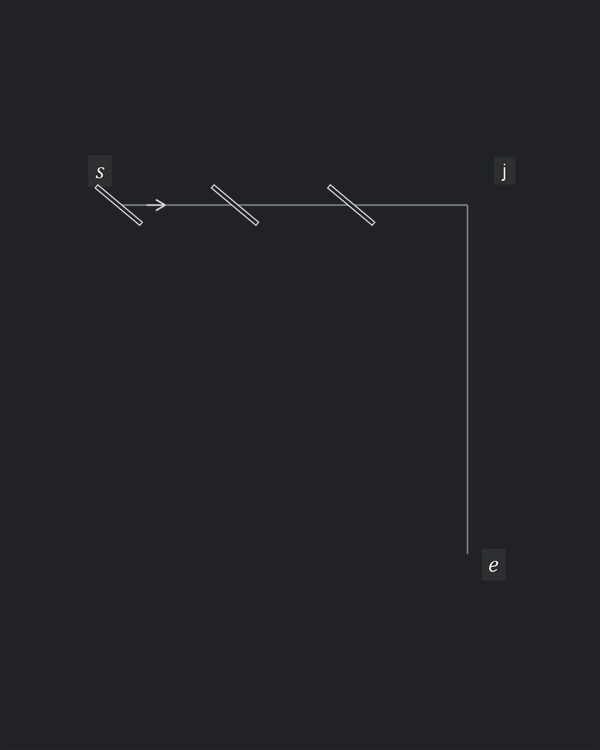
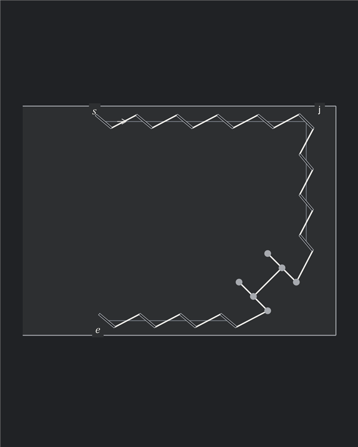
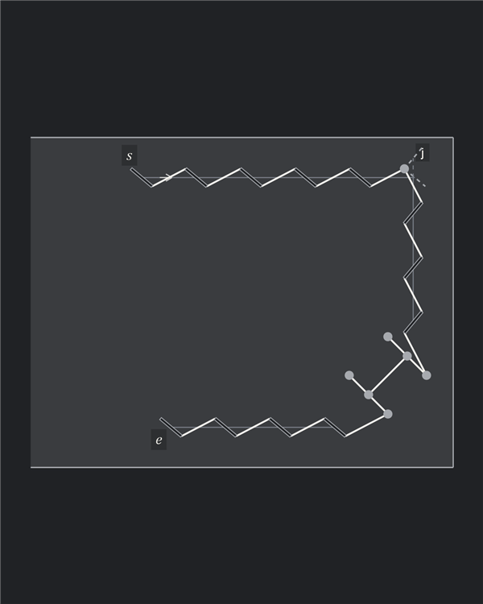
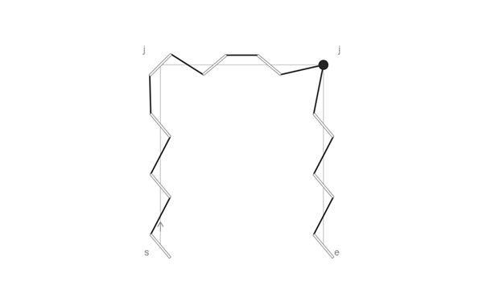
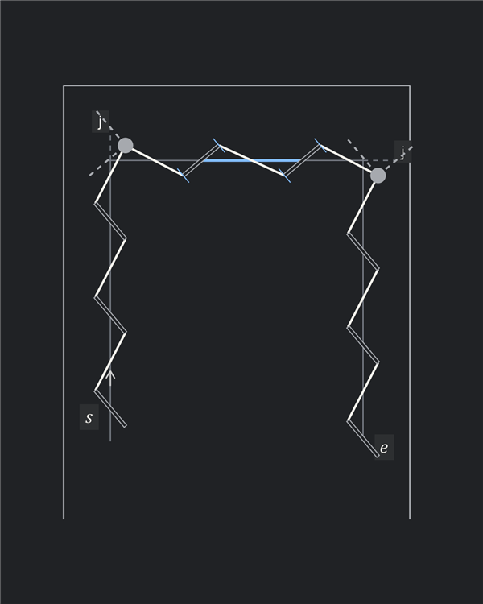
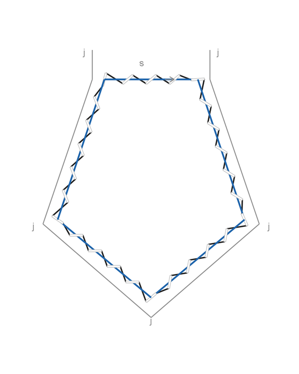
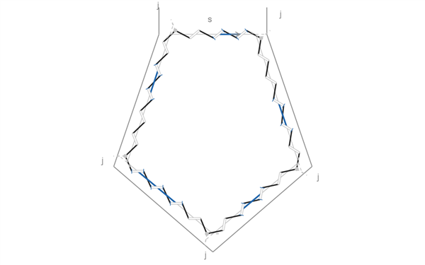
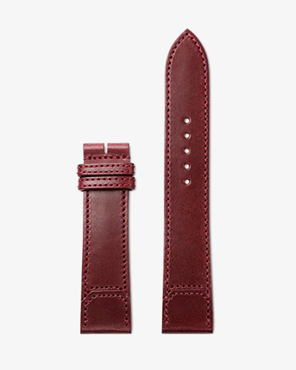
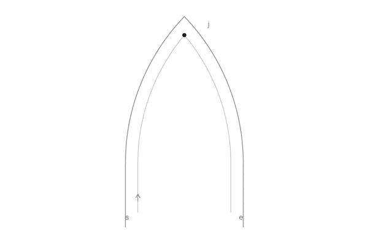
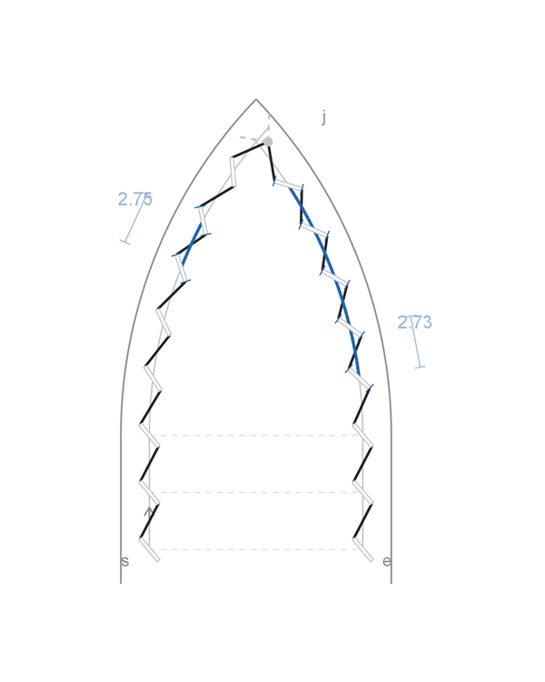

# Stitching examples

Corner treatments found in finished work, reconstructed as stitch diagrams and compared with Autostitch.

- Reference diagrams interpret the photographs; slit axes are inferred from the visible thread
- Dimensions and spacing are chosen for the diagrams, using $p=3\,\mathrm{mm}$. The totals describe these reconstructions, not the products
- Autostitch changes corner openings and sometimes start/end positions. The comparisons include those changes, as well as the distribution of adjustments

## Corner treatments

### Shared diagonal slit and mixed slit lean

- One real diagonal slit joins the incoming and outgoing arms
- Its orientation differs from both rows, changing the direction and visible length of the thread entering and leaving the corner slit
- In the Sellier reconstruction, the top row uses rear-style lean and the vertical row uses front-style lean; their slit axes remain nearly parallel across the turn
- The shared slit bisects the corner in this diagram. Front/rear style describes the lean, not which face was physically punched
- The shared opening stays at the intended vertex
- This treatment relaxes the consistent-lean rule: one arm uses mirrored lean and the corner slit has its own orientation
- A good corner solution when those changes in lean and thread appearance suit the design

| Construction | Number of adjusted gaps | Absolute adjustment ($\mathrm{mm}$) | Absolute residual ($\mathrm{mm}$) |
| --- | ---: | ---: | ---: |
| Shared diagonal slit | $0$ | $0.000$ | $0.000$ |

## Cases

### Hermès Sellier wallet

- Focus: the top corner and the decorative H below the right-hand run
- The H is represented by six round holes; its two approaches are set to nominal pitch, with no residual

#### Reference

- Shared diagonal corner slit; rear-style top row and front-style vertical row
- The stitches entering the H continue the adjoining thread angles

#### Autostitch

- Consistent rear-style lean; a round corner hole at the virtual slit-tip intersection
- The H keeps its shape and nominal approaches; its position and the bottom row move to suit the changed slit lean

| Construction | Number of adjusted gaps | Absolute adjustment ($\mathrm{mm}$) | Absolute residual ($\mathrm{mm}$) |
| --- | ---: | ---: | ---: |
| Reference | $0$ | $0.000$ | $0.000$ |
| Autostitch | $0$ | $0.000$ | $0.000$ |

### Loewe Mini Feather hanger

- Focus: the rectangular strap below the swivel hook
- The stitch line goes up the left side, across the top and down the right side

#### Reference

- Shared slit at the left corner; round hole at the right corner
- The two top slits have opposing lean, giving the middle thread a horizontal line

#### Autostitch

- Same guides; round holes at both corners and consistent slit lean
- One adjusted top gap, approximately $3.249\,\mathrm{mm}$
- Start and end positions shift along the vertical guides to keep those rows nominal

| Construction | Number of adjusted gaps | Absolute adjustment ($\mathrm{mm}$) | Absolute residual ($\mathrm{mm}$) |
| --- | ---: | ---: | ---: |
| Reference | $3$ | $0.900$ | $0.900$ |
| Autostitch | $1$ | $0.249$ | $0.249$ |

### Louis Vuitton Speedy handle chape

- Focus: the left [handle chape](https://us.louisvuitton.com/eng-us/products/nano-speedy-g81-nvprod7890132v/M29781), the leather tab attaching the handle hardware to the bag
- Closed pentagonal stitch line; one handedness throughout

#### Reference

- A shared slit at each corner
- Each side uses equal spacing between its corner slits

#### Autostitch

- Same pentagonal guides; five round corner holes
- Each span uses the fewest adjusted gaps allowed by the pitch bounds
- The loop closes at its starting opening

| Construction | Number of adjusted gaps | Absolute adjustment ($\mathrm{mm}$) | Absolute residual ($\mathrm{mm}$) |
| --- | ---: | ---: | ---: |
| Reference | $26$ | $4.931$ | $4.931$ |
| Autostitch | $6$ | $0.917$ | $0.917$ |

### Jaeger-LeCoultre / Casa Fagliano strap tip

- Focus: the pointed end of the right strap
- Both straight rows start at matching heights, with one handedness throughout

#### Reference

- Symmetric curves meet at a round hole fixed at the vertex
- Equal compression through each curve is an assumption of this reconstruction
- Five adjusted gaps per side, approximately $2.749\,\mathrm{mm}$ each; the straight rows remain aligned

#### Autostitch

- Same guides and aligned straight rows
- Virtual slit tips locate the shared hole slightly right of the vertex, changing the available span on each arm
- Left: one adjusted gap of approximately $2.747\,\mathrm{mm}$
- Right: four adjusted gaps of approximately $2.729\,\mathrm{mm}$
- Minimizing adjusted gaps gives different spacing patterns on the two sides

| Construction | Number of adjusted gaps | Absolute adjustment ($\mathrm{mm}$) | Absolute residual ($\mathrm{mm}$) |
| --- | ---: | ---: | ---: |
| Reference | $10$ | $2.509$ | $2.513$ |
| Autostitch | $5$ | $1.337$ | $1.339$ |

[Sources, geometry and reproduction](../examples/counter_examples/README.md)
