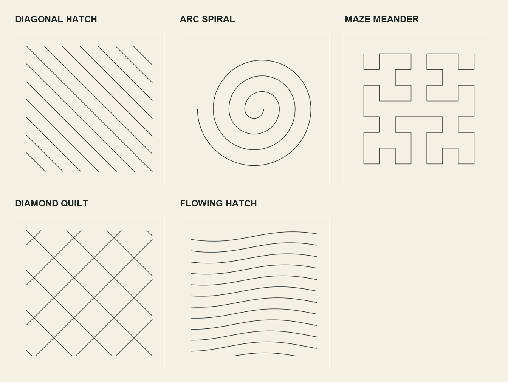

# Fill recipes

Fills arrange guides; the production solver places the stitches. Fill spacing controls density independently of stitch pitch.

All samples use pitch $p=3\,\mathrm{mm}$ and slit length $\ell=1.5\,\mathrm{mm}$.

| Recipe | Configuration | Construction |
| --- | --- | --- |
| Concentric circles | $9\,\mathrm{mm}$ inner radius; $6\,\mathrm{mm}$ radial spacing | Five closed circles; shared diameter supplies two landmarks per ring |
| Branching maze | $36\times30\,\mathrm{mm}$; $6\,\mathrm{mm}$ corridors | Twelve wall lines with seven shared T junctions |
| Diamond quilt | $6\,\mathrm{mm}$ between crossings; $4.5\,\mathrm{mm}$ beyond outer crossings | Two families of eight lines; 64 shared X junctions |
| Flow | $35.38\times74.89\,\mathrm{mm}$; $3\,\mathrm{mm}$ row spacing | 25 translated circular arcs; free ends stop at nominal pitch |

The diameter intersections reserve nominal gaps. Equal semicircles receive matching spacing adjustments; each loop starts beside a landmark.

These are tested configurations, not minimum spacings. Maze and quilt junctions reserve half-pitch connections on every arm; the remaining gaps stay nominal. Connected maze walls' free ends stop $1.5\,\mathrm{mm}$ inside their grid endpoints while the junctions retain the $6\,\mathrm{mm}$ grid. Its passages remain connected. Flow gaps are nominal.

## Reuse

- [fills.lsp](../examples/fills.lsp): `ast:fill-paths` returns native line/arc polyline vertices. `ASTFILLDEMOS` draws and stitches the samples.
- [cases.json](../tests/cases.json): stable IDs, parameters and expected results.
- [fills.dwg](../examples/demos/fills.dwg): editable guides and generated blocks, with a named view per recipe.
- [Reproduction commands](../examples/demo.md): native generation and preview export.

Maze coordinates define one fixed motif; they are not an arbitrary maze generator. Flow trims the free ends equally without changing the underlying arc. No independent hatch recipe is needed: the crossing grid is the diamond quilt.

The banner reuses Flow as one shared field with $3\,\mathrm{mm}$ row spacing, clips it inside YOU, then trims each retained fragment to $2.7\,\mathrm{mm}$ pitch. Its holes stay $3\,\mathrm{mm}$ from the stitched lettering; O's counter stays empty.

The banner also uses a looser diamond quilt: crossings $13.5\,\mathrm{mm}$ apart, $2.7\,\mathrm{mm}$ pitch. The quilt is clipped around a $6\,\mathrm{mm}$ text perimeter and stops inside the image frame.

## Validation

Each sample must fit completely and pass combined opening clearance, including openings on separate guides. Crossings are declared junctions with shared holes. Clearance uses default model settings; it is not a calibrated material-width allowance. [Native results](../tests/QUALIFICATION.md).
