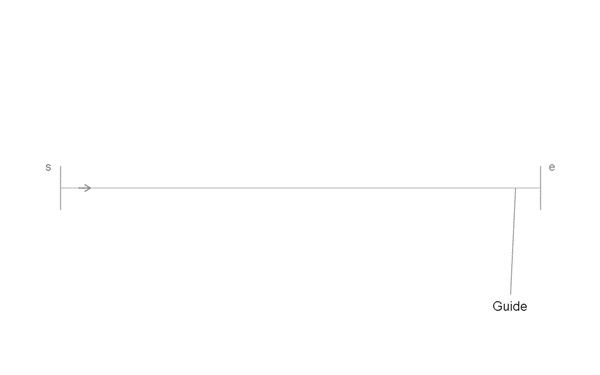
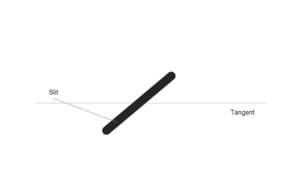
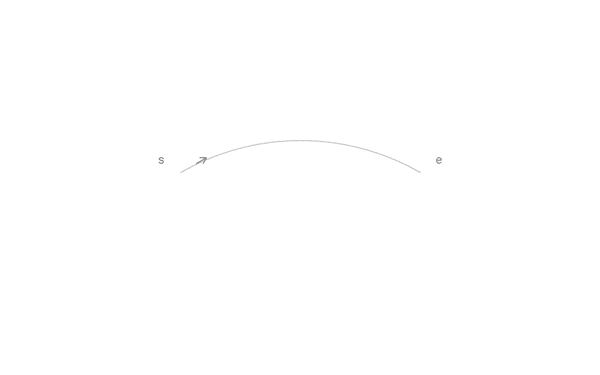
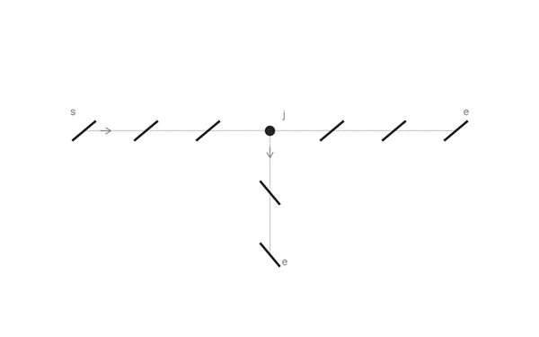

# Glossary

Terms used by the [axioms](AXIOMS.md), [model](MODEL.md) and [junction construction](JUNCTIONS.md).

Notation: `s` start, `e` end, arrow for direction, `L1` landmark. The `I` crossbars identify slits bordering adjusted gaps.

## Guide

An editable path on which real slit centres lie, made of straight or circular **segments**. A **stitch line** is the stitching defined on one guide or a connected set of guides. Each guide has a chosen extent and direction; it may be open or a closed loop. Connected guides meet at junctions and share one stitch ID.

**Station** is distance along the guide from a chosen origin; on a curve, it is arc length. The **tangent** is the guide's local direction.

**Matched guides** use one source stitch line's complete hole layout. A match can include a whole connected guide set on another pattern piece; it does not add an arm to a junction. **Front face** and **Back face** identify the material face shown in the drawing; opposite-face copies reflect the complete layout. Travel direction remains a separate choice.

## Slit

A slit is one type of **opening**; a round hole is the other. Its **axis** is the finite centreline between its tips. **Length** $\ell$ runs along that axis, **width** $w$ across it, and **lean** $\alpha$ is its signed angle to the guide tangent.

A **virtual slit** is construction only: its selected tip helps locate a corner hole. It is not a separate opening.

## Gap and pitch

A **gap** is the direct centre-to-centre spacing between consecutive openings. **Pitch** $p$ is the target spacing. On a circular guide, the gap is the **chord length**: measured straight between the centres. **Arc length** follows the guide between those same centres.

For radius $R$ and angular separation $\theta$ in radians:

$$
g=2R\sin\left(\frac{\theta}{2}\right),\qquad s_{\mathrm{arc}}=R\theta.
$$

At $R=3\,\mathrm{mm}$ and $\theta=\pi/3$, the nominal chord gap is $3\,\mathrm{mm}$; the arc length is approximately $3.14\,\mathrm{mm}$.

- **Nominal gap:** equals $p$.
- **Adjusted gap:** a slit-to-slit gap changed from $p$, within $0.9p\leq g\leq1.1p$.
- **Protected gap:** fixed at $p$ and cannot be adjusted, such as the gap centred on a landmark.

Sharp-corner gaps with a round-hole endpoint follow the corner construction. A **corner step** is the centre distance from a virtual slit to its real neighbour: nominally $p$, adjustable within $0.9p\leq q\leq1.1p$ to keep that neighbour on its guide. It is not a real slit-to-slit gap. At junctions with three or more arms, each first neighbour is one nominal pitch from the shared hole.

Consecutive equal adjusted gaps form an **adjustment block** within a free span.

## Junction

A meeting with two or more **arms**: portions of stitch lines extending away from it. A through-line contributes two arms, a T has three, and an X has four.

- A **smooth join** keeps the tangent direction. Straight or co-circular continuation at equal pitch remains one run; a smooth change of curvature shares one slit.
- A **sharp corner** has two arms with different tangent directions. Virtual slits locate its shared round hole.
- A junction with three or more arms, such as a T or X, shares a round hole at the guide intersection.

For a two-arm corner, the **turn angle** $\delta$ is the signed change of tangent direction. The **included angle** $\beta$ is the angle between the arms pointing away from the corner:

$$
\beta=\pi-\lvert\delta\rvert.
$$

A small included angle is sharp; a small turn is nearly straight.

## Landmark

A reference position centred along the guide between two nominally spaced slits. It fixes that pair; there is no opening at the reference itself.

## Free span

The section between fixed features whose intermediate openings still need to be placed. Endpoints, landmarks and junctions fix the required opening positions and protected gaps; fitting fills the remaining space without changing them.

## Clearance

The shortest edge-to-edge separation of disjoint openings, accounting for slit width and hole diameter. The **margin** $m$ is the minimum required clearance. Touching or overlap is invalid, including when $m=0$.
