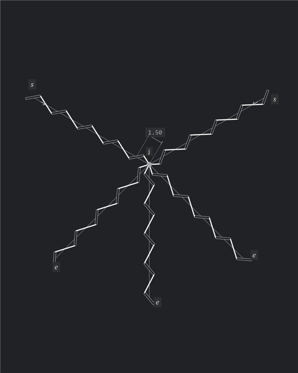
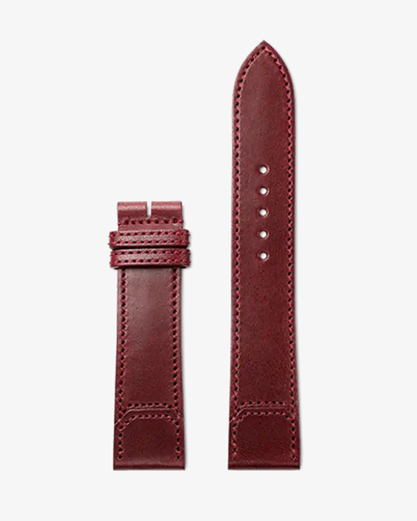

# Introduction

A seam begins as a line in a design, but making it means deciding where each opening will go and how it will face. Those decisions connect the intended appearance to the tools used to produce it. Along a straight run, a pricking iron can repeat the same spacing with little difficulty. As the seam approaches an endpoint, turns a corner or meets another row, the craftsperson has to reconcile that regular pattern with the shape of the piece.

The openings themselves complicate the fit. Round holes are rotationally symmetric; slits have length, width and orientation, all of which affect the visible thread. A multi-tooth iron fixes the spacing between slits, yet seam lengths rarely divide into whole multiples of that spacing. The craftsperson must judge where a change will be least conspicuous, how much each gap can change and whether the resulting openings can still be placed with the intended tool. A gap that departs from the iron's pitch can require an awl or a single tooth.

These judgements are repeated whenever a pattern changes. A digital array can produce a row of openings, but fitting that row around fixed features still takes manual work. Moving an endpoint or changing a curve can undo the corrections already made. In physical layout, experience guides the same choices, although the decisions may never be recorded separately from the finished pattern.

Autostitch makes those placement choices explicit. It preserves the tool pitch where possible, limits departures from that pitch and identifies where they occur. Corners and other fixed features are resolved before the spaces between them are fitted, so a spacing correction cannot quietly move a feature that the design depends on. When the constraints cannot be met together, the layout is rejected and the guide or its fixed features must change. The craftsperson chooses the composition, tool profile and treatment; the geometric rules carry those choices through the pattern.

## Pitch Fitting

The path carrying the slit centres is the guide, and one stitch line may follow several connected guides. The direct distance between consecutive opening centres is a gap; its target value is the nominal pitch $p$. A nominal gap equals $p$, while an adjusted gap departs from it within the permitted bounds. On a curve, that direct distance is a chord, which is shorter than the corresponding distance along the guide.

Consider six slits on a $15.3\,\mathrm{mm}$ straight guide with a nominal pitch of $3\,\mathrm{mm}$. Five nominal gaps cover $15\,\mathrm{mm}$, leaving a residual of $0.30\,\mathrm{mm}$ before the fixed endpoint. Reaching that endpoint requires the extra length to go somewhere. The figures mark the residual in red, adjusted guide segments in blue and gap lengths with bracketed dimensions.

Dividing the guide equally gives five $3.06\,\mathrm{mm}$ gaps. This familiar fit-to-length construction produces a uniform row, but its spacing is determined by the guide length and chosen gap count. Another stitch line will generally receive a different pitch. The $3\,\mathrm{mm}$ iron cannot place either row at its new spacing without individual placement of the gaps.

Keeping the first four gaps nominal concentrates the residual in a final $3.30\,\mathrm{mm}$ gap. Most of the row remains compatible with the iron, although the endpoint stitch takes the entire change. On a different length it could be shorter rather than longer. Spreading the correction across more gaps would make each change smaller and easier to blend into the row, but would also increase the number of individual placements.

Autostitch formalizes that tradeoff by limiting each departure from pitch to ten percent, then using the fewest adjusted gaps needed. Those gaps share the residual equally in one block placed as centrally as possible within the available span. Here a single $3.30\,\mathrm{mm}$ gap is sufficient, so four gaps remain nominal and the correction moves to the centre. The row retains the common tool pitch on either side of the adjustment instead of acquiring a new pitch throughout.

This policy gives priority to the number and location of departures from the tool pitch. Equal spacing remains a possible visual choice, and an endpoint correction remains a possible placement choice. Autostitch selects a repeatable treatment whose consequences can be inspected: how many gaps change, by how much, and where they lie in relation to the rest of the design.

## Corner Treatments

At a corner, spacing and orientation become inseparable. The two portions of the stitch line extending away from the corner are its arms. Each slit has a finite axis between its tips, and its lean is the signed angle of that axis to the guide's local tangent. Obverse stitch uses the reference lean; reverse stitch mirrors it. These choices describe the slit row independently of travel direction and the material face shown. Where two rows meet, their lean affects the position of the opening at the turn and the lengths and directions of the adjoining thread.

One treatment, called Vertex point here, keeps a round hole at the guide vertex. In the right-angle example, moving the vertical run balances the two corner stitches: each has a visible length of $1.96\,\mathrm{mm}$ and meets its guide at $14.3^\circ$. Spacing within the arms stays nominal, while the far endpoint moves with the vertical row. The two final gaps into the hole absorb the change. The red angle annotations show the thread's approach to each guide.

A Bridge bypasses the vertex and carries thread directly from the last slit on one arm to the last slit on the other. Moving the vertical row changes both the length and direction of that connection. In the example, the visible bridge varies from $1.00$ to $3.00\,\mathrm{mm}$ while spacing within each arm remains nominal. As with Vertex point, the far endpoint moves with the row.

Reverse corner develops the Bridge treatment by inserting a shared diagonal slit at the vertex and mirroring the outgoing row. The turn joins obverse and reverse stitches, bringing the outgoing corner stitch closer to the ordinary thread direction along that row in this example. The arm gaps remain nominal, and the final gaps into the shared slit take the residual. Length brackets show the two corner stitches alongside the red approach angles.

Autostitch derives the round-hole position from the two rows while preserving their lean. Each row continues towards the corner to a virtual slit, an unpunched construction slit whose selected tip helps locate the shared hole. At this right-angle corner, the horizontal row's terminal virtual slit locates the vertical row through its lower tip. Sliding the virtual slit and its preceding real slit brings the vertical row into alignment with its guide. The vertical row follows sideways, and the movement leaves a residual in the horizontal arm.

Once the corner is fixed, that residual can be distributed within the horizontal span. With nominal steps between the real and virtual slit centres, both entering and leaving thread meet their guides at $27.5^\circ$. The hole's offset from the vertex follows from the slit length, lean and corner angle, so a different tool profile produces a different placement. The construction separates the choice of corner geometry from the fitting needed to reach it.

Each treatment preserves a different combination of features. Reverse corner keeps the turn at the vertex and has less visible thread-length deviation in this example; Autostitch keeps the lean consistent and places the hole off the vertex. The offset alone does not establish a preferable seam. The craftsperson still has to assess the thread angles, stitch lengths and corner position, while the rules make the selected treatment reproducible across the pattern.

## Fixed Features and Shared Openings

A spacing correction needs boundaries. Chosen endpoints, corner neighbours and landmarks determine openings that must stay in place while the intervening gaps are fitted. A landmark is a reference position midway along the guide between two nominally spaced slits, with no opening at the reference itself. It fixes the pair and protects their gap from adjustment. The remaining sections between fixed features are free spans, each with its own residual to distribute.

The geometric axioms keep real slit centres on their guides and preserve slit length, width and lean relative to the local tangent. Following a curve therefore rotates the slit with the guide without changing the tool profile. Pitch remains a direct centre distance, measured as a chord on a circular guide. The following examples use $3\,\mathrm{mm}$ nominal pitch.

Within each free span, unprotected slit-to-slit gaps may range from $0.9p$ to $1.1p$. A protected landmark pair stays nominal even when the spans on either side need different corrections. In the example below, seven slits on each side are fitted using two central $3.25\,\mathrm{mm}$ gaps per span, while the landmark pair remains $3\,\mathrm{mm}$ apart. Fixing the pair preserves the reference position without requiring the whole row to have equal spacing.

Connected portions must also agree on the opening they share. At a smooth change of curvature, one slit serves both portions at the common tangent. Its centre, opening type and undirected axis must agree from both sides; otherwise the two portions do not describe one compatible opening.

Closure imposes the same requirement at the end of a loop. If nominal spacing misses the start, the residual must be fitted so that the loop reuses its start opening once. In the circular example, a diameter supplies two opposite landmarks. Their protected pairs divide the circle into equal halves that can be fitted separately with equal, symmetrically placed adjustment blocks. That symmetry follows from the equal spans and fixed features; independently fitted spans of different lengths need not receive matching corrections.

## Curved Corners and Branching Junctions

At a sharp two-arm corner, the virtual slit tips determine the shared round hole, while each last real slit stays on its guide. The corner step $q$ measures from the real slit centre to the virtual slit centre, rather than to the hole. It is nominally $p$ and may vary within $0.9p\leq q\leq1.1p$ when necessary to keep the real neighbour on its finite arm. The two virtual slits are construction geometry and are never punched.

The tip-to-tip construction also applies when one or both arms are circular. Each virtual slit follows its arm's local tangent, so the selected tips locate the hole using the actual curved geometry. The resulting real neighbours then become fixed boundaries for the adjacent free spans, just as they do on straight arms.

A junction with three or more arms uses a different construction. An arm is a direction extending away from the junction: a through-line contributes two, a T has three and an X has four. At these branching junctions, one round hole stays at the guide intersection. Placing every first slit a full pitch from that hole can make the two connections near straight-through alignment read as one overlong stitch, with thread angles that differ from the ordinary rows.

Moving each first slit centre to half-pitch distance from the hole gives a straight-arm connection the ordinary thread direction and half its visible length. Opposite equal-pitch arms with compatible lean then read as one ordinary stitch through the hole. Applying the same half-pitch rule to every arm keeps the treatment consistent as the junction opens or closes.

The reason follows directly from the thread geometry. Let the shared hole be at $P$ and the first slit centre at $C$, with $\lVert C-P\rVert=p/2$. For a straight arm, let $\mathbf e$ be the outward unit tangent, $\mathbf u$ the unit slit axis and $\ell$ the slit length. The vector $\mathbf v$ from the hole to the near slit tip is

$$
\mathbf v=\frac p2\mathbf e-\frac\ell2\mathbf u
=\frac12\left(p\mathbf e-\ell\mathbf u\right).
$$

The expression in parentheses is the ordinary straight-row thread vector, so halving it preserves direction while halving length. On a circular arm of radius $R$, the same centre-distance rule reserves an angular advance of $2\arcsin\left(p/(4R)\right)$. Curvature changes the relation between the chord and the local slit tangent, so the visible thread must be evaluated from the actual tips.

These half-pitch connections are fixed junction geometry, excluded from ordinary gap counts and the adjustment allowance. Fitting begins at the reserved slit neighbours and fills the remaining spans without moving them. Between two branching holes on a straight guide of length $L$, those reservations leave a slit-to-slit distance $D=L-p$; one branching end reserves only $p/2$. Coincident reserved centres can reuse one slit when its axis agrees, but overlapping reservations have no solution.

The rule extends to an X with a curved arm and to junctions with five arms. Every arm receives the same half-pitch chord connection, with the local tangent setting its slit lean. Additional arms introduce additional openings that must fit together, and the close spacing around the hole makes clearance a necessary part of accepting the result.

## Span Fitting

Once the fixed openings are established, the spacing problem can be solved separately within each free span. The inputs combine the guide geometry, chosen start and end, direction, landmarks and junctions with nominal pitch $p$ and a tool profile: slit length $\ell$, width $w$, lean $\alpha$, round-hole diameter $d$ and clearance margin $m$. Resolving the fixed features first prevents a convenient spacing fit from changing the intended corner or landmark treatment.

The emblem illustrates that order at $p=2.7\,\mathrm{mm}$, beginning with its outlined A and continuing through the lettering and rings. Crown landmarks establish symmetry, while protected pairs and shared corner openings bound the spans. Each residual is absorbed between those boundaries, leaving the construction that defines the lettering intact.

For a straight free span, let $D>0$ be the distance between its fixed end openings, with no protected gaps inside. Choosing an integer number of gaps $n\geq1$ gives $n+1$ openings including both ends. Since every gap must lie between $0.9p$ and $1.1p$, the span can accept only counts in the range

$$
\max\left\{1,\left\lceil\frac{D}{1.1p}\right\rceil\right\}
\leq n\leq
\left\lfloor\frac{D}{0.9p}\right\rfloor.
$$

Each count leaves a residual $r=D-np$. Positive residual means the gaps must lengthen; negative residual means they must shorten. Because one adjusted gap can absorb at most $0.1p$, the smallest number of adjusted gaps for that count is

$$
k(n)=\left\lceil\frac{|r|}{0.1p}\right\rceil.
$$

An exact nominal fit has $r=0$ and needs no adjustment. Otherwise, the required count must satisfy $k\leq n$, and the $k$ adjusted gaps receive equal spacing:

$$
g=p+\frac{r}{k}.
$$

This keeps $|g-p|\leq0.1p$ while making the nominal and adjusted portions reach the fixed endpoint together:

$$
(n-k)p+kg=np+r=D.
$$

There can be several feasible gap counts. Autostitch first minimizes the number of adjusted gaps, then prefers a count that allows their block to be exactly centred. Remaining ties go to the smaller fractional pitch change and then fewer gaps. For the unprotected span considered here, exact centring is possible when $n-k$ is even; otherwise the block sits half a gap towards the end. Protected gaps constrain the available placement, and fixed openings do not move to improve the ranking.

On a circular guide, the same reasoning uses angular advances because chord lengths cannot simply be added to obtain arc length. A gap $g$ on radius $R$ advances by

$$
a(g)=2\arcsin\left(\frac{g}{2R}\right).
$$

The nominal chord requires $p\leq2R$, using the minor chord. For total sweep $T=|\Delta\phi|$, the nominal angular advance is $a=a(p)$ and the limits are $a_-=a(0.9p)$ and $a_+=a(\min\{1.1p,2R\})$. Feasible integer counts satisfy $na_-\leq T\leq na_+$, leaving angular residual $r=T-na$. Multiplying that residual by $R$ gives the length left over or missing along the guide.

Extension and contraction have different angular capacities: $a_+-a$ and $a-a_-$. When the residual is nonzero, dividing its magnitude by the applicable capacity and rounding up gives the required $k$. A zero capacity or $k>n$ rejects that count. Otherwise, the adjusted advance becomes $a'=a+r/k$ and converts back to chord spacing as $g=2R\sin(a'/2)$. Equal adjusted advances on one circle give equal adjusted chords, so the correction remains one block centred in angular station. An exact nominal fit keeps every gap at $p$.

## Feasibility and Geometric Limits

A fitted span establishes spacing and endpoint agreement, but openings also occupy space. Clearance is the shortest edge-to-edge distance between distinct openings, accounting for slit width and hole diameter; the margin $m$ is the minimum allowed separation. Every pair of real openings must remain disjoint and meet that margin, including pairs on different guides and across closure. Shared openings are counted once, and virtual slits are excluded. Even at zero margin, touching is invalid.

The acute junction below shows why a local spacing rule is insufficient. With an included angle of $6^\circ$, slit width $w=0.3\,\mathrm{mm}$ and margin $m=0.2\,\mathrm{mm}$, the nearest pair overlaps and the next pair falls short of the required clearance. Pairs farther along the arms pass. All the openings must pass together for the layout to be accepted.

Usable corner angles consequently depend on pitch, slit dimensions, lean, hole diameter, clearance and the available arm geometry. Width and margin must be supplied to obtain a finite-width angle limit: their unset defaults evaluate to $w=m=0$. Curved arms also bring their radii and available lengths into the construction.

A shallow turn can fail for a different reason: a nominal corner step can put a real neighbour outside its finite arm. Autostitch chooses the permitted step nearest nominal that brings the neighbour onto the arm, then fixes that opening before fitting the adjoining span. The illustrated case needs approximately $3.21\,\mathrm{mm}$. The policy does not search other corner-step combinations to rescue a later spacing or clearance failure.

Even a straight span can have no permitted gap count. Without protected gaps, its shortest possible length is $0.9p$, and every length $D\geq4.5p$ fits the spacing bounds. Shorter lengths have gaps between feasible ranges. At $p=3\,\mathrm{mm}$, every length from $13.5\,\mathrm{mm}$ meets the spacing bounds, but $7\,\mathrm{mm}$ falls between what two gaps can reach and what three can compress to: $2\times3.3<7<3\times2.7$. Changing the guide or its fixed features is necessary; clearance still has to be checked after a fit becomes possible.

Some geometric choices remain unresolved. A landmark gap that crosses a change of curvature needs a mixed-curve construction, whereas the current rule applies within one straight or circular segment. There is also no symmetry constraint linking adjustments in separate free spans. A symmetric outline can therefore receive asymmetric spacing when its corner treatment leaves different lengths available on the two sides.

## Comparative Applications in Leather Goods

The same choices appear in the stitching of wallets, straps and handle attachments. The following comparisons reconstruct observed corner methods and apply Autostitch to corresponding guides at $3\,\mathrm{mm}$ nominal pitch. Their dimensions are illustrative, and their results are analytic geometry rather than measurements of the photographed holes or native CAD qualification.

Three quantities describe the drawings. The number of adjusted gaps counts departures from nominal spacing. Absolute adjustment sums the magnitudes of those changes, so compression and extension both contribute positively. On curves it uses chord lengths, whereas residual length follows the arc. Absolute stitch-length deviation sums the absolute differences between visible thread lengths and ordinary straight-row stitches at nominal pitch, including changes from curvature and corner treatment. Thread is measured between the drawn slit tips or round-hole centres. This last quantity measures length variation, without measuring thread direction or deciding which seam looks better.

### Hermès Sellier Wallet

The top corner of the Hermès Sellier wallet and the decorative H below its right-hand run connect the corner choice to a nearby detail. In the reference reconstruction, the top and vertical rows have opposite lean and meet through a Reverse corner. The H is represented by six round holes, and its incoming stitches continue the adjoining thread angles.

Keeping the lean consistent with Autostitch moves the turn to a round hole at the virtual slit-tip intersection. The H retains its shape and nominal approaches, but its position and the bottom row move to accommodate the changed lean. Both constructions retain nominal gaps, so the difference is principally in corner placement and thread geometry. The H remains external decoration in this comparison; it does not establish support for arbitrary fixed decorative holes.

| Construction | Number of adjusted gaps | Absolute adjustment ($\mathrm{mm}$) | Absolute stitch-length deviation ($\mathrm{mm}$) |
| --- | ---: | ---: | ---: |
| Reference | $0$ | $0.000$ | $1.213$ |
| Autostitch | $0$ | $0.000$ | $1.090$ |

### Loewe Mini Feather Hanger

The rectangular strap below the Loewe Mini Feather's swivel hook has a stitch line running up the left side, across the top and down the right. Its reference construction combines a shared diagonal slit at the left corner with Vertex point at the right. The two top slits lean in opposite directions, making their connecting thread horizontal.

Autostitch keeps the same guides but uses round holes at both corners and consistent lean. The top span then needs one adjusted gap, while the start and end move along the vertical guides so those rows can remain nominal. The reduction in adjustment comes with that freedom to reposition the endpoints; the comparison does not hold every opening fixed.

| Construction | Number of adjusted gaps | Absolute adjustment ($\mathrm{mm}$) | Absolute stitch-length deviation ($\mathrm{mm}$) |
| --- | ---: | ---: | ---: |
| Reference | $3$ | $0.900$ | $1.403$ |
| Autostitch | $1$ | $0.249$ | $0.224$ |

### Louis Vuitton Speedy Handle Chape

The left handle chape of the Louis Vuitton Speedy, the leather tab attaching the handle hardware to the bag, gives a closed pentagonal example. The reference uses shared diagonal slits at all five corners with consistent lean around the loop. Equal spacing on each side fits between the corner slits, but leaves many gaps away from the nominal tool pitch.

Using five Autostitch round corners on the same guides changes the boundaries available for fitting. Each intervening span receives the fewest adjusted gaps allowed by the pitch bounds, and closure reuses the starting opening. Most gaps return to the iron's pitch, reducing the individual placements associated with the reference construction. Here the change applies around the whole closed shape rather than at one isolated turn.

| Construction | Number of adjusted gaps | Absolute adjustment ($\mathrm{mm}$) | Absolute stitch-length deviation ($\mathrm{mm}$) |
| --- | ---: | ---: | ---: |
| Reference | $26$ | $4.931$ | $6.610$ |
| Autostitch | $6$ | $0.917$ | $0.821$ |

### Jaeger-LeCoultre / Casa Fagliano Strap Tip

The pointed end of the Jaeger-LeCoultre / Casa Fagliano strap exposes a different tradeoff. Both straight rows begin at matching heights and use one handedness throughout. The reference carries them into symmetric curves meeting at a Vertex point hole, distributing the residual equally through five gaps on each curve. The aligned rows lead into matching spacing patterns on either side of the tip.

Autostitch retains the guides and aligned straight rows, but the virtual slit tips put the shared hole to the right of the vertex. That offset leaves unequal lengths for fitting: the left side needs one adjusted gap and the right needs four. The result requires fewer individual placements and has less absolute stitch-length deviation in the drawing, while giving up the reference's matching spacing pattern. The numerical reductions and the loss of symmetry are both consequences of the selected treatment.

| Construction | Number of adjusted gaps | Absolute adjustment ($\mathrm{mm}$) | Absolute stitch-length deviation ($\mathrm{mm}$) |
| --- | ---: | ---: | ---: |
| Reference | $10$ | $2.509$ | $2.030$ |
| Autostitch | $5$ | $1.337$ | $1.169$ |

The cases show that a corner treatment determines how much of the surrounding seam can retain the tool pitch. The Sellier comparison needs no spacing adjustment in either construction; its choice concerns lean and thread geometry. Across the hanger, chape and strap tip, Autostitch reduces the number of adjusted gaps, but sometimes moves endpoints or gives up matching spacing on opposite sides. These are design choices with consequences that can be located and measured. Making them explicit lets the craftsperson choose a treatment once, understand what it preserves and what it changes, and apply it consistently as the pattern becomes more complex.

## Pattern Complexity and Layout Effort

The wallet, hanger, handle chape and strap tip show that corner and spacing treatments vary even among goods sold at luxury price points. A high price does not imply one consistent geometric treatment. A craftsperson can work towards a precise, deliberate layout by hand, but repeatedly resolving its spacing is a costly use of attention once the design choices are settled. Automating those calculations leaves more effort for the composition and the quality of its execution.

A skilled craftsperson can resolve an individual seam by eye, judging where spacing can change and how the thread should turn. The demand on that judgement grows with the number of interacting constraints. A long uninterrupted seam may require less fitting than a short letter with several corners, and every clipped curve or crossing adds another place where openings must agree with the surrounding pattern. Repetition multiplies these decisions even when the individual constructions are familiar.

The emblem combines outlined lettering with interrupted concentric rings. Its layout depends on the relationship between fixed features and the spans left between them. Changing a letter's size or moving an intersection changes those available lengths, so an earlier manual correction may no longer apply. Reapplying the same rules allows the geometry to be resolved again without preserving every previous placement decision by hand.

A skilled craftsperson could lay out a design this complex by hand. The question is whether the effort remains practical: every corner, crossing and short span adds another placement decision, and revisions require those decisions to be checked again. Beyond a certain level of complexity, the layout work can make an otherwise achievable piece impractical to undertake. Explicit rules make those placement decisions automatic, reducing the effort needed to develop and revise the pattern. Designs that would demand too much manual layout become practical to pursue, even for a single piece.

The benefit changes with the craftsperson's experience. A beginner can use a resolved layout before acquiring the judgement needed to balance spacing and corners unaided. For an intermediate craftsperson, explicit bounds and fixed features provide a consistent basis for decisions that might otherwise vary from one seam to the next. In both cases, the rules make precise placement more accessible while leaving the craftsperson responsible for choosing whether the treatment suits the design.

For advanced and expert craftspeople, the same rules reduce repeated layout work. A practitioner who already knows how to resolve a corner still has to fit the adjoining spans and revisit them when the pattern changes. Applying a consistent construction reduces manual adjustment and makes revision easier. At that level, the main benefit is efficiency and repeatability: decisions that the craftsperson understands can be carried through a complex pattern and reproduced on later pieces. The time saved can go into exploring the design and refining its execution, including accurate punching, thread tension and control of the finished stitch.

## Manufacturing Applications

A resolved pattern records both the intended spacing and every permitted departure from it. In manual and semi-automated production, this gives the operator the location and size of each adjustment before work begins. Fewer placement decisions have to be made during production, and the chosen treatment is easier to communicate between the person designing the pattern and the person making the openings. Repeated runs can use the same geometric instructions even when different operators carry them out.

Precision leather goods give those instructions a direct purpose because stitch regularity and symmetry contribute to the visible result. In bespoke work, a custom shape may require considerable fitting for a single piece; reducing that effort has value without any repetition in production. Small-batch luxury work adds a further reason for explicit placement: the treatment resolved for one piece can be reproduced across the batch without each craftsperson independently deciding where to absorb the residuals. The physical results still depend on execution, but the layout decisions can remain consistent.

Automation changes the cost of making an adjustment. CNC equipment that supports variable spacing may place an adjusted gap with little additional effort, so minimizing individual placements becomes less consequential than it is with a pricking iron. The resolved layout can still supply the opening positions and orientations needed to carry the selected treatment through corners, intersections and closure. Automatic stitch distribution is useful when the equipment can consume that geometry; integration and achievable tolerances remain properties of the production process.

The same reasoning limits the value of additional precision. Ordinary industrial textiles may already be adequately served by existing tolerances, leaving little benefit from more detailed control of each opening. Footwear and technical textiles offer a stronger use where stitch or perforation placement must be controlled precisely, but that requirement depends on the application. The case for explicit geometric layout rests on whether the placement decisions affect the product and how much effort is otherwise needed to make, communicate and repeat them.
