# Introduction

## Stitch Layout and Fabrication

A stitched seam begins with a path, but making it requires a sequence of openings along that path. Their positions must accommodate the shape of the seam: spacing must resolve at endpoints and corners, and rows that meet or are sewn together must align. The layout specifies where each stitch is made. Producing those openings connects the geometry of the design to the craftsperson's judgement and use of the tools.

## Tool Geometry and Spacing Constraints

For hand stitching with a pricking iron, the layout must accommodate both the tool and the openings it produces. A round hole is rotationally symmetric: turning it does not change its geometry. An angled slit has length, width and orientation, all of which affect how the thread crosses the opening and appears on the surface. As the seam turns, slit orientation must be considered alongside position.

A multi-tooth iron adds a spacing constraint. Its teeth have a fixed pitch, but the distance between endpoints, corners or other fixed features rarely divides into whole multiples of that pitch. The craftsperson must decide where spacing should change, by how much, and whether the resulting openings can still be made with the intended tool. An adjusted gap may require an awl or a single tooth.

## Craft Judgement and Computational Methods

A craftsperson develops an eye for a balanced seam and the judgement to adapt a regular stitch pattern to the shape of a piece. Those decisions recur whenever the pattern changes. A digital array produces a row of openings, but fitting that row around fixed features still takes manual corrections. Moving an endpoint or changing a curve can invalidate the work already done. Physical layout relies on the same judgement, although its decisions may remain unrecorded.

That judgement can be expressed through geometric constraints and priorities: which features stay fixed, how closely spacing follows the tool, and where an adjustment will be least conspicuous. Judgement establishes what makes a layout good; computational search evaluates placements against those priorities. It can compare combinations that would be impractical to consider by hand and apply the same rules again when the pattern changes.

## Autostitch

Autostitch applies geometric constraints and computational search to stitch layout for hand stitching with pricking irons. It is implemented in AutoLISP with an OpenDCL interface, using the extension technologies shared by CAD platforms such as BricsCAD and AutoCAD. The current implementation runs in BricsCAD.

Given seam guides and a tool profile, Autostitch places openings, resolves corners and junctions, and fits the spacing between fixed features. Its purpose is to preserve the intended seam and nominal tool pitch while making necessary adjustments explicit and controlled. The result is a geometric layout specifying opening positions and orientations, shared openings and adjusted gaps, ready to guide physical execution.

# Terminology

## Guides and Openings

A **guide** is the path followed by the slit centres. A **stitch line** is a row of stitching along one guide or several connected guides. The thread passes through **openings**, which are either slits or round holes.

A **slit** has length, width and orientation. Its **lean** is the angle of its axis to the guide's local direction. An **obverse stitch** uses the reference lean; a **reverse stitch** uses its mirrored lean. These describe the slit row separately from travel direction and the material face shown.

## Spacing

A **gap** is the straight-line distance between consecutive opening centres, and **pitch** $p$ is the tool's target spacing. A **nominal gap** equals $p$. An **adjusted gap** is a slit-to-slit gap made longer or shorter within the allowed limits, while a **protected gap** stays at nominal pitch during fitting.

The **residual** is the length left over or missing before fitting. An **adjustment** is the change made to a gap to absorb that residual. Consecutive, equal adjusted gaps form an **adjustment block**.

## Fixed Features and Connections

A **landmark** is a reference position halfway along the guide between two slits at nominal spacing. It fixes both slits, with no opening at the reference itself. The remaining openings are fitted within a **free span**, the space between fixed features.

A **junction** is where **arms** meet. Each arm extends away from the junction: a corner has two, a T has three and an X has four. Three or more arms form a **branching junction**.

Corner construction uses a **virtual slit**, whose tip locates a corner hole. The virtual slit is not punched. Its centre lies a **corner step** away from the centre of its neighbouring slit.

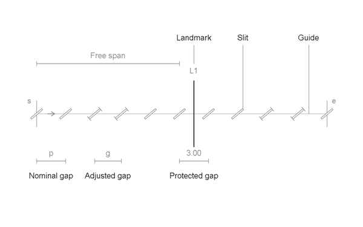

# Stitch Layout Problems

A regular stitch pattern must fit the seam's lengths and turns. Spacing must resolve a length that does not divide into whole nominal gaps, while corners must join rows of slits into a continuous turn. The treatments below show how those choices affect use of the iron, the location of adjustments and the visible thread.

## Spacing Between Fixed Endpoints

Consider six slits on a $15.3\,\mathrm{mm}$ guide, with a nominal pitch of $3\,\mathrm{mm}$. Five nominal gaps cover $15\,\mathrm{mm}$, leaving a $0.30\,\mathrm{mm}$ residual. Both endpoints must be met, so the extra length has to be absorbed somewhere in the row. Red segments and numbers show that residual; bracketed dimensions show the gap lengths.

### Even Spacing

Dividing the length equally gives five $3.06\,\mathrm{mm}$ gaps. Spacing is uniform along the line, but the resulting pitch depends on the line's length and gap count. Different lines generally receive different pitches, so a common tool no longer fits them all. Here the $3\,\mathrm{mm}$ iron cannot place the row at its new spacing; every gap needs individual placement.

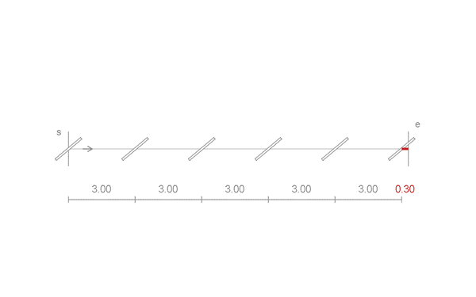

### End Adjustment

Keeping four nominal gaps puts the full residual into a final $3.30\,\mathrm{mm}$ gap. Most of the row remains at the tool pitch, while the last stitch takes the entire change. In this example it becomes longer; a row that overruns its endpoint would need a shorter final gap. Sharing the residual across more gaps reduces each change, at the cost of more individual placements.

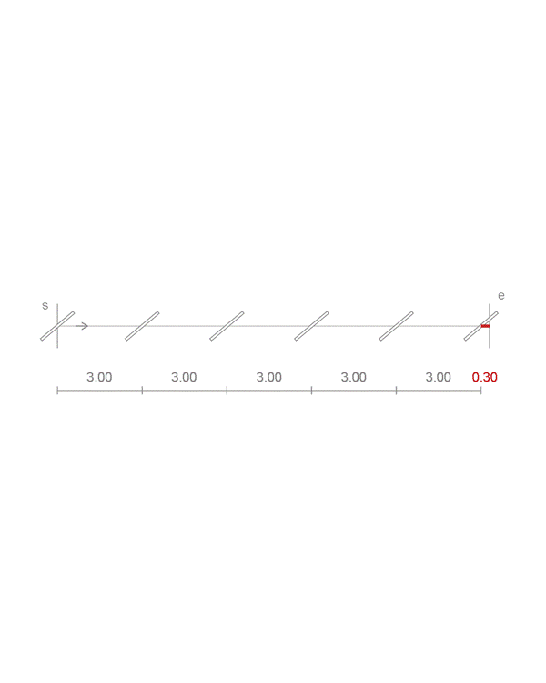

### Autostitch Solution

Autostitch limits the change allowed in each gap, then uses the fewest adjusted gaps needed to absorb the residual. Those gaps share the correction equally in a block centred within the span. The remaining runs keep the tool pitch.

Here one $3.30\,\mathrm{mm}$ gap is sufficient, leaving four nominal gaps. Moving that adjusted gap to the centre puts the correction away from both endpoints while requiring the same number of individual placements as end adjustment. Equal spacing is retained within the adjustment block, and the nominal runs on either side remain compatible with the iron.

## Corner Construction

At a corner, two rows of slits must join into one continuous seam. Their arrangement determines where the thread turns, whether slit lean stays consistent, and the lengths and angles of the adjoining stitches. The red angles in these examples measure the entering and leaving thread against their respective guides.

### Vertex Point

Vertex point puts a round hole at the corner and stitches into it from both rows. Spacing along each row stays nominal, leaving the final gaps into the hole to take up the spacing difference. The last slit on each arm therefore determines the length and angle of the thread entering the hole.

In this example, moving the vertical row balances the two corner stitches. Its far endpoint moves with it.

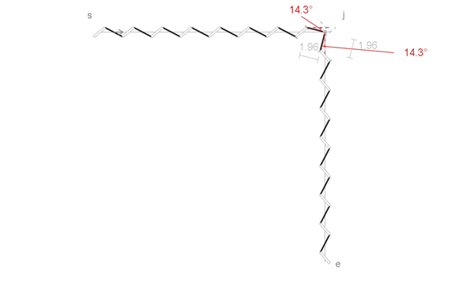

### Bridge

Bridge joins the last slit on each arm directly with thread, bypassing the vertex. Moving the vertical row varies the visible bridge stitch from $1.00\,\mathrm{mm}$ to $3.00\,\mathrm{mm}$ and changes the thread angles with it. Gaps within each row stay nominal, while the far endpoint follows the moving row.

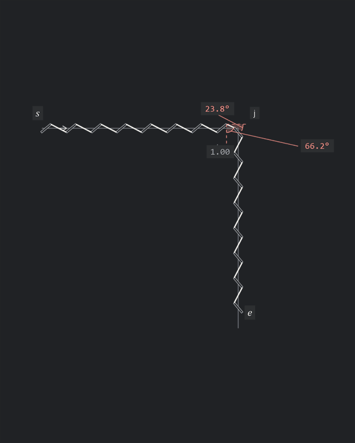

### Reverse Corner

Reverse corner adds a shared diagonal slit at the vertex, joining an obverse row to a reverse row. This brings the outgoing corner stitch closer to the usual thread direction along that row. Gaps within both rows remain nominal, and the final connections to the shared slit take up the spacing difference.

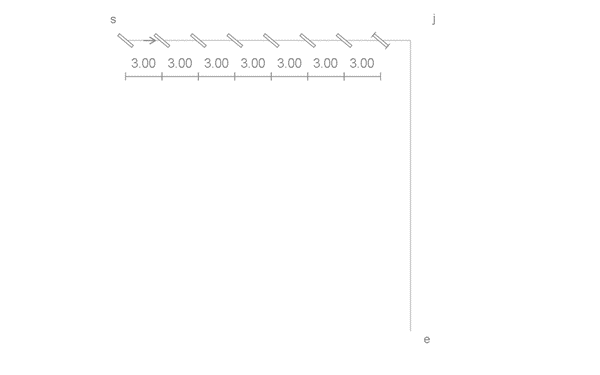

### Autostitch Solution

Autostitch refines Vertex point by placing the round hole off the vertex, with consistent slit lean on both arms. Each row extends to a virtual slit, and the selected tips meet at the shared hole. Slit lean, slit length and corner angle determine the hole's offset.

In the illustrated corner, fitting this construction to the guides creates a residual on the horizontal arm. Once the corner is fixed, that residual is distributed within the arm. With nominal corner steps, both corner stitches meet their guides at $27.5^\circ$.

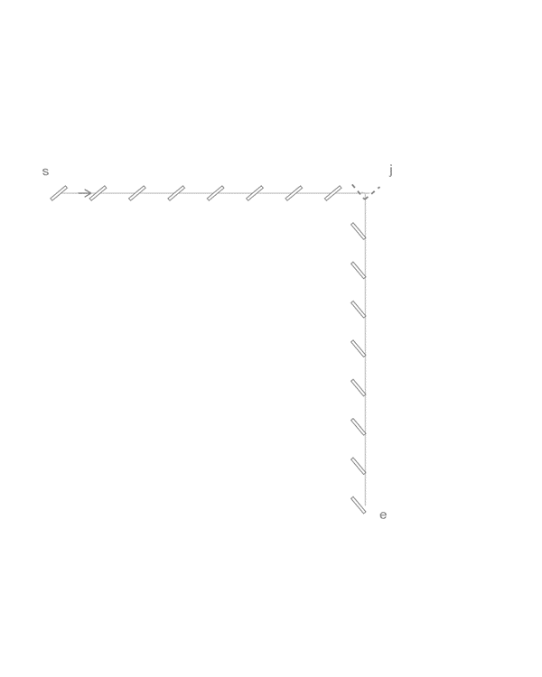

Reverse corner keeps the opening at the vertex and gives less stitch-length deviation in this example; Autostitch preserves lean with an offset hole. That choice establishes the corner geometry before the remaining spans are fitted. Endpoints, landmark pairs, gap bounds and the required separation between openings must all be respected. The construction makes the layout repeatable, while the maker judges whether its thread angles, stitch lengths and corner position suit the design.

# Even Big Fashion Gets It Wrong

The same corner and spacing choices appear in wallets, straps and handle attachments. The diagrams reconstruct observed treatments and compare them with Autostitch at $3\,\mathrm{mm}$ nominal pitch. The dimensions and results describe the illustrated geometry.

The tables record how many gaps change and the total size of those changes. **Absolute adjustment** adds compression and extension positively. **Absolute stitch-length deviation** adds the absolute differences between the visible thread lengths and their nominal straight-row counterparts. Together with the diagrams, these measures show how each treatment changes spacing and thread geometry.

## Loewe Mini Feather Hanger

On the [Loewe Mini Feather hanger](../examples/counter_examples/loewe_mini_feather.png), the rectangular strap below the swivel hook carries stitching up the left side, across the top and down the right. The reference layout uses a shared diagonal slit at the left corner and Vertex point at the right. The two top slits have opposing lean, placing the thread between them on a horizontal line.

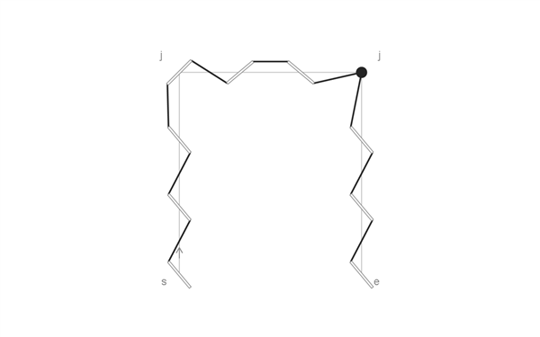

On the same guides, the Autostitch layout uses round holes at both corners and keeps the slit lean consistent. One adjusted gap fits the short top span, reducing the number of adjusted gaps from three to one. The start and end positions shift along the vertical guides so that both side rows retain nominal spacing.

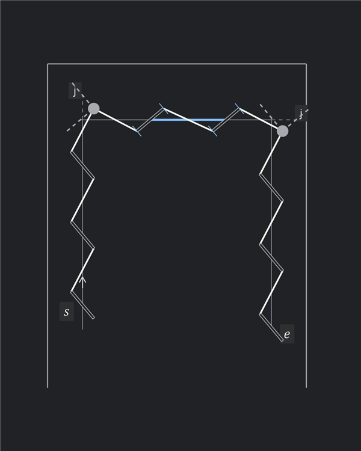

| Construction | Number of adjusted gaps | Absolute adjustment | Absolute stitch-length deviation |
| --- | ---: | ---: | ---: |
| Reference | $3$ | $0.90\,\mathrm{mm}$ | $1.40\,\mathrm{mm}$ |
| Autostitch | $1$ | $0.25\,\mathrm{mm}$ | $0.22\,\mathrm{mm}$ |

## Louis Vuitton Speedy Handle Chape

The [Speedy example](../examples/counter_examples/lv_speedy.png) follows the left handle chape, the leather tab attaching the handle hardware to the bag. Its closed pentagonal stitch line maintains one handedness through five corners and back to its starting opening. In the reference layout, each corner uses a shared diagonal slit, and each side is equally spaced between its corner slits. Each side therefore takes the pitch needed to fit its length.

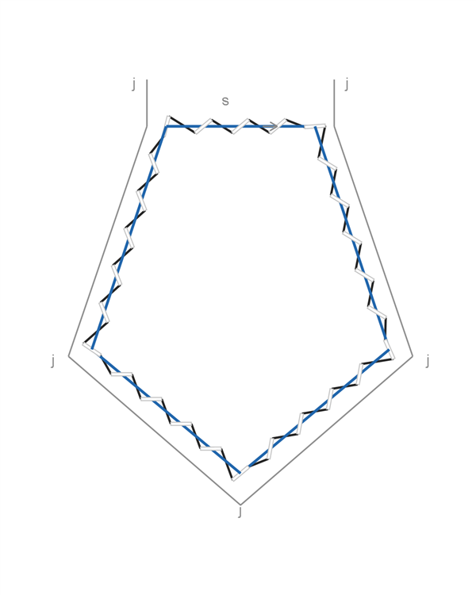

The Autostitch layout places five round corner holes on the same guides and fits each intervening span with the fewest adjusted gaps allowed by the pitch bounds. The loop closes at its starting opening, and most gaps return to the iron's pitch. Adjusted gaps fall from twenty-six to six, reducing the individual placement required to make the closed seam.

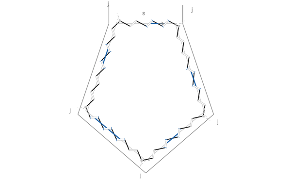

| Construction | Number of adjusted gaps | Absolute adjustment | Absolute stitch-length deviation |
| --- | ---: | ---: | ---: |
| Reference | $26$ | $4.93\,\mathrm{mm}$ | $6.61\,\mathrm{mm}$ |
| Autostitch | $6$ | $0.92\,\mathrm{mm}$ | $0.82\,\mathrm{mm}$ |

## Jaeger-LeCoultre Casa Fagliano Watch Strap

At the pointed end of the right [Jaeger-LeCoultre Casa Fagliano Watch Strap](../examples/counter_examples/jaeger_lecoultre_fagliano.png), two straight rows begin at matching heights and continue towards the tip with one handedness throughout. The reference layout joins the symmetric curves at a Vertex point hole. Each curve shares its residual equally across five gaps, preserving the aligned straight rows and giving both sides a matching spacing pattern.

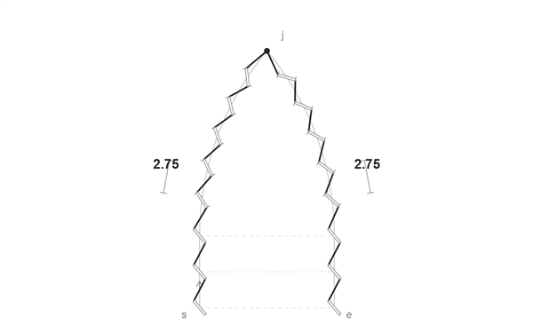

The Autostitch layout keeps the same guides and aligned straight rows, but the virtual slit tips place the shared hole to the right of the vertex. The offset creates unequal spans within the symmetric outline: the left needs one adjusted gap and the right needs four. The number of gaps requiring individual placement is halved, while the two sides lose their matching spacing pattern.

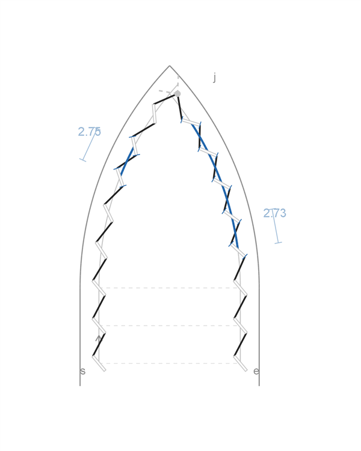

| Construction | Number of adjusted gaps | Absolute adjustment | Absolute stitch-length deviation |
| --- | ---: | ---: | ---: |
| Reference | $10$ | $2.51\,\mathrm{mm}$ | $2.03\,\mathrm{mm}$ |
| Autostitch | $5$ | $1.34\,\mathrm{mm}$ | $1.17\,\mathrm{mm}$ |

## Hermès Sellier Wallet

The [Sellier example](../examples/counter_examples/hermies_sellier.png) follows the top corner and the decorative H below the right-hand run. Reverse corner joins an obverse row to a reverse row, allowing the stitches entering the H to balance around the detail. Six round holes represent the H, linking the vertical stitching to the bottom row. The corner treatment is an effective design choice: the change of lean supports the composition of the H and its adjoining rows.

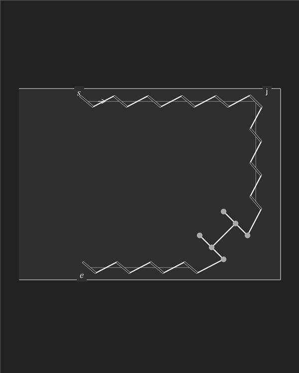

The Autostitch layout keeps the lean consistent through the turn and locates a round corner hole where the virtual slit tips meet. The H retains its shape and nominal approaches, while its position and the bottom row move to accommodate the changed slit lean. Both layouts keep nominal gaps throughout; the choice changes the corner position and thread geometry.

Reverse corner works particularly well for this design. Its limitation appears when extending the construction to junctions with three or more arms, where the shared diagonal slit produces an imbalance between the connecting threads. Autostitch uses a round hole at those junctions so each arm can meet it without a preferred slit orientation.

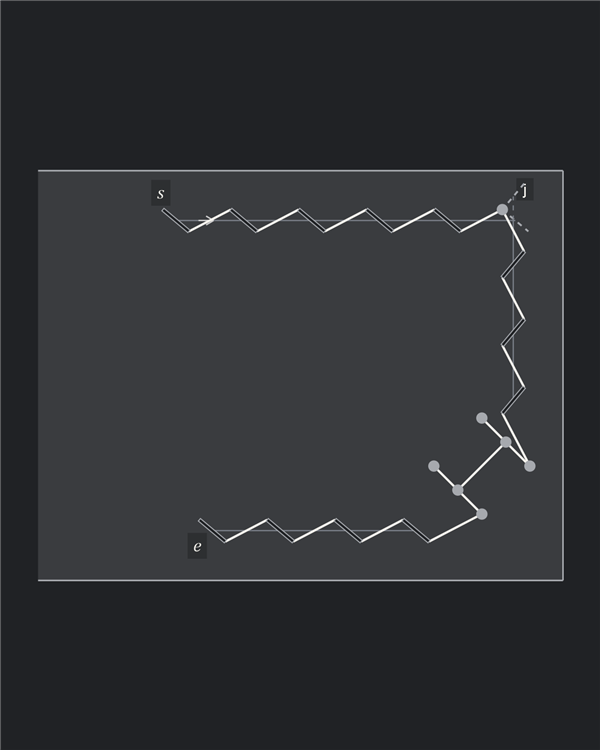

| Construction | Number of adjusted gaps | Absolute adjustment | Absolute stitch-length deviation |
| --- | ---: | ---: | ---: |
| Reference | $0$ | $0.00\,\mathrm{mm}$ | $1.21\,\mathrm{mm}$ |
| Autostitch | $0$ | $0.00\,\mathrm{mm}$ | $1.09\,\mathrm{mm}$ |

# Geometric Rules

Autostitch's geometric rules define which layouts are valid. All must be satisfied together, so fitting one span cannot come at the expense of a fixed feature or another opening. The examples in this section use a nominal pitch of $p=3\,\mathrm{mm}$.

## Guide, Slit and Pitch

Slit centres lie on the guide, and slit length, width and lean stay fixed. As the guide turns, each slit turns with its local direction, preserving the relationship between the tool profile and the path.

Nominal pitch is measured straight between consecutive opening centres. On a circular guide, that distance is a chord rather than the arc followed by the guide. Connections at corners and branching junctions use the constructions described below.

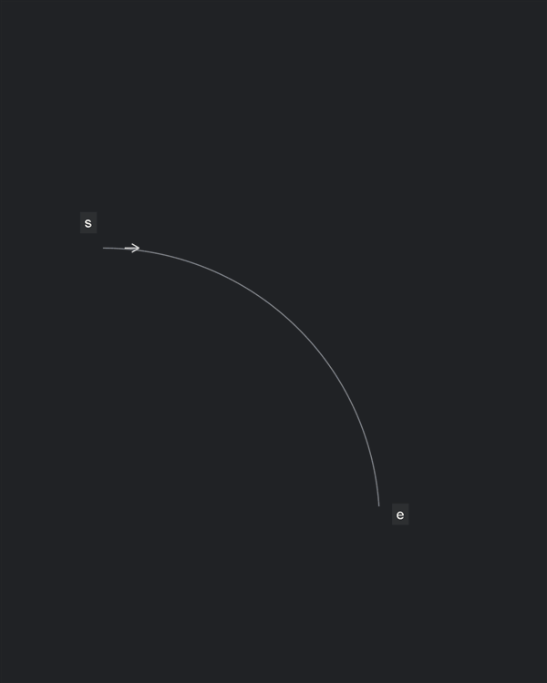

## Fixed Features

Chosen endpoints, landmark pairs and junction neighbours stay fixed during fitting. A landmark places its reference halfway along the guide between two nominally spaced slits, with no opening at the reference itself. Protecting the gap between those slits preserves the pair while the surrounding spacing is resolved.

Each free span must fit between its fixed openings. An unprotected slit-to-slit gap $g$ may change within $0.9p\leq g\leq1.1p$, while protected gaps remain nominal. In the example, each side contains seven slits and two central $3.25\,\mathrm{mm}$ gaps; the landmark pair stays $3\,\mathrm{mm}$ apart.

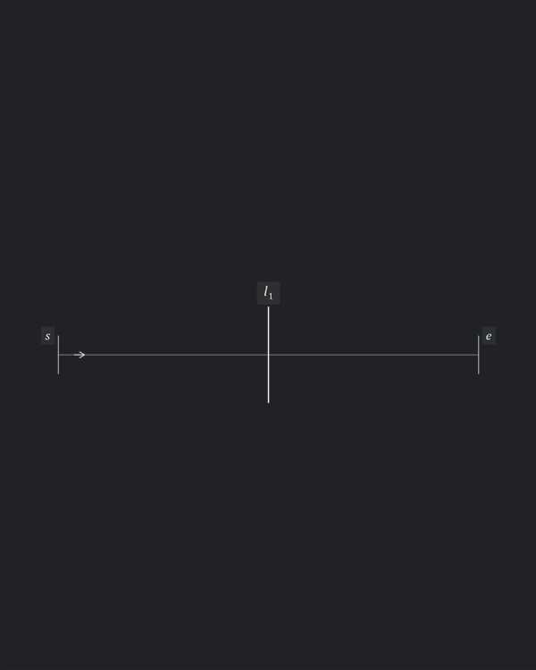

## Shared Openings

A smooth change of curvature shares one slit at the common tangent, as where a straight guide meets a circular arc. The opening serves both portions and is used only once; the connected portions must agree on its centre, type and slit axis.

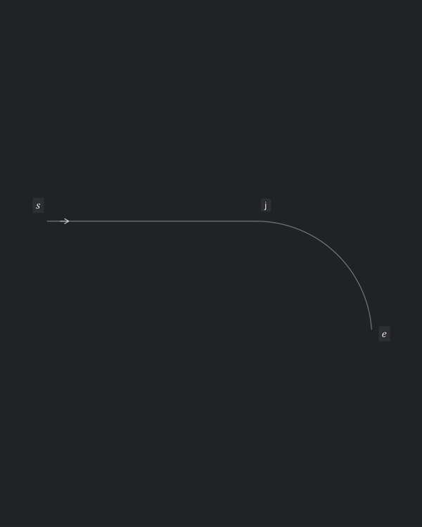

A closed loop makes the same demand at its starting opening. The spacing must return to that opening exactly, without placing a second one there. In the circular example, two opposite landmarks fix nominal pairs of slits. Fitting each half separately gives matching adjustment blocks while preserving those pairs.

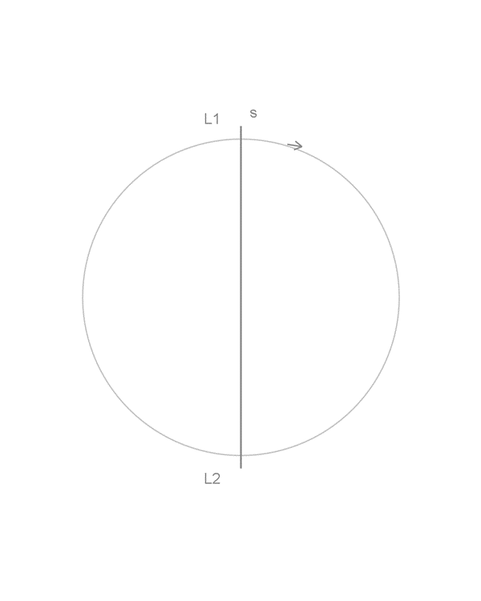

## Two-Arm Corners

Each arm's row continues towards the corner to a virtual slit with the same lean. The selected tips of the two virtual slits meet at one shared round hole, establishing its position relative to both rows. Only the round hole is punched at that meeting; the virtual slits remain construction geometry.

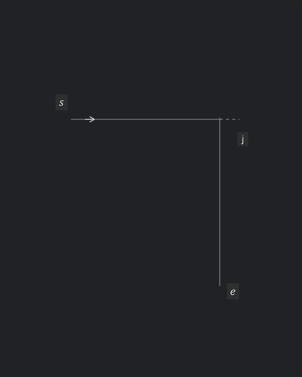

The last slit on each arm stays on its guide. The distance from its centre to the virtual slit centre is the corner step $q$, constrained by $0.9p\leq q\leq1.1p$. The virtual tips locate the hole, while the corner steps set the positions of the slits that approach it.

The same construction applies to straight and circular arms. A virtual slit follows its arm's local direction, allowing the tips to locate a shared hole when one or both guides curve towards the corner.

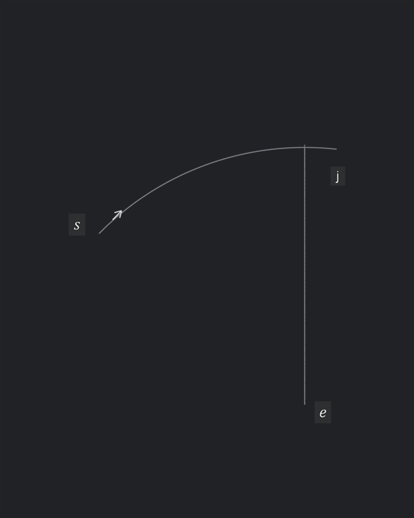

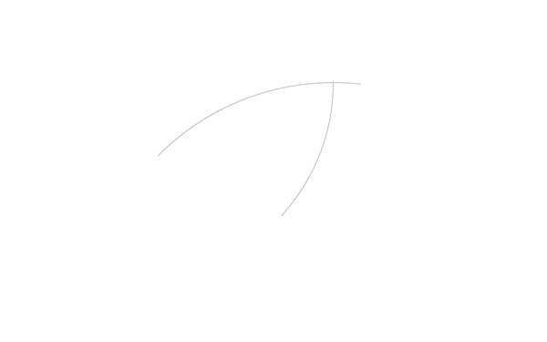

## Branching Junctions

Three or more arms share one round hole at the guide intersection. A through-line contributes two arms, giving a T three and an X four. The round hole provides a common meeting point without imposing a slit lean at the centre. Each arm's first slit centre lies a straight-line distance of $p/2$ from that hole.

### Why Half Pitch?

#### Vertex Point

With each first slit centre one pitch from the hole, opposite neighbours are two pitches apart. As two arms approach a straight line, their connections through the hole appear as one overlong stitch. The thread angles also differ from those along the ordinary rows.

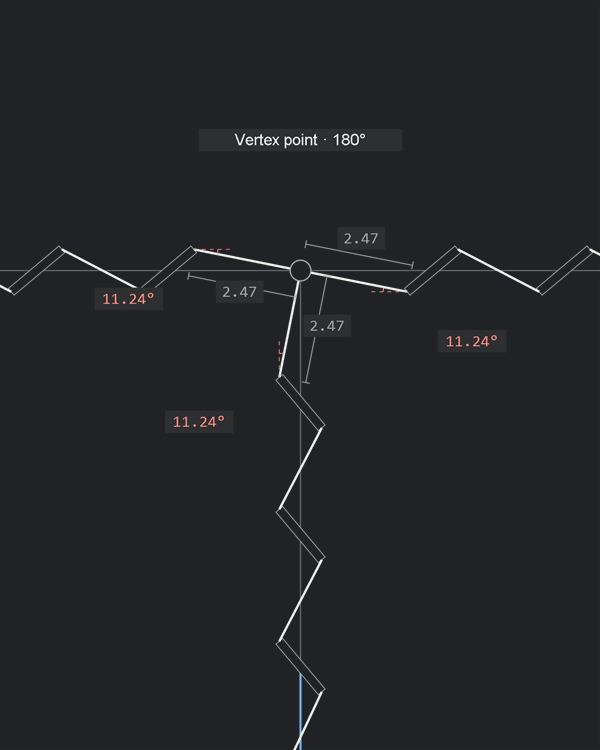

#### Vertex Point, Half Pitch

Consider an ordinary straight-row stitch between matching slits whose centres are one pitch apart. A round hole halfway between those centres also lies halfway along the visible thread. Each slit centre is then $p/2$ from the hole, and each connection retains the ordinary thread direction with half its visible length.

Half pitch therefore lets opposite straight arms with matching pitch and lean read as one ordinary stitch through the hole. Each arm keeps the same relationship to the hole as its angle changes, so the construction works without selecting a preferred pair of arms.

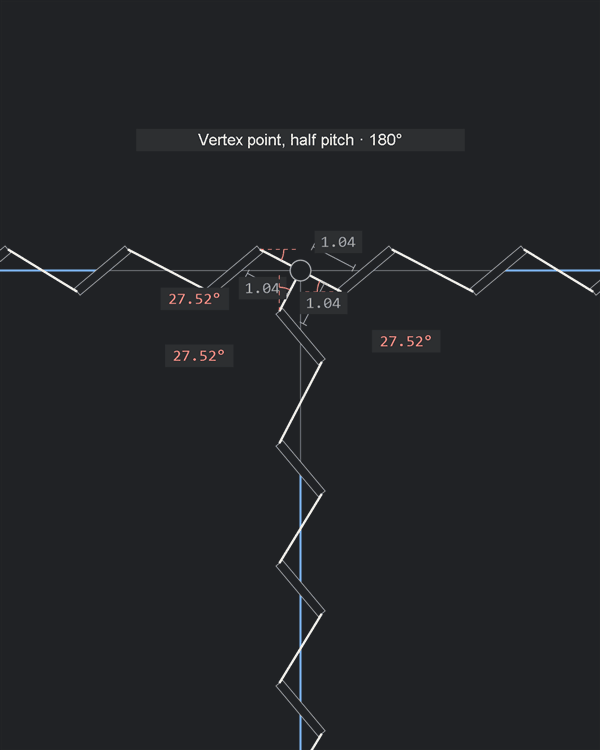

The geometry can be written using the outward unit tangent $\mathbf e$ along a straight arm and the unit vector $\mathbf u$ along its slit axis. For slit length $\ell$, the thread vector $\mathbf v$ from the hole to the near slit tip is

$$
\mathbf v=\frac p2\mathbf e-\frac\ell2\mathbf u
=\frac12\left(p\mathbf e-\ell\mathbf u\right).
$$

The expression in parentheses is the ordinary straight-row thread vector. Multiplying it by one half preserves its direction and halves its length, giving each arm the required connection to the hole.

### Fit the Remaining Spans

The junction neighbours must stay fixed to preserve those thread lengths and angles. Absorbing a residual by moving them would change the connection at the hole, so fitting begins with the free spans between those neighbours and the other fixed features. The half-pitch connections belong to the junction geometry and are excluded from ordinary gap adjustment limits and counts.

Bringing the neighbours closer to the hole also brings them closer to one another. Their openings must still have enough clearance, even when every individual arm satisfies the half-pitch rule.

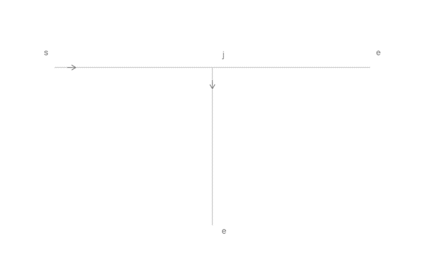

### X Junction with a Curved Arm

An X junction applies the same shared-hole and half-pitch rule to all four arms. On the circular arm, half pitch is measured along the chord, while slit lean follows the guide's local direction. Because the guide turns between the hole and the slit, this spacing no longer guarantees the ordinary straight-row thread direction or half its visible length.

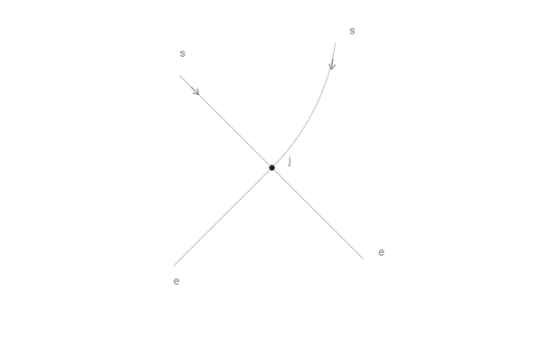

## Clearance

Separate openings must neither touch nor overlap, and their edges must remain at least the required margin apart. This clearance requirement applies across the whole layout, including openings on different guides and around closed loops. Virtual slits are excluded because they are not punched.

The acute-junction example has an included angle of $6^\circ$, slit width $w=0.3\,\mathrm{mm}$ and clearance margin $m=0.2\,\mathrm{mm}$. The nearest pair of openings overlaps, the next pair falls below the margin, and farther pairs have enough separation. All openings must pass for the layout to be valid.

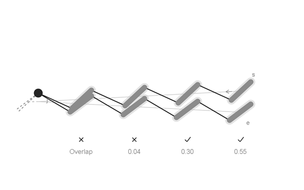

# Solution Method

Fixed openings divide the layout into free spans, each with its own spacing problem. Autostitch fits these spans without moving their boundaries, then checks the complete layout for clearance. This final check connects the local calculations: a valid corner or span can still place openings too close to those elsewhere in the design.

## Inputs and Fixed Openings

The inputs describe the guide geometry, start and end, direction, landmarks, junctions and nominal pitch $p$. The tool profile supplies slit length $\ell$, width $w$, lean $\alpha$, round-hole diameter $d$ and clearance margin $m$. Together they establish the endpoint slits, protected landmark pairs, shared junction openings and corner neighbours that bound the free spans.

The emblem shows this process at $p=2.7\,\mathrm{mm}$, beginning with the outlined A and continuing through the complete lettering and rings. Crown landmarks establish symmetry, while protected pairs and shared corner openings fix the boundaries of the available spans. Redistributing the residuals between those boundaries fills the design without moving the features that define it.

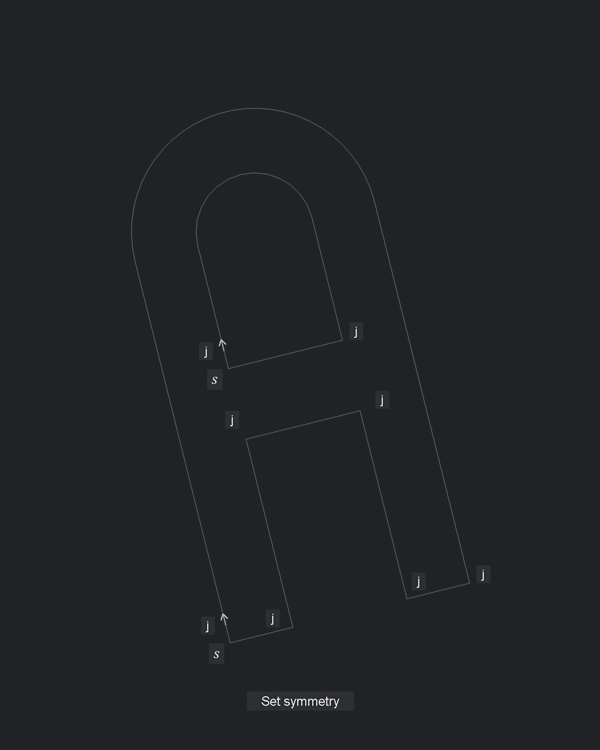

## Branching Junction Spacing

Each branching end reserves a half-pitch connection from its shared hole to the first slit centre. A straight run of length $L$ between two branching holes at the same pitch therefore leaves $D=L-p$ between its reserved slit centres. With one branching end and a fixed endpoint slit, the remaining span is $D=L-p/2$.

On a circular arm of radius $R$, the half-pitch chord reserves an angular advance of $2\arcsin\left(p/(4R)\right)$. The remaining slit-to-slit span is fitted after this reservation, with the fixed half-pitch connections excluded from ordinary gap counts and adjustments.

When two reserved centres coincide, one slit can serve both ends if its axis agrees. Overlapping reservations leave no solution: the required neighbours cannot be placed on the available run.

## Corner-Step Adjustment

A nominal corner step can put a neighbouring slit beyond the end of its arm. Autostitch prefers nominal steps and changes them only as needed to keep the neighbour on the arm, within $0.9p\leq q\leq1.1p$. The resulting neighbours become fixed boundaries before their adjoining free spans are fitted.

In the shallow-turn example, the curved neighbour needs a corner step of approximately $3.21\,\mathrm{mm}$. The range of usable angles depends on pitch, slit geometry, hole diameter, clearance and the available arm geometry.

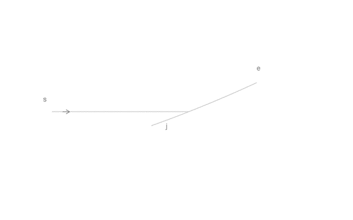

## Straight-Span Fitting

For a straight free span, let $D>0$ be the distance between its fixed end openings, with no protected gaps inside. A choice of $n\geq1$ gaps gives $n+1$ openings, including both ends. The first task is to find which whole-number gap counts can cover $D$ while keeping every gap within $0.9p\leq g\leq1.1p$:

$$
\max\left\{1,\left\lceil\frac{D}{1.1p}\right\rceil\right\}
\leq n\leq
\left\lfloor\frac{D}{0.9p}\right\rfloor.
$$

The lower bound rules out counts with too few gaps to reach the endpoint even at maximum extension. The upper bound rules out counts with too many gaps to fit even at maximum compression.

For each permitted count, the residual is $r=D-np$. A positive residual requires longer gaps; a negative residual requires shorter ones. Each adjusted gap can absorb at most $0.1p$, so the smallest number of adjusted gaps for that count is

$$
k(n)=\left\lceil\frac{\lvert r\rvert}{0.1p}\right\rceil.
$$

Rounding up provides enough gaps to carry the full correction without exceeding the limit on any one gap. If $r=0$, every gap remains nominal. Otherwise, the required number must satisfy $k\leq n$, and the residual is shared equally across those $k$ gaps:

$$
g=p+\frac{r}{k}.
$$

Each adjusted gap stays within $\lvert g-p\rvert\leq0.1p$. The remaining $n-k$ gaps retain nominal pitch, and together the two portions fill the span exactly: $(n-k)p+kg=D$.

## Selection of the Preferred Fit

Several gap counts can satisfy the bounds. Autostitch first favours the fit with the fewest adjusted gaps, reducing individual placement with an awl or single tooth. It groups those gaps in a central block so that the remaining nominal runs lie beside the fixed features.

Among fits with the same number of adjusted gaps, exact centring takes priority, followed by smaller fractional pitch change and then fewer gaps. These choices keep the correction balanced within the span and close to the tool pitch. Fixed openings and protected gaps remain in place throughout the ranking.

An adjusted block can be centred exactly when $n-k$ is even, leaving equal numbers of nominal gaps on either side. Otherwise, the block sits half a gap towards the end. A nominal fit needs no adjustment block.

## Circular-Span Fitting

On a circular guide, the openings advance along an arc while the gaps are measured across chords. Fitting therefore converts each chord gap into an angle and adds those angles to cover the guide's sweep. For radius $R$, a gap $g$ has angular advance

$$
a(g)=2\arcsin\left(\frac{g}{2R}\right).
$$

The nominal chord must satisfy $p\leq2R$, and the construction uses the minor chord. Let the total sweep be $T=\lvert\Delta\phi\rvert$, where $\Delta\phi$ is the change in angle along the guide. The nominal advance is $a=a(p)$, with lower and upper limits

$$
a_-=a(0.9p),\qquad
a_+=a\left(\min\{1.1p,2R\}\right).
$$

The upper chord is capped at the circle's diameter. A whole-number count $n$ is feasible when $na_-\leq T\leq na_+$: its gaps can cover the sweep somewhere between maximum compression and maximum extension.

The residual is now angular, $r=T-na$. Extension and compression have different angular capacities: an extending gap can absorb $a_+-a$, while a contracting gap can absorb $a-a_-$. The direction of the correction therefore determines how much each adjusted gap can contribute.

If the residual is zero, all gaps stay nominal. Otherwise, dividing its magnitude $\lvert r\rvert$ by the applicable capacity and rounding up gives the smallest number $k$ of adjusted gaps. A count fails when that capacity is zero or when the correction requires more gaps than are available, $k>n$.

For a nonzero residual, the adjusted advance is $a'=a+r/k$. Converting it back to a chord gives

$$
g=2R\sin\left(\frac{a'}2\right).
$$

Equal angular advances on the same circle produce equal chord gaps. The adjusted gaps therefore form the same kind of centred block as on a straight span, with their positions determined by angles along the guide.

## Layout Validation

The span calculations establish spacing and endpoint agreement. Clearance is checked across the complete result, comparing every pair of distinct openings, including pairs on different arms or guides. Shared openings count once, and virtual slits are excluded.

A layout is accepted only when the openings neither touch nor overlap and their edges remain at least the margin $m$ apart. This check catches conflicts that individual span calculations cannot resolve on their own.

## Infeasible Layouts

An empty range of feasible gap counts means that the span cannot fit within the spacing bounds. The shortest possible straight span is $0.9p$, and every length $D\geq4.5p$ has a spacing fit. Below that threshold, some lengths fall between the ranges covered by successive gap counts.

At $p=3\,\mathrm{mm}$, every length from $13.5\,\mathrm{mm}$ fits the spacing bounds. A $7\,\mathrm{mm}$ span fails because two gaps can reach only $6.6\,\mathrm{mm}$, while three need at least $8.1\,\mathrm{mm}$. Changing the count cannot solve that span; the guide or its fixed features must change. Any resulting fit must still pass clearance.

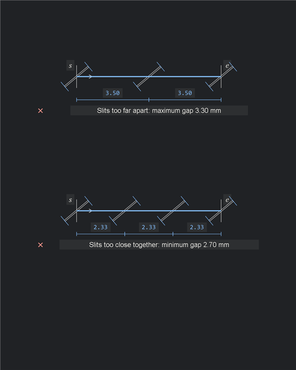

# Conclusion

The wallet, hanger, handle chape and strap tip show that corner and spacing treatments vary even among goods sold at luxury price points. A high price does not imply a consistent geometric treatment. A skilled craftsperson can resolve those choices by hand, but repeating the spacing calculations takes attention after the design decisions are settled. Automating that work leaves more time for the composition and its execution.

Layout effort grows with the number of interacting constraints. A seam with several corners and short spans can require more fitting than a long uninterrupted run, and revisions require earlier decisions to be checked again. The lettering and decorative patterns shown here were developed to push the boundaries of stitching. They bring many of those constraints together, exploring designs whose manual layout would demand substantial effort. Applying explicit rules makes that complexity easier to develop and revise, even for a single piece.

One _can_ do that by hand but...

The benefit changes with the maker's experience. A beginner can use a resolved layout before developing the judgement needed to balance spacing and corners unaided. For an intermediate maker, explicit bounds and fixed features provide a consistent basis for decisions across seams. The maker still chooses whether the treatment suits the design, while the layout supplies precise positions for its execution.

Advanced and expert makers spend less time repeating familiar calculations and correcting layouts after revisions. That saving matters in bespoke work, where a custom shape must be resolved even when only one piece is made. A chosen treatment can be carried through a complex pattern, leaving more attention for accurate punching, thread tension and control of the finished stitch.

The same recorded decisions support repeated production. A resolved pattern gives the location and size of every adjustment before work begins, helping the pattern designer communicate the treatment to the person making the openings. In manual and semi-automated work, fewer placement decisions remain with the operator. Small batches can follow the same layout across makers and production runs without each person independently deciding where to adjust spacing.

CNC equipment that supports variable spacing may place adjusted gaps with little extra effort, reducing the importance of minimizing their number. The layout still supplies opening positions and orientations through corners, intersections and closure, while equipment integration and achievable tolerances depend on the production process.

Precision leather goods give this control a direct purpose because stitch regularity and symmetry contribute to the visible result. Ordinary industrial textiles may already be adequately served by existing tolerances. In footwear and technical textiles, the value depends on whether precise stitch or perforation placement is required. Across these applications, the benefit depends on how much placement affects the product and the effort needed to make, communicate and repeat those decisions.
