# Introduction

## Stitch layout and fabrication

- Design sets the seam path and its intended appearance; making it requires a sequence of openings
- Opening positions must resolve spacing at endpoints and corners; rows that meet or are sewn together must align
- The layout specifies where each stitch is made
- Physical execution produces those openings; craft judgement connects the design, geometric layout and tool use

## Tool geometry and spacing constraints

- Round holes are rotationally symmetric; slits have length, width and orientation that affect how thread crosses them and appears on the surface
- As a seam turns, slit orientation must be considered alongside position
- A multi-tooth iron fixes the spacing between openings, but distances between fixed features rarely divide into whole nominal gaps
- The maker decides where spacing departs from nominal pitch, by how much, and whether the intended tool can produce the layout
- Adjusted gaps can require individual placement with an awl or single tooth

## Craft judgement and computational methods

- A craftsperson develops an eye for a balanced seam and adapts a regular stitch pattern to the shape of a piece
- Digital arrays produce rows of openings; fitting those rows around fixed features still requires manual corrections
- Moving an endpoint or changing a curve can invalidate earlier corrections; layout judgements recur whenever the pattern changes
- Physical layout relies on the same judgement, although its decisions may remain unrecorded
- Describe that judgement through explicit constraints and priorities: which features stay fixed, how closely spacing follows the tool, and where adjustments are least conspicuous
- Judgement establishes what makes a layout good; computational search evaluates candidate placements against those priorities
- Search can consider combinations that would be impractical to compare by hand
- Explicit rules make placement decisions repeatable when the pattern changes

## Autostitch

- Autostitch applies geometric constraints and computational search to stitch layout for hand stitching with pricking irons
- Implemented in AutoLISP with an OpenDCL interface for CAD platforms such as BricsCAD and AutoCAD
- Given those guides and a tool profile, it places openings, resolves corners and junctions, and fits spacing between fixed features
- The aim is to preserve the intended seam and nominal tool pitch while making necessary adjustments explicit and controlled
- The result is a geometric layout specifying opening positions and orientations, shared openings and adjusted gaps, ready to guide physical execution

# Terminology

## Guides and openings

- **Guide:** the path followed by the slit centres
- **Stitch line:** a row of stitching along one or more connected guides
- **Opening:** a slit or round hole for the thread
- **Slit and lean:** a slit has length, width and orientation. Lean is its angle to the guide's local direction
- **Obverse and reverse stitch:** obverse uses the reference lean; reverse mirrors it. These are separate from travel direction and material face

## Spacing

- **Gap and pitch:** a gap is the straight-line distance between opening centres; pitch $p$ is the tool's target spacing
- **Nominal gap:** equals $p$
- **Adjusted gap:** a slit-to-slit gap made longer or shorter within the allowed limits
- **Protected gap:** stays at nominal pitch during fitting
- **Residual and adjustment:** residual is the length left over or missing before fitting; adjustment is the change made to a gap
- **Adjustment block:** a group of consecutive, equal adjusted gaps

## Fixed features and connections

- **Landmark:** a reference position halfway between two slits at nominal spacing. It fixes both slits, with no opening at the reference itself
- **Free span:** the space between fixed features where the remaining openings are fitted
- **Junction and arms:** a junction is where arms meet. Each arm extends away from it: two at a corner, three at a T and four at an X
- **Branching junction:** a junction with three or more arms
- **Virtual slit:** a construction slit whose tip locates a corner hole. It is not punched
- **Corner step:** the distance between the centres of a virtual slit and its neighbouring real slit

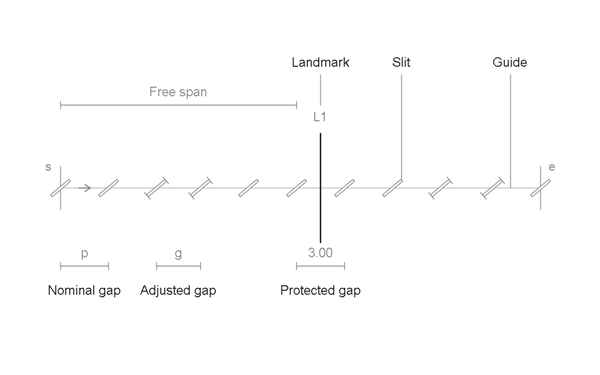

# Stitch layout problems

- Spacing: fit a seam whose length is not a whole number of nominal gaps
- Corners: join rows of oriented slits while controlling the opening and thread at the turn
- Compare how each solution uses the iron, where adjustments occur, and what changes in the visible stitching

## Spacing between fixed endpoints

- Six slits on a $15.3\,\mathrm{mm}$ guide, at $3\,\mathrm{mm}$ nominal pitch
- Both endpoints must be met; the nominal row leaves a $0.30\,\mathrm{mm}$ residual
- Red segments and numbers show the residual; bracketed dimensions show gap lengths

### Even spacing


- Five equal $3.06\,\mathrm{mm}$ gaps
- Spacing is uniform along the line, but its pitch depends on the line's length and gap count
- Different lines generally require different pitches
- The $3\,\mathrm{mm}$ iron cannot place the row at this spacing; every gap needs individual placement

### End adjustment

- Four nominal gaps; one $3.30\,\mathrm{mm}$ gap at the end
- The last stitch takes the entire residual, making it longer or shorter than the rest
- Sharing the residual across more gaps would reduce each change, but require more individual placements

### Autostitch solution

- Keep four nominal gaps and place one $3.30\,\mathrm{mm}$ gap in the centre
- Set limits on each spacing change, then use the fewest adjusted gaps needed
- Share the residual equally across those gaps and centre the adjustment block within the span
- This combines equal spacing within the adjustment block with nominal spacing in the remaining runs
- The correction sits away from the endpoints; here, it requires the same number of individual placements as end adjustment

## Corner construction

- At a corner, two rows of slits must join into one continuous seam
- How those rows meet determines where the thread turns, whether slit lean stays consistent, and the length and angle of the adjoining stitches
- Red angles measure the entering and leaving thread against their respective guides, showing how each stitch approaches or leaves the corner

### Vertex point

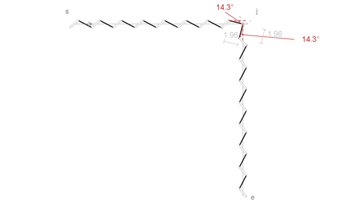

- Put a round hole at the corner and stitch into it from both rows
- Keep nominal spacing along each row; the final gaps into the hole take up the spacing difference
- The last slit on each arm determines the length and angle of the thread entering the hole
- In this example, move the vertical row to balance the two corner stitches; its far endpoint moves with it

### Bridge


- Join the last slit on each arm directly with thread, bypassing the vertex
- Move the vertical row to vary the visible bridge stitch from $1.00$ to $3.00\,\mathrm{mm}$
- The thread angles change with the bridge length
- Gaps within each row stay nominal; the far endpoint moves with the row

### Reverse corner


- Add a shared diagonal slit at the vertex, joining an obverse row to a reverse row
- This brings the outgoing corner stitch closer to the usual thread direction along that row
- Gaps within each row stay nominal
- The final connections to the shared slit take up the spacing difference

### Autostitch


- Refine Vertex point by placing the round hole off the vertex, with consistent slit lean on both arms
- Extend each row to a virtual slit; their selected tips meet at the shared hole
- Slit lean, slit length and corner angle determine the hole's offset
- In this example, fitting the corner to the guides creates a residual on the horizontal arm
- Distribute that residual within the arm while keeping the corner construction fixed
- With nominal corner steps, both corner stitches meet their guides at $27.5^\circ$
- Reverse corner keeps the opening at the vertex and gives less stitch-length deviation here; Autostitch preserves lean with an offset hole
- Autostitch resolves the corner first, then fits the remaining spans around it. Endpoints, landmark pairs, gap bounds and clearance apply together
- The rules determine a repeatable layout; the maker judges whether its thread angles, lengths and corner position suit the design

# Even Big Fashion Gets It Wrong

- The diagram comparisons use $3\,\mathrm{mm}$ nominal pitch

- Diagrams compare the observed corner methods with Autostitch

## Hermès Sellier wallet

- Focus: the top corner and the decorative H below the right-hand run
- The H is represented by six round holes

### Reference

- Reverse corner: the top and vertical rows use opposite lean
- The stitches entering the H continue the adjoining thread angles

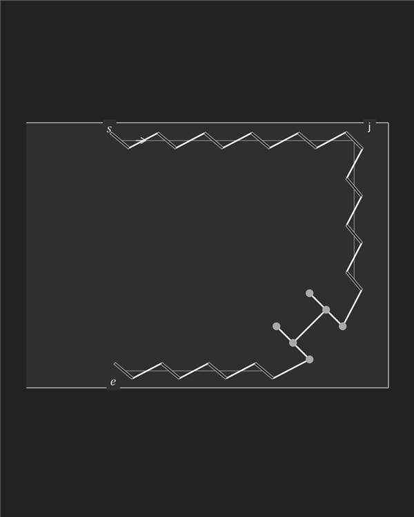

### Autostitch

- Consistent lean from the top row through the vertical run; a round corner hole at the virtual slit-tip intersection
- The H keeps its shape and nominal approaches; its position and the bottom row move to suit the changed slit lean

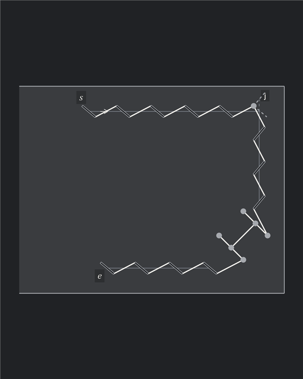

| Construction | Number of adjusted gaps | Absolute adjustment ($\mathrm{mm}$) | Absolute stitch-length deviation ($\mathrm{mm}$) |
| --- | ---: | ---: | ---: |
| Reference | $0$ | $0.000$ | $1.213$ |
| Autostitch | $0$ | $0.000$ | $1.090$ |

- Both layouts keep nominal gaps; the choice changes the corner position and thread geometry

## Loewe Mini Feather hanger

- Focus: the rectangular strap below the swivel hook
- The stitch line goes up the left side, across the top and down the right side

### Reference

- Shared diagonal slit at the left corner; Vertex point at the right corner
- The two top slits have opposing lean, giving the middle thread a horizontal line

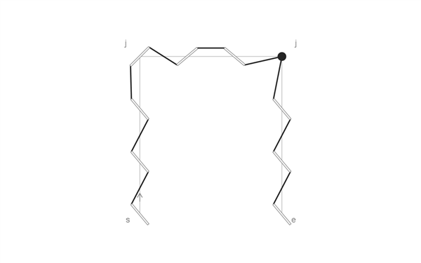

### Autostitch

- Same guides; round holes at both corners and consistent slit lean
- One adjusted gap across the top
- Start and end positions shift along the vertical guides to keep those rows nominal

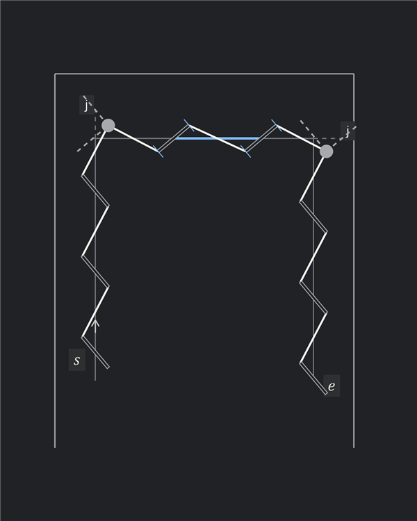

| Construction | Number of adjusted gaps | Absolute adjustment ($\mathrm{mm}$) | Absolute stitch-length deviation ($\mathrm{mm}$) |
| --- | ---: | ---: | ---: |
| Reference | $3$ | $0.900$ | $1.403$ |
| Autostitch | $1$ | $0.249$ | $0.224$ |

## Louis Vuitton Speedy handle chape

- Focus: the left [handle chape](https://us.louisvuitton.com/eng-us/products/nano-speedy-g81-nvprod7890132v/M29781), the leather tab attaching the handle hardware to the bag
- Closed pentagonal stitch line; one handedness throughout

### Reference

- Shared diagonal slit at each corner; consistent lean around the loop
- Each side uses equal spacing between its corner slits

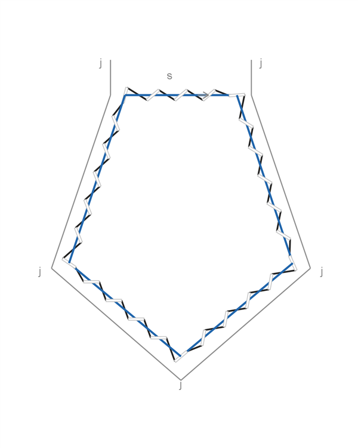

### Autostitch

- Same pentagonal guides; five round corner holes
- Each span uses the fewest adjusted gaps allowed by the pitch bounds
- The loop closes at its starting opening
- Most gaps return to the iron's pitch, reducing the individual placements required by the reference layout

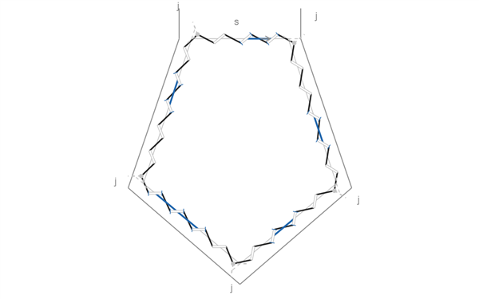

| Construction | Number of adjusted gaps | Absolute adjustment ($\mathrm{mm}$) | Absolute stitch-length deviation ($\mathrm{mm}$) |
| --- | ---: | ---: | ---: |
| Reference | $26$ | $4.931$ | $6.610$ |
| Autostitch | $6$ | $0.917$ | $0.821$ |

## Jaeger-LeCoultre / Casa Fagliano strap tip

- Focus: the pointed end of the right strap
- Both straight rows start at matching heights, with one handedness throughout

### Reference

- Vertex point: symmetric curves meet at a round hole
- Residual distributed equally through five gaps on each curve; the straight rows remain aligned

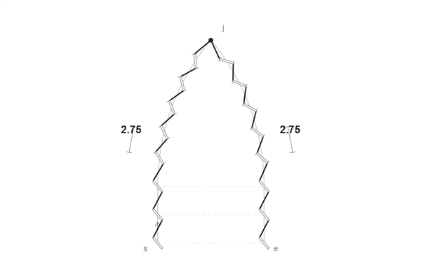

### Autostitch

- Same guides and aligned straight rows
- Virtual slit tips place the shared hole right of the vertex, changing the available span on each arm
- One adjusted gap on the left; four on the right
- Fewer gaps need individual placement; the two sides lose their matching spacing pattern

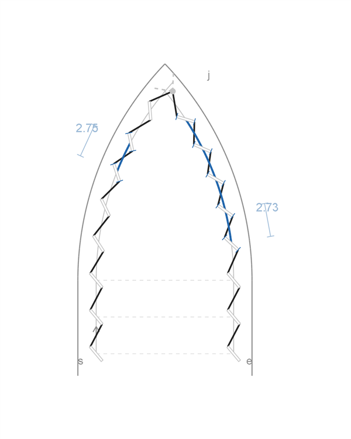

| Construction | Number of adjusted gaps | Absolute adjustment ($\mathrm{mm}$) | Absolute stitch-length deviation ($\mathrm{mm}$) |
| --- | ---: | ---: | ---: |
| Reference | $10$ | $2.509$ | $2.030$ |
| Autostitch | $5$ | $1.337$ | $1.169$ |

[Sources, geometry and reproduction](../examples/counter_examples/README.md)

# Geometric rules

- These rules define a valid stitch layout
- All rules must be satisfied together
- The examples use a nominal pitch of $p=3\,\mathrm{mm}$

## Guide, slit and pitch

- Slit centres lie on the guide
- Slit length, width and lean stay fixed; lean is measured against the guide's local direction
- Nominal pitch is the straight-line distance between consecutive opening centres; on a circle, it is a chord
- Connections at corners and branching junctions follow the rules below


## Fixed features

- Chosen endpoints, landmark pairs and junction neighbours stay fixed during fitting
- A landmark sits halfway along the guide between two nominally spaced slits
- There is no opening at the landmark itself; the gap between its two slits is protected
- Protected gaps stay at nominal pitch
- Unprotected slit-to-slit gaps may change within $0.9p\leq g\leq1.1p$
- Each free span must fit between its fixed openings
- In this example, each side has seven slits and two central $3.25\,\mathrm{mm}$ gaps; the landmark pair stays $3\,\mathrm{mm}$ apart


## Shared openings

- A smooth change of curvature shares one slit at the common tangent
- Connected portions use the shared opening only once; its centre, type and slit axis must agree


- A closed loop must return to its starting opening and use that opening only once
- In this example, two opposite landmarks fix nominal pairs of slits
- Each half is fitted separately, giving matching adjustment blocks


## Two-arm corners

- Continue each arm's slit row towards the corner, ending in a virtual slit with the same lean
- The selected virtual slit tips meet at one shared round hole
- The virtual slits are not punched


- The last real slit on each arm stays on its guide
- The distance between its centre and the virtual slit centre is the corner step $q$, within $0.9p\leq q\leq1.1p$
- The virtual tips locate the hole; the corner steps set the positions of its neighbouring real slits
- The same construction applies to straight and circular arms



## Branching junctions

- A through-line contributes two arms; a T has three and an X has four
- Three or more arms share one round hole at the guide intersection
- The round hole gives every arm a common meeting point without imposing a slit lean at the centre
- The first slit centre on every arm is a straight-line distance of $p/2$ from the hole centre

### Why half pitch?

#### Vertex point

- With the first slit centres one pitch from the hole, opposite neighbours are two pitches apart
- As two arms approach a straight line, their connections through the hole appear as one overlong stitch
- The thread angles also differ from those along the ordinary rows


#### Vertex point, half pitch

- Consider one ordinary straight-row stitch between matching slits whose centres are one pitch apart
- A round hole halfway between those centres also lies halfway along the visible thread
- Each slit centre is then $p/2$ from the hole; each connection keeps the ordinary thread direction and has half its visible length
- This is why the junction uses half pitch: opposite straight arms with matching pitch and lean read as one ordinary stitch through the hole
- Each straight arm keeps that same relationship to the hole as its angle changes, so the rule applies to every arm without choosing a preferred pair

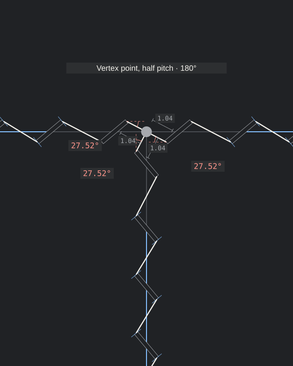

- For a straight arm, let $\mathbf e$ be the outward unit tangent and $\mathbf u$ the unit vector along the slit axis. With slit length $\ell$, the thread vector from the hole to the near slit tip is

$$
\mathbf v=\frac p2\mathbf e-\frac\ell2\mathbf u
=\frac12\left(p\mathbf e-\ell\mathbf u\right).
$$

- The term in parentheses is the ordinary straight-row thread vector; multiplying it by one half preserves its direction and halves its length

### Fit the remaining spans

- Moving the junction neighbours to absorb a residual would change the thread lengths and angles established at the hole
- Keep those neighbours fixed and fit the free spans between them and the other fixed features
- Half-pitch connections are part of the junction geometry; they are excluded from ordinary gap adjustment limits and counts
- Bringing the neighbours closer to the hole also brings them closer to one another, so their openings must still pass clearance


### X junction with a curved arm

- Four arms use the same shared hole and half-pitch rule
- On the circular arm, half pitch is measured along the chord, while slit lean follows the guide's local direction
- The guide turns between the hole and the slit, so half-pitch spacing no longer guarantees the ordinary straight-row thread direction or half its visible length


## Clearance

- Separate real openings must not touch or overlap
- Their edges must remain at least the required margin apart
- This applies across the whole layout, including openings on different guides and around closed loops
- Virtual slits are construction geometry and are excluded
- In this acute-junction example, the nearest pair overlaps, the next pair falls below the margin, and farther pairs pass
- Example: included angle $6^\circ$, slit width $w=0.3\,\mathrm{mm}$ and margin $m=0.2\,\mathrm{mm}$

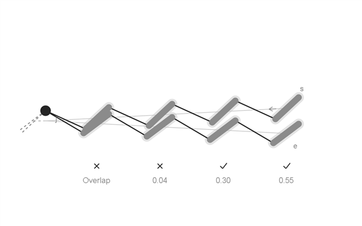

# Solution method

- Given a guide and tool profile, find opening positions that satisfy the geometric rules
- Fixed openings divide the layout into free spans, each with its own spacing problem
- Fit those spans without moving their boundaries, then check the complete layout for clearance
- A valid corner or span can still leave openings that collide elsewhere in the layout

## Inputs and fixed openings

- Inputs: guide geometry, start and end, direction, landmarks, junctions and pitch $p$
- Tool profile: slit length $\ell$, width $w$, lean $\alpha$, round-hole diameter $d$ and clearance margin $m$
- Place endpoint slits, protected landmark pairs and shared junction openings; resolve corner neighbours before fitting
- These openings divide the guide into free spans. Their positions stay fixed; solve the remaining spacing within each span

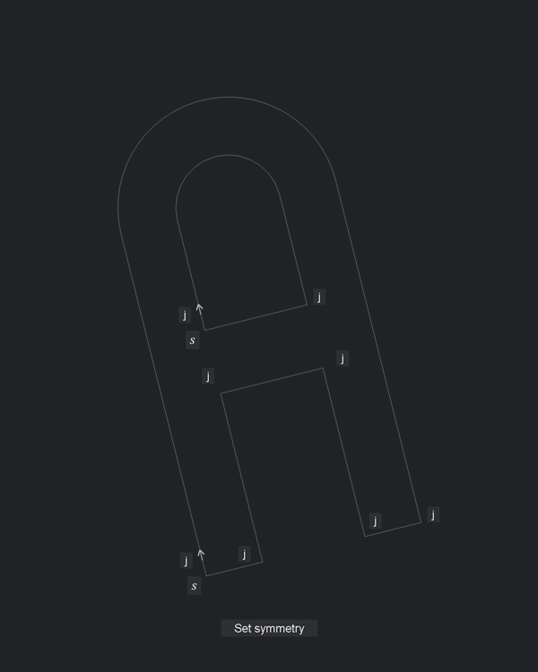

- Example: the emblem's outlined A, then the complete lettering and rings; $p=2.7\,\mathrm{mm}$
- Crown landmarks establish symmetry. Protected pairs and shared corner openings bound the free spans
- Redistribute residuals within those spans while keeping their boundary openings fixed

## Branching junction spacing

- Each branching end reserves a half-pitch connection between the shared hole and its first slit centre
- A straight run of length $L$ between two branching holes at the same pitch leaves $D=L-p$ between its reserved slit centres
- With one branching end and a fixed endpoint slit, the remaining span is $D=L-p/2$
- On a circular arm of radius $R$, a half-pitch chord reserves an angular advance of $2\arcsin\left(p/(4R)\right)$
- If two reserved centres coincide, reuse their slit when its axis agrees. Overlapping reservations have no solution
- Fit the remaining slit-to-slit spans; fixed half-pitch connections are excluded from ordinary gap counts and adjustments

## Corner-step adjustment

- A nominal corner step can put a neighbouring real slit beyond the end of its arm
- Prefer nominal steps; adjust only as needed to keep that neighbour on the arm, within $0.9p\leq q\leq1.1p$
- Fix the resulting neighbours before fitting their adjoining free spans
- A shallow turn requires an adjusted corner step of approximately $3.21\,\mathrm{mm}$ in this example
- Usable angles depend on pitch, slit geometry, hole diameter, clearance and available arm geometry


## Straight-span fitting

- Let $D>0$ be the distance between its fixed end openings, with no protected gaps inside
- Choose an integer number of gaps $n\geq1$. There are $n+1$ openings, including both ends
- Every gap must lie within $0.9p\leq g\leq1.1p$, so the possible counts are

$$
\max\left\{1,\left\lceil\frac{D}{1.1p}\right\rceil\right\}
\leq n\leq
\left\lfloor\frac{D}{0.9p}\right\rfloor.
$$

- For each count, the residual is $r=D-np$: positive means lengthen gaps; negative means shorten them
- Each adjusted gap can absorb at most $0.1p$. The smallest number of adjusted gaps for that count is

$$
k(n)=\left\lceil\frac{\lvert r\rvert}{0.1p}\right\rceil.
$$

- If $r=0$, all gaps stay nominal. Otherwise require $k\leq n$ and give those $k$ gaps equal spacing

$$
g=p+\frac{r}{k}.
$$

- Each adjusted gap stays within $\lvert g-p\rvert\leq0.1p$, and the gaps fill the span exactly: $(n-k)p+kg=D$

## Selection of the preferred fit

- Fewer adjusted gaps reduce individual placement with an awl or single tooth
- Grouping the adjustments in a central block keeps nominal runs beside the fixed features
- Smaller changes keep the adjusted spacing closer to the tool pitch
- Rank feasible fits by fewest adjusted gaps, then exact centring, then smaller fractional pitch change, then fewer gaps
- Put the adjusted gaps together in one block, as close to the span's centre as possible; for a nominal fit, no block is needed
- Exact centring is possible when $n-k$ is even; otherwise place the block half a gap towards the end
- Fixed openings and protected gaps do not move to improve that ranking

## Circular-span fitting

- Openings advance along an arc, but their gaps are measured straight across chords
- Convert each chord gap into an angle so the fitting calculation can cover the guide's total sweep
- On a circular guide of radius $R$, a gap $g$ has angular advance

$$
a(g)=2\arcsin\left(\frac{g}{2R}\right).
$$

- Require $p\leq2R$ and use the minor chord. Fit the total sweep $T=\lvert\Delta\phi\rvert$ using angular advances
- Nominal advance is $a=a(p)$; the limits are $a_-=a(0.9p)$ and $a_+=a(\min\{1.1p,2R\})$
- Test integer counts with $na_-\leq T\leq na_+$
- The residual is now angular: $r=T-na$. Each gap can absorb $a_+-a$ when extending, or $a-a_-$ when contracting
- If $r=0$, keep nominal gaps. Otherwise divide $\lvert r\rvert$ by the applicable capacity and round up to obtain $k$; reject that count if the capacity is zero or $k>n$
- Use $a'=a+r/k$ for the adjusted gaps. Convert back to chord spacing with $g=2R\sin(a'/2)$
- Equal adjusted chords and a centred block follow from equal angular advances on the same circle

## Layout validation

- The span equations establish spacing and endpoint agreement; the complete layout must also pass clearance
- Check every pair of distinct real openings, including openings on different arms or guides; count shared openings once
- Accept only when openings neither touch nor overlap and their edges remain at least the margin $m$ apart
- Virtual slits locate corner holes and are excluded from clearance checks

## Infeasible layouts

- If the feasible count range is empty, the span cannot be fitted within the bounds
- Shortest possible straight span: $0.9p$. Every length $D\geq4.5p$ fits the spacing bounds; shorter lengths have gaps between feasible ranges
- Clearance remains a separate check
- At $p=3\,\mathrm{mm}$, every length from $13.5\,\mathrm{mm}$ fits the spacing bounds
- A $7\,\mathrm{mm}$ span fails: two gaps can reach only $6.6\,\mathrm{mm}$, while three need at least $8.1\,\mathrm{mm}$
- Change the guide or its fixed features

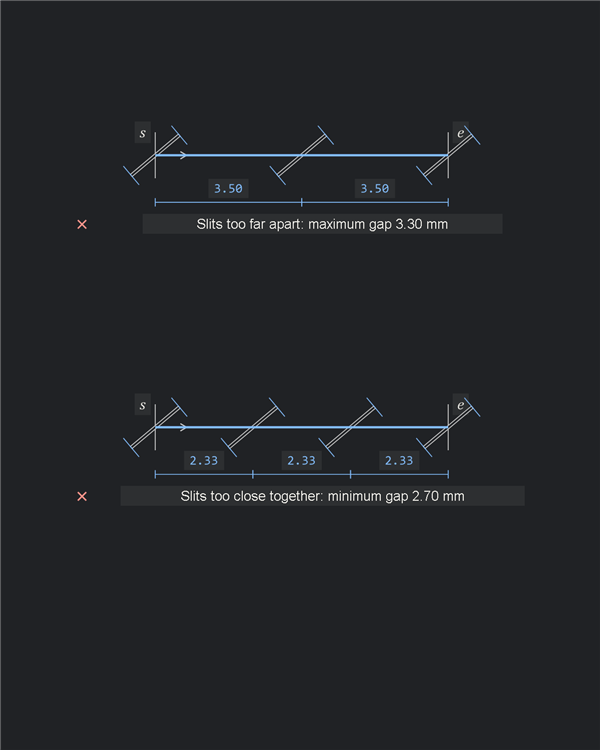

# Who it helps

## Layout effort and design complexity

- The product examples show different corner and spacing treatments, even at luxury price points; price alone does not imply a consistent geometric treatment
- A skilled craftsperson can resolve these layouts by hand, but repeating the calculations takes attention after the design choices are settled
- Layout effort grows with interacting constraints: a short letter with several corners can require more fitting than a long uninterrupted seam
- Each corner, crossing and short span adds placement decisions; revisions require those decisions to be checked again
- At sufficient complexity, manual layout can make an otherwise achievable piece impractical to undertake
- Applying explicit rules automatically reduces the work needed to develop and revise the pattern
- This can make elaborate designs practical even for a single piece, before repeated production offers any benefit

## Benefits across experience levels

- Beginners can use a resolved layout before developing the judgement needed to balance spacing and corners unaided
- Intermediate makers gain explicit bounds and fixed features that keep placement decisions consistent across seams
- Advanced and expert makers spend less time repeating familiar calculations and correcting layouts after revisions
- A chosen treatment can be carried through a complex pattern and reproduced on later pieces
- The maker still judges whether the treatment suits the design
- Time saved in layout can go towards composition and execution, including accurate punching, thread tension and control of the finished stitch

## Manufacturing applications

- A resolved pattern records the intended spacing and the location and size of every adjustment before production begins
- Manual and semi-automated work leaves fewer placement decisions to the operator
- Explicit opening positions help communicate the chosen treatment between the pattern designer and the person making the openings
- Different operators and production runs can use the same layout decisions; physical results still depend on execution
- CNC equipment that supports variable spacing may place adjusted gaps with little extra effort, reducing the importance of minimizing their number
- The layout still supplies opening positions and orientations through corners, intersections and closure
- Equipment integration and achievable tolerances depend on the production process

## Value by application

- Precision leather goods: stitch regularity and symmetry contribute directly to the visible result
- Bespoke work: reducing layout effort has value for a custom shape, even when only one piece is made
- Small-batch production: the chosen treatment can be repeated without each maker deciding independently where to adjust spacing
- Ordinary industrial textiles: existing tolerances may already be sufficient, leaving little benefit from finer control of individual openings
- Footwear and technical textiles: value depends on whether the application requires precise stitch or perforation placement
- The benefit depends on how much opening placement affects the product and the effort needed to make, communicate and repeat those decisions
