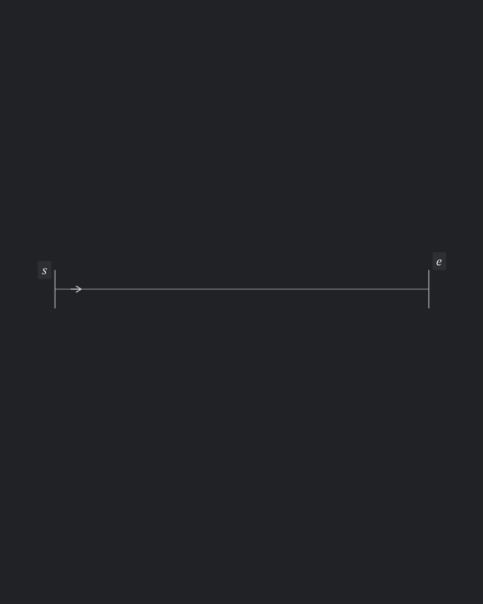

# Introduction

- A seam path expresses design intent; making it requires exact positions and orientations for individual openings
- Bridge design, geometric layout and physical execution: turn spacing and junction judgement into instructions someone can follow
- Pricking-iron slits have length and orientation as well as position; diagonal slits and their transitions shape the visible stitching
- Seam lengths and required features rarely fall on exact multiples of nominal pitch
- Manual arrays create many objects and make edits tedious; manual placement depends on spacing and junction judgement
- Encode that judgement in explicit rules, repeatable output and useful rejection when no valid layout exists
- An axiomatic approach grounded in manufacturability, visual balance and precision
- Bring specialized stitch-layout tools into established CAD: pitch, landmarks, corners and shared junctions from editable pattern guides

# The spacing problem

- Seam lengths and required features rarely fall on exact multiples of the tool's pitch
- Manual arrays leave endpoint, landmark and junction adjustments to the maker
- Example: $30.5\,\mathrm{mm}$ guide, $3\,\mathrm{mm}$ pitch, fixed endpoints

## Naive solution

- Distribute eleven openings evenly: ten $3.05\,\mathrm{mm}$ gaps
- Every gap departs from nominal tool spacing

## Good enough solution

- Keep eight nominal gaps; absorb the remainder in two $3.25\,\mathrm{mm}$ gaps at the end

## Autostitch solution

- Fix required features, then fit the intervening spans
- Use the fewest permitted adjustments, centred between those features
- Mark adjusted gaps for individual placement

# Why CAD

- Exact curves, dimensions, snaps and references define where the stitching belongs
- Pattern guides and generated openings stay in the same drawing
- Blocks contain the generated geometry; source guides remain editable
- Use existing drafting tools, libraries and production drawings

# Axioms

## Guide, slit and pitch

- Real slit centres lie on the guide
- Slit length, width and lean remain fixed relative to the local tangent
- Pitch is direct centre-to-centre distance; on a circle, it is a chord

## Fixed features

- Chosen endpoints, landmark pairs and junction neighbours stay fixed during fitting
- A landmark sits midway between a nominally spaced pair of slits
- The landmark gap is protected from adjustment

## Adjustment bounds

- Protected gaps remain nominal; other slit-to-slit gaps may vary within $0.9p\leq g\leq1.1p$

## Shared openings

- A smooth change of curvature shares one slit at the common tangent
- Connected portions reuse a shared opening with the same centre, type and axis

- A closed loop reuses its start opening; the closing gap must fit

## Two-arm corners

- Selected tips of two virtual slits locate one shared round hole
- Real neighbours lie on their arms, one corner step from the virtual centres
- Corner steps satisfy $0.9p\leq q\leq1.1p$; real neighbours stay on their finite guides

- The same construction applies to straight and circular arms

- A shallow turn can require an adjusted corner step: approximately $3.21\,\mathrm{mm}$ here
- Usable angles depend on pitch, slit geometry, hole diameter, clearance and available arm geometry

## Branching junctions

- A through-line contributes two arms; a T has three and an X four
- Three or more arms share one round hole at the guide intersection
- Each arm's first neighbour is one nominal pitch from that hole

## Clearance

- Distinct openings must remain disjoint and retain the required edge-to-edge margin
- Check all openings together, including separate guides and closure
- Example: slit width $w=0.3\,\mathrm{mm}$, margin $m=0.2\,\mathrm{mm}$; the overlapping rows fail

# Model and solution

## Fit the free spans

- Fit between the fixed openings at endpoints, landmarks and junctions
- Prefer nominal corner steps; adjust only as needed to keep a neighbour on its finite arm
- Minimize adjusted gaps; then prefer exact centring, smaller pitch change and fewer gaps
- Use equal spacing within one adjustment block per free span
- Place the block as centrally as protected gaps allow; half-index ties go toward the end
- On circles, convert chord spacing to angular advance

## Reject impossible fits

- A $7\,\mathrm{mm}$ span at $3\,\mathrm{mm}$ pitch cannot fit within the adjustment bounds
- Two gaps are too long; three are too short: $2(3.3)<7<3(2.7)$
- Change the guide or its fixed features

## Match pattern pieces

- Solve one source stitch line; transfer the complete layout by translation, rotation or reflection
- Matching guides retain every opening and spacing adjustment
- Reflection gives the opposite-face view; travel direction is independent
- Start correspondence fixes registration; closed guides also need a chosen phase

# Pattern workflow

- Draw the guides; connect those belonging to one stitch line
- Set pitch, extent, direction and landmarks
- Generate contained stitch blocks with opening geometry and placement notation
- Edit the source guides and regenerate
- Link matching guides to reuse the source layout on other pieces

# Can you really?

- Curved lettering, clipped fills, shared junctions and controlled spacing in one pattern
- The same rules apply throughout the artwork

# Who it helps

- Makers: explicit hole positions and spacing adjustments
- Pattern designers: reusable layouts that remain editable
- Small-batch production: matching pieces and repeatable placement instructions

# Reference

- [Glossary](GLOSSARY.md), [axioms](AXIOMS.md), [mathematical model](MODEL.md), [junction construction](JUNCTIONS.md)
- [Demo drawings](../examples/demo.md), [figure sources](../examples/illustrated/README.md)
