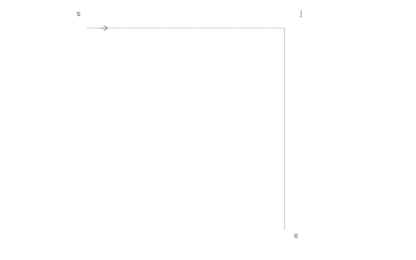

# Introduction

- A seam path expresses design intent; making it requires exact positions and orientations for individual openings
- Bridge design, geometric layout and physical execution: turn spacing and junction judgement into instructions someone can follow
- Pricking-iron slits have length and orientation as well as position; diagonal slits and their transitions shape the visible stitching
- Seam lengths and required features rarely fall on exact multiples of nominal pitch
- Manual arrays create many objects and make edits tedious; manual placement depends on spacing and junction judgement
- Encode that judgement in explicit rules, repeatable output and useful rejection when no valid layout exists
- An axiomatic approach grounded in manufacturability, visual balance and precision
- Bring specialized stitch-layout tools into established CAD: pitch, landmarks, corners and shared junctions from editable pattern guides

# Even Big Fashion Gets It Wrong

Research note: Anthony to find stitching examples from:

- Hermès
- Louis Vuitton
- Loewe
- Delvaux
- Berluti
- Valextra
- Gucci
- Bottega Veneta

# Terms

- [Glossary](GLOSSARY.md): guide, slit, gap, landmark, junction and arm

# The spacing problem

- Six slits on a $15.3\,\mathrm{mm}$ guide, at $3\,\mathrm{mm}$ nominal pitch
- Both endpoints must be met; the nominal row leaves a $0.30\,\mathrm{mm}$ residual
- Red segments and numbers show the residual; bracketed dimensions show gap lengths

## Even spacing

- Five equal $3.06\,\mathrm{mm}$ gaps
- Uniform spacing; every gap requires individual placement

## End adjustment

- Four nominal gaps; one $3.30\,\mathrm{mm}$ gap at the end
- One individual placement, beside the endpoint

## Autostitch

- Four nominal gaps; one $3.30\,\mathrm{mm}$ gap in the centre
- One individual placement; nominal spacing near both endpoints

| Treatment | Number of adjusted gaps | Absolute adjustment ($\mathrm{mm}$) | Absolute residual ($\mathrm{mm}$) | Absolute stitch-length deviation ($\mathrm{mm}$) |
| --- | ---: | ---: | ---: | ---: |
| Even spacing | $5$ | $0.300$ | $0.300$ | $0.267$ |
| End adjustment | $1$ | $0.300$ | $0.300$ | $0.270$ |
| Autostitch | $1$ | $0.300$ | $0.300$ | $0.270$ |

- End adjustment and Autostitch: identical totals, different placement

# The corner problem

- Two perpendicular guides with eight intervals per arm, at $3\,\mathrm{mm}$ nominal pitch
- Arm lengths: $23.472\,\mathrm{mm}$ and $23.954\,\mathrm{mm}$; chosen for equal absolute adjustment between the diagonal slit and Autostitch
- The same outer endpoints apply to every treatment
- The choice of corner opening changes the adjoining thread and the spans available for fitting

## Vertex point

- Nominal arm spacing, as the tool lands; round hole at the vertex
- Residual remains in the two final gaps into the hole
- Retains the intended vertex
- Changes the direction and visible length of the two adjoining stitches

## Bridge

- Nominal arm spacing, as the tool lands; thread connects the last slit on each arm
- No corner opening; thread bypasses the vertex
- Bridging gap: $3.851\,\mathrm{mm}$, above the $3.3\,\mathrm{mm}$ adjustment limit

## Shared diagonal slit with mirrored lean

- Shared diagonal slit at the vertex; mirrored lean on one arm
- Nominal arm spacing; residual absorbed only in each final gap into the shared slit
- Retains the intended vertex; relaxes consistent lean
- Corner slit sets the direction and visible length of the two adjoining stitches
- Final gaps: $2.472\,\mathrm{mm}$ and $2.954\,\mathrm{mm}$; the first falls below Autostitch's $2.7\,\mathrm{mm}$ limit

## Autostitch

- Shared round hole where the terminal virtual slit tips meet
- Consistent lean throughout; bounded pitch adjustments centred within each free span
- Hole offset from the guide vertex
- Same absolute adjustment as the diagonal slit, distributed across three gaps instead of two

| Treatment | Number of adjusted gaps | Absolute adjustment ($\mathrm{mm}$) | Absolute residual ($\mathrm{mm}$) | Absolute stitch-length deviation ($\mathrm{mm}$) |
| --- | ---: | ---: | ---: | ---: |
| Vertex point | $2$ | $0.575$ | $0.575$ | $0.470$ |
| Bridge | $1$ | $0.851$ | $0.851$ | $1.105$ |
| Shared diagonal slit with mirrored lean | $2$ | $0.575$ | $0.575$ | $0.407$ |
| Autostitch | $3$ | $0.575$ | $0.575$ | $0.516$ |

- Totals include out-of-bound gaps in the comparison treatments

# Why CAD

- Exact curves, dimensions, snaps and references define where the stitching belongs
- Pattern guides and generated openings stay in the same drawing
- Blocks contain the generated geometry; source guides remain editable
- Use existing drafting tools, libraries and production drawings

# Axioms

## Guide, slit and pitch

- Real slit centres lie on the guide
- Slit length, width and lean remain fixed relative to the local tangent
- Pitch is direct centre-to-centre distance; on a circle, it is a chord

## Fixed features

- Chosen endpoints, landmark pairs and junction neighbours stay fixed during fitting
- A landmark sits midway between a nominally spaced pair of slits
- The landmark gap is protected from adjustment
- Absorb each free span's residual in its unprotected gaps, within $0.9p\leq g\leq1.1p$
- Centre the adjustments within each span; the two sides can require different corrections
- Example: five slits on each side, with two central $3.25\,\mathrm{mm}$ gaps per span; the landmark pair stays $3\,\mathrm{mm}$ apart

## Shared openings

- A smooth change of curvature shares one slit at the common tangent
- Connected portions reuse a shared opening with the same centre, type and axis

- A closed loop reuses its start opening; the closing gap must fit

## Two-arm corners

- Stitch along each arm towards the corner; the virtual slit is the terminal slit of that row
- Its position and orientation continue the approaching row
- The two terminal virtual slits meet tip-to-tip at one shared round hole
- Real neighbours lie on their arms, one corner step from the virtual centres
- Corner steps satisfy $0.9p\leq q\leq1.1p$; real neighbours stay on their finite guides

- The same construction applies to straight and circular arms

- A shallow turn can require an adjusted corner step: approximately $3.21\,\mathrm{mm}$ here
- Usable angles depend on pitch, slit geometry, hole diameter, clearance and available arm geometry

## Branching junctions

- A through-line contributes two arms; a T has three and an X four
- Three or more arms share one round hole at the guide intersection
- Each arm's first neighbour is one nominal pitch from that hole

## Clearance

- Distinct openings must remain disjoint and retain the required edge-to-edge margin
- Check all openings together, including separate guides and closure
- Acute junction: the nearest pair overlaps; the next pair misses the required margin; farther pairs pass
- Example: included angle $6^\circ$, slit width $w=0.3\,\mathrm{mm}$, margin $m=0.2\,\mathrm{mm}$

# Model and solution

## Fit the free spans

- Fit between the fixed openings at endpoints, landmarks and junctions
- Prefer nominal corner steps; adjust only as needed to keep a neighbour on its finite arm
- Minimize adjusted gaps; then prefer exact centring, smaller pitch change and fewer gaps
- Use equal spacing within one adjustment block per free span
- Place the block as centrally as protected gaps allow; half-index ties go toward the end
- On circles, convert chord spacing to angular advance

## Reject impossible fits

- Straight span, fixed endpoints, no protected gaps: a fit requires $0.9np\leq L\leq1.1np$ for an integer gap count $n\geq1$
- Shortest possible fit: $0.9p$. Every length $L\geq4.5p$ fits the spacing bounds; shorter lengths have gaps between feasible ranges
- Clearance remains a separate check
- At $p=3\,\mathrm{mm}$, every length from $13.5\,\mathrm{mm}$ fits; $7\,\mathrm{mm}$ fails because $2(3.3)<7<3(2.7)$
- Change the guide or its fixed features

# Pattern workflow

- Draw the guides; connect those belonging to one stitch line
- Set pitch, extent, direction and landmarks
- Generate contained stitch blocks with opening geometry and placement notation
- Edit the source guides and regenerate

# Can you really?

- Curved lettering, clipped fills, shared junctions and controlled spacing in one pattern
- The same rules apply throughout the artwork

# Who it helps

- Makers: explicit hole positions and spacing adjustments
- Pattern designers: reusable layouts that remain editable
- Small-batch production: repeatable placement instructions

# Reference

- [Glossary](GLOSSARY.md), [axioms](AXIOMS.md), [mathematical model](MODEL.md), [junction construction](JUNCTIONS.md)
- [Demo drawings](../examples/demo.md), [figure sources](../examples/illustrated/README.md)
