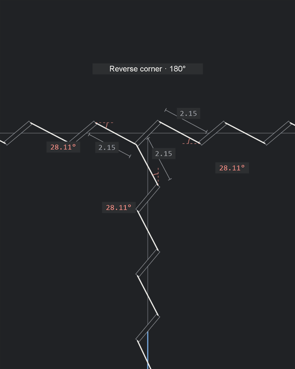
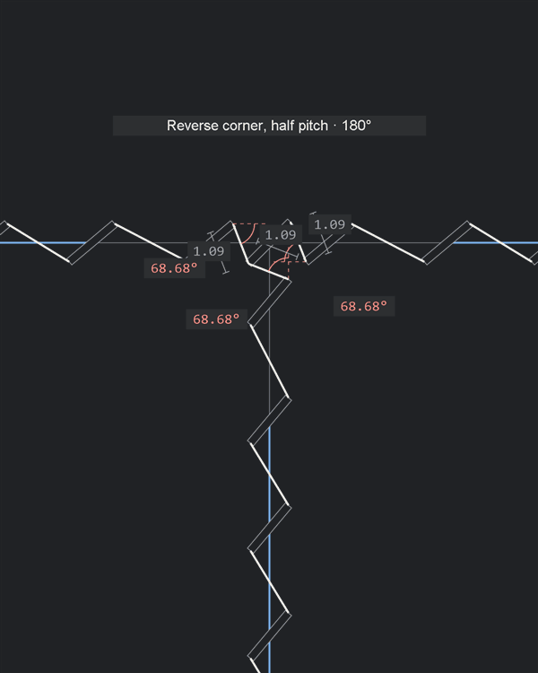
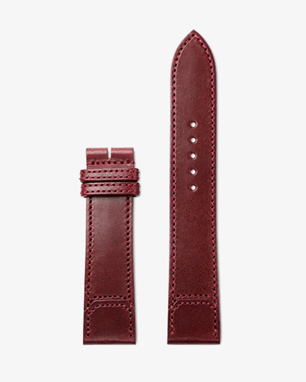

# Introduction

## From design to execution

- Design sets the seam path and its intended appearance; making it requires discrete, oriented openings
- Geometric layout is a constrained placement problem: choose opening positions, orientations and gap counts while preserving the intended seam
- Physical execution produces those openings; craft judgement connects the design, geometric layout and tool use

## Pricking irons and nominal pitch

- Round holes are rotationally symmetric; slits have length, width and orientation that shape the visible thread
- A multi-tooth iron fixes the spacing between openings, but seam lengths rarely divide into whole nominal gaps
- Where and how much spacing changes affects both appearance and tool use
- Adjusted gaps can require individual placement with an awl or single tooth

## From manual judgement to explicit rules

- Digital arrays create many objects; fitting and revising the seam requires manual edits
- Physical layout relies on judgement developed through practice, repeated for each pattern
- Encode that judgement in repeatable placement instructions: preserve nominal spacing where possible and identify every adjustment
- Make the placement choices explicit so the same rules can be reapplied when the pattern changes
- Reject layouts that cannot satisfy the rules so the design can be revised
- Ground the axioms in manufacturability with the intended tools, visual balance through consistent lean and deliberate adjustments, and precision through explicit constraints and reproducible geometry

# Terms

- **Guide and stitch line:** the guide carries the slit centres; one stitch line can follow several connected guides
- **Slit and lean:** a slit has length, width and an axis between its tips. Lean is the angle of that axis to the guide's local tangent
- **Obverse and reverse stitch:** obverse uses the reference slit lean; reverse mirrors that lean. Travel direction and material face are separate choices
- **Gap and pitch:** a gap is the direct distance between consecutive opening centres; pitch $p$ is the target. On a curve, the gap is a chord, while arc length follows the guide
- **Nominal, adjusted and protected gaps:** nominal gaps equal $p$; adjusted gaps depart from $p$ within the fitting bounds; protected gaps stay nominal
- Blue guide segments identify adjusted gaps between opening centres; red segments identify residuals
- **Landmark and free span:** a landmark fixes a nominally spaced pair of slits around a reference position, with no opening at the reference itself. Endpoints, landmarks and junctions bound the free spans where the remaining openings are fitted
- **Junction and arms:** a junction is where stitch lines meet. Each direction away from it is an arm: two at a corner, three at a T, four at an X. A through-line contributes two arms
- **Virtual slit:** an unpunched construction slit toward which an arm is laid out. In an Autostitch corner, the terminal virtual slit tips meet at the shared hole
- **Clearance:** the shortest edge-to-edge distance between separate openings, accounting for slit width and hole diameter. The margin is the minimum allowed clearance
- **Residual and adjustment:** residual is the length left over or missing before fitting; adjustment is the change made to a gap. Absolute adjustment sums gap changes, counting compression and extension positively. On curves, residual uses arc length and adjustment uses chord length
- **Absolute stitch-length deviation:** total absolute difference between visible thread lengths and nominal straight-row stitches. It captures changes from spacing, curvature and corner treatment; it does not measure thread direction

# Two layout problems

- Spacing: fit a seam whose length is not a whole number of nominal gaps
- Corners: join rows of oriented slits while controlling the opening and thread at the turn
- Compare how each solution uses the iron, where adjustments occur, and what changes in the visible stitching

## The spacing problem

- Six slits on a $15.3\,\mathrm{mm}$ guide, at $3\,\mathrm{mm}$ nominal pitch
- Both endpoints must be met; the nominal row leaves a $0.30\,\mathrm{mm}$ residual
- Red segments and numbers show the residual; bracketed dimensions show gap lengths

### Even spacing

- Five equal $3.06\,\mathrm{mm}$ gaps
- A fit-to-length CAD pattern: divide the line equally between the chosen openings
- Each stitch line gets its own pitch, determined by its length and gap count
- Spacing is uniform within each line; different lines generally have different pitches
- The chosen iron cannot place those runs at their new pitches; every gap needs individual placement

### End adjustment

- Four nominal gaps; one $3.30\,\mathrm{mm}$ gap at the end
- The last stitch takes the entire residual, making it longer or shorter than the rest
- Sharing the residual across more gaps makes each change smaller and easier to blend into the run, at the cost of more individual placements

### Autostitch

- Four nominal gaps; one $3.30\,\mathrm{mm}$ gap in the centre
- Formalizes those decisions: bound each pitch change, use the fewest adjusted gaps needed, and centre them within the available span
- Share the residual equally across those gaps; keep the remaining runs at the tool pitch

### Spacing tradeoffs

- Even spacing solves the visual pattern; it gives up the common tool pitch across stitch lines
- End adjustment preserves the tool pitch through most of the line, but leaves one visibly longer or shorter stitch at the endpoint
- Autostitch borrows equal spacing for a selected adjustment block. The remaining runs keep the tool pitch; the correction sits away from fixed features

## The corner problem

- At a corner, two rows of angled slits must join into one continuous seam
- How those rows meet determines where the thread turns, whether slit lean stays consistent, and the length and angle of the adjoining stitches
- Red angles measure the entering and leaving thread against their respective guides, showing how each stitch approaches or leaves the corner

### Vertex point

- Keep the round hole at the vertex and move the vertical run to balance the adjoining stitches
- Both angles are $14.3^\circ$; both visible stitch lengths are $1.96\,\mathrm{mm}$
- Arm spacing stays nominal; the far endpoint moves with the vertical run
- The two final gaps into the hole absorb the spacing change

### Bridge

- Thread bridges the last slit on each arm, bypassing the vertex
- Move the vertical run to vary the visible bridge stitch from $1.00$ to $3.00\,\mathrm{mm}$; the red angles change with it
- Both positions retain nominal arm spacing; the far endpoint moves with the row

### Reverse corner

- Refines Bridge: add a shared diagonal slit at the vertex and mirror the outgoing row, joining obverse and reverse stitches
- Mirroring brings the outgoing corner stitch closer to the ordinary thread direction along that row
- Arm spacing stays nominal; the final gaps into the shared slit absorb the residual
- Length brackets show the two visible corner stitches; red angles show how they meet the arms

### Autostitch

- Refines Vertex point at this right-angle corner: derive the shared hole from the two slit rows, keeping their lean consistent
- The horizontal row's terminal virtual slit locates the vertical row through its lower tip
- Slide that virtual slit and its preceding real slit until the vertical row lines up with its guide; the whole vertical row follows sideways
- That movement creates the horizontal residual. Distribute it within the arm while keeping the corner construction fixed
- The vertical guide fixes the outgoing arm's direction. With nominal corner steps, the entering and leaving thread both meet their guides at $27.5^\circ$
- Slit lean, slit length and corner angle determine the hole's offset from the vertex; changing the tool profile changes that placement
- The corner step measures from the last real slit centre to the virtual slit centre; the round hole is where the two virtual tips meet

### Corner tradeoffs

- Keeping the opening at the vertex, keeping slit lean consistent and keeping the arm gaps nominal lead to different corner treatments
- Reverse corner keeps the turn at the vertex and gives less visible thread-length deviation here; Autostitch preserves lean with an offset hole
- Autostitch resolves the corner first, then fits the remaining spans around it. Endpoints, landmark pairs, gap bounds and clearance apply together
- The rules determine a repeatable layout; the maker judges whether its thread angles, lengths and corner position suit the design

# Axioms

## Guide, slit and pitch

- Real slit centres lie on the guide
- Slit length, width and lean remain fixed relative to the local tangent
- Pitch is direct centre-to-centre distance; on a circle, it is a chord

## Fixed features

- Chosen endpoints, landmark pairs and junction neighbours stay fixed during fitting
- A landmark sits midway between a nominally spaced pair of slits
- The landmark gap is protected from adjustment
- Absorb each free span's residual in its unprotected gaps, within $0.9p\leq g\leq1.1p$
- Centre the adjustments within each span; the two sides can require different corrections
- Example: seven slits on each side, with two central $3.25\,\mathrm{mm}$ gaps per span; the landmark pair stays $3\,\mathrm{mm}$ apart

## Shared openings

- A smooth change of curvature shares one slit at the common tangent
- Connected portions reuse a shared opening with the same centre, type and axis

- Nominal spacing can miss the start of a closed loop; distribute the residual so the loop reuses its start opening
- A diameter marks two opposite landmarks. Protect their nominal pairs and fit each half separately to place equal adjustment blocks symmetrically

## Two-arm corners

- Continue each arm's slit row towards the corner, ending in a virtual slit with the same lean
- The virtual slits meet tip-to-tip; one round hole replaces them both

- The last real slit on each arm stays on its guide
- Its centre is one corner step $q$ from the virtual slit's centre, within $0.9p\leq q\leq1.1p$
- The virtual tips determine the hole position; the corner step controls the approach from each real row

- The same construction applies to straight and circular arms

## Branching junctions

- A through-line contributes two arms; a T has three and an X four
- Three or more arms use Vertex point: one round hole at the guide intersection
- Each arm's first neighbour is one nominal pitch from that hole
- Releasing the common virtual-tip constraint admits more arm directions, at the cost of ordinary thread angle and visible length at the hole
- Keep the hole and neighbours fixed; fit each remaining span with the fewest bounded adjustments, centred within that span

### X junction with a curved arm

- One round hole shared by four arms, including a circular arm
- Nominal chord gap from the hole to each neighbouring slit
- Fixed endpoints and neighbours; bounded corrections within the remaining spans

## NEW: Branching junctions

- Proposal for review: use half pitch near a straight-through junction; retain Vertex point elsewhere
- Near $180^\circ$, the two threads through a Vertex point read as one overlong stitch. As the arms turn apart, the bend makes them read as separate stitches
- The choice controls that visible continuity while keeping one round hole at the guide intersection

### T junction: four treatments

[Synchronized angle study](../examples/illustrated/t-junctions/index.html): the same arms sweep from $180^\circ$ to $120^\circ$ and back under all four treatments.

#### Vertex point

- First slit centres are one pitch from the hole; near straight-through alignment, the combined thread looks too long

#### Vertex point, half pitch

- First slit centres are half a pitch from the hole on all three arms
- On straight arms, each connection has the ordinary thread angle and half its visible length. Two opposite connections read as one ordinary stitch

#### Reverse corner

- The shared diagonal slit favours some arm connections over others: some stitches look continuous while others break that rhythm

#### Reverse corner, half pitch

- Halving the centre spacing retains that imbalance; reject both Reverse corner variants for this branching rule

### Proposed angle rule

- Let $\beta$ be the largest angle between any pair of outward arm tangents, measured from $0^\circ$ to $180^\circ$
- Set the fixed distance $d_J$ from the shared hole centre to the first slit centre on every arm:

$$
d_J=\begin{cases}
p/2,&170^\circ\leq\beta\leq180^\circ,\\
p,&\beta<170^\circ.
\end{cases}
$$

- This is a special junction distance; ordinary slit-to-slit gaps retain their fitting bounds
- On curved arms, use the tangent at the junction to classify the angle and a chord for $d_J$
- The $10^\circ$ band is a visual choice to review. Half pitch still has to pass opening clearance and leave feasible free spans

### X junctions

- Extend the same rule to four arms: a nearly straight pair selects half pitch on all four arms; otherwise use Vertex point
- Two nearly straight opposing pairs should each read as an ordinary stitch through the hole
- Review the mixed case: only one pair is nearly straight. Compare halving all four arms with halving only the qualifying pair before settling the rule
- Include an X with a curved arm to check how curvature changes the local thread angles

### Follow-through after the decision

- Revise A9, the junction construction, glossary and model; implement the selected fixed neighbour distances before fitting the remaining spans
- Test both sides of the $170^\circ$ boundary, mixed X junctions, curved arms, clearance and short spans
- Replace the current T/X illustrations and junction glossary figure; rebuild the rounded-A solution and affected connected fill/demo examples

## Clearance

- Distinct openings must remain disjoint and retain the required edge-to-edge margin
- Check all openings together, including separate guides and closure
- Acute junction: the nearest pair overlaps; the next pair misses the required margin; farther pairs pass
- Example: included angle $6^\circ$, slit width $w=0.3\,\mathrm{mm}$, margin $m=0.2\,\mathrm{mm}$

# Model and solution

- Given a guide and tool profile, find the opening positions that satisfy the axioms
- Resolve the fixed features first; fit the gaps between them without undoing those choices
- Check the complete layout for clearance. A valid corner construction can still leave an impossible span or colliding openings

## Establish the fixed openings

- Inputs: guide geometry, start and end, direction, landmarks, junctions and pitch $p$
- Tool profile: slit length $\ell$, width $w$, lean $\alpha$, round-hole diameter $d$ and clearance margin $m$
- Place endpoint slits, protected landmark pairs and shared junction openings; resolve corner neighbours before fitting
- These openings divide the guide into free spans. Their positions stay fixed; solve the remaining spacing within each span

- Example: a single-line A with a rounded crown, two landmarks and two T junctions at the crossbar; $p=3\,\mathrm{mm}$
- Resolve junctions: locate the shared round holes and reserve their three nominal neighbours. The crown shares one slit with each straight leg at its smooth joins
- The fixed openings leave seven straight free spans and one semicircular span
- A $6.50\,\mathrm{mm}$ span leaves $0.50\,\mathrm{mm}$ beyond two nominal gaps. One $3.50\,\mathrm{mm}$ gap would exceed the limit; two $3.25\,\mathrm{mm}$ gaps fit
- The crown compresses four central gaps to approximately $2.73\,\mathrm{mm}$; its other gaps stay nominal
- Landmark pairs, junction neighbours and smooth-join slits stay fixed. The fitted opening positions balance across the A

## Solve one straight span

- Let $D>0$ be the distance between its fixed end openings, with no protected gaps inside
- Choose an integer number of gaps $n\geq1$. There are $n+1$ openings, including both ends
- Every gap must lie within $0.9p\leq g\leq1.1p$, so the possible counts are

$$
\max\left\{1,\left\lceil\frac{D}{1.1p}\right\rceil\right\}
\leq n\leq
\left\lfloor\frac{D}{0.9p}\right\rfloor.
$$

- For each count, the residual is $r=D-np$: positive means lengthen gaps; negative means shorten them
- Each adjusted gap can absorb at most $0.1p$. The smallest number of adjusted gaps for that count is

$$
k(n)=\left\lceil\frac{|r|}{0.1p}\right\rceil.
$$

- If $r=0$, all gaps stay nominal. Otherwise require $k\leq n$ and give those $k$ gaps equal spacing

$$
g=p+\frac{r}{k}.
$$

- The bound on $k$ ensures $|g-p|\leq0.1p$. The gaps reach the fixed endpoint exactly because

$$
(n-k)p+kg=np+r=D.
$$

## Choose where the adjustments go

- Among feasible counts, minimize $k$, the number of adjusted gaps
- Break ties by exact centring, then smaller fractional pitch change, then fewer gaps
- Put the adjusted gaps together in one block, as close to the span's centre as possible
- Exact centring is possible when $n-k$ is even; otherwise place the block half a gap towards the end
- Fixed openings and protected gaps do not move to improve that ranking

## Apply the same fit to curves

- On a circular guide of radius $R$, a gap is a chord. Its angular advance is

$$
a(g)=2\arcsin\left(\frac{g}{2R}\right).
$$

- Require $p\leq2R$ and use the minor chord. Fit the total sweep $T=|\Delta\phi|$ using angular advances
- Nominal advance is $a=a(p)$; the limits are $a_-=a(0.9p)$ and $a_+=a(\min\{1.1p,2R\})$
- Test integer counts with $na_-\leq T\leq na_+$
- The residual is now angular: $r=T-na$. Each gap can absorb $a_+-a$ when extending, or $a-a_-$ when contracting
- If $r=0$, keep nominal gaps. Otherwise divide $|r|$ by the applicable capacity and round up to obtain $k$; reject that count if the capacity is zero or $k>n$
- Use $a'=a+r/k$ for the adjusted gaps. Convert back to chord spacing with $g=2R\sin(a'/2)$
- Equal adjusted chords and a centred block follow from equal angular advances on the same circle

## Check the complete layout

- The span equations establish spacing and endpoint agreement. They do not establish clearance
- Check every pair of distinct real openings, including openings on different arms or guides; count shared openings once
- Accept only when openings remain disjoint and satisfy the margin $m$. Virtual slits locate corner holes and are not punched

## When a corner step must change

- Prefer nominal corner steps; adjust only as needed to keep a neighbour on its finite arm, within $0.9p\leq q\leq1.1p$
- Fix those neighbours before solving their adjoining free spans
- A shallow turn can require an adjusted corner step: approximately $3.21\,\mathrm{mm}$ here
- Usable angles depend on pitch, slit geometry, hole diameter, clearance and available arm geometry

## Reject impossible fits

- If the feasible count range is empty, the span cannot be fitted within the bounds
- Shortest possible straight span: $0.9p$. Every length $D\geq4.5p$ fits the spacing bounds; shorter lengths have gaps between feasible ranges
- Clearance remains a separate check
- At $p=3\,\mathrm{mm}$, every length from $13.5\,\mathrm{mm}$ fits; $7\,\mathrm{mm}$ fails because $2\times3.3<7<3\times2.7$
- Change the guide or its fixed features

# Even Big Fashion Gets It Wrong

- Diagrams compare the observed corner methods with Autostitch

## Hermès Sellier wallet

- Focus: the top corner and the decorative H below the right-hand run
- The H is represented by six round holes

### Reference

- Reverse corner: the top and vertical rows use opposite lean
- The stitches entering the H continue the adjoining thread angles

### Autostitch

- Consistent lean from the top row through the vertical run; a round corner hole at the virtual slit-tip intersection
- The H keeps its shape and nominal approaches; its position and the bottom row move to suit the changed slit lean

| Construction | Number of adjusted gaps | Absolute adjustment ($\mathrm{mm}$) | Absolute stitch-length deviation ($\mathrm{mm}$) |
| --- | ---: | ---: | ---: |
| Reference | $0$ | $0.000$ | $1.213$ |
| Autostitch | $0$ | $0.000$ | $1.090$ |

- Both layouts keep nominal gaps; the choice changes the corner position and thread geometry

## Loewe Mini Feather hanger

- Focus: the rectangular strap below the swivel hook
- The stitch line goes up the left side, across the top and down the right side

### Reference

- Shared diagonal slit at the left corner; Vertex point at the right corner
- The two top slits have opposing lean, giving the middle thread a horizontal line

### Autostitch

- Same guides; round holes at both corners and consistent slit lean
- One adjusted gap across the top
- Start and end positions shift along the vertical guides to keep those rows nominal

| Construction | Number of adjusted gaps | Absolute adjustment ($\mathrm{mm}$) | Absolute stitch-length deviation ($\mathrm{mm}$) |
| --- | ---: | ---: | ---: |
| Reference | $3$ | $0.900$ | $1.403$ |
| Autostitch | $1$ | $0.249$ | $0.224$ |

## Louis Vuitton Speedy handle chape

- Focus: the left [handle chape](https://us.louisvuitton.com/eng-us/products/nano-speedy-g81-nvprod7890132v/M29781), the leather tab attaching the handle hardware to the bag
- Closed pentagonal stitch line; one handedness throughout

### Reference

- Shared diagonal slit at each corner; consistent lean around the loop
- Each side uses equal spacing between its corner slits

### Autostitch

- Same pentagonal guides; five round corner holes
- Each span uses the fewest adjusted gaps allowed by the pitch bounds
- The loop closes at its starting opening
- Most gaps return to the iron's pitch, reducing the individual placements required by the reference layout

| Construction | Number of adjusted gaps | Absolute adjustment ($\mathrm{mm}$) | Absolute stitch-length deviation ($\mathrm{mm}$) |
| --- | ---: | ---: | ---: |
| Reference | $26$ | $4.931$ | $6.610$ |
| Autostitch | $6$ | $0.917$ | $0.821$ |

## Jaeger-LeCoultre / Casa Fagliano strap tip

- Focus: the pointed end of the right strap
- Both straight rows start at matching heights, with one handedness throughout

### Reference

- Vertex point: symmetric curves meet at a round hole
- Residual distributed equally through five gaps on each curve; the straight rows remain aligned

### Autostitch

- Same guides and aligned straight rows
- Virtual slit tips place the shared hole right of the vertex, changing the available span on each arm
- One adjusted gap on the left; four on the right
- Fewer gaps need individual placement; the two sides lose their matching spacing pattern

| Construction | Number of adjusted gaps | Absolute adjustment ($\mathrm{mm}$) | Absolute stitch-length deviation ($\mathrm{mm}$) |
| --- | ---: | ---: | ---: |
| Reference | $10$ | $2.509$ | $2.030$ |
| Autostitch | $5$ | $1.337$ | $1.169$ |

[Sources, geometry and reproduction](../examples/counter_examples/README.md)

# Can you really?

## Raise the floor

- Skilled bespoke leatherworkers already exercise judgement over pitch, corners and visual balance
- Codifying that judgement makes precise layout repeatable across a piece and through revisions
- Corner treatments and spacing corrections become decisions that can be checked together across the whole pattern
- Precise layout becomes easier to achieve consistently, with fewer missed constraints and manual corrections
- Design judgement, accurate punching and stitching remain the practitioner's work

## Go beyond an ordinary seam

- The maker draws the intended pattern; the rules resolve the opening positions and identify departures from nominal pitch
- An array repeats a shape; each corner, junction and interrupted run still needs a placement decision
- For an expert making a one-off piece, less repetitive layout work makes room for more ambitious detail

## Deliberately ridiculous

- Stitching becomes the decoration: lettering, texture and background all depend on resolved stitch placement
- The emblem combines outlined capitals, script and concentric rings interrupted around the lettering

- The banner pushes further: script outlines, curved fill clipped inside YOU, and a diamond background kept clear of the text
- The banner uses $2.7\,\mathrm{mm}$ pitch; its many short runs, corners and crossings apply the same placement rules
- The excess is intentional: the same rules handle a density of detail that would demand repeated manual fitting

# Who it helps

## Craft and pattern design

- Make spacing and corner judgement available as reusable instructions
- Reduce layout effort while keeping control of the pattern
- More consistent layout across makers; physical execution still depends on skill

| Experience | Main benefit |
| --- | --- |
| Beginner | Usable geometric layouts with less prior layout experience |
| Intermediate | More precise, consistent placement decisions |
| Advanced | Fewer manual adjustments and easier revision |
| Expert | Efficiency, repeatability and standardization |

## Manufacturing

- Identify, quantify and locate nonstandard gaps before production
- Manual and semi-automated work: fewer spacing decisions left to the operator; clearer instructions for controlled placement
- Repeated production: the same design carries the same placement decisions across operators and runs
- CNC planning: resolved openings can supply placement geometry; variable spacing may add little execution effort when the equipment supports it
- Equipment integration and achievable tolerances depend on the production process

## Value by application

- Additional precision matters when stitch appearance or opening placement affects the product

| Context | Expected value |
| --- | --- |
| Ordinary industrial textiles | Limited where existing processes already meet placement tolerances |
| Precision leather goods | Control of visible regularity, symmetry and consistency |
| Small-batch luxury production | Repeatability with less manual layout effort |
| Bespoke leathercraft | Control over irregular geometry and individual pieces |
| Fully automated production | Explicit placement geometry for manufacturing planning, subject to equipment integration |
| Footwear and technical textiles | Useful where visible stitching or perforation placement needs tight control |

# Reference

- [Glossary](GLOSSARY.md), [axioms](AXIOMS.md), [mathematical model](MODEL.md), [junction construction](JUNCTIONS.md)
- [Demo drawings](../examples/demo.md), [figure sources](../examples/illustrated/README.md)
