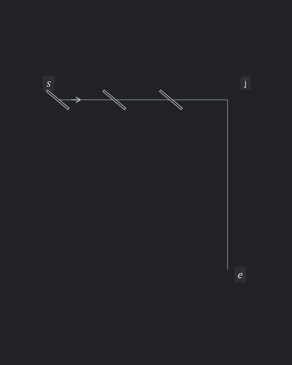
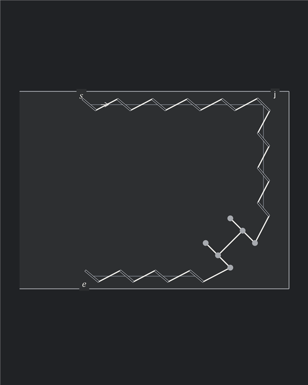
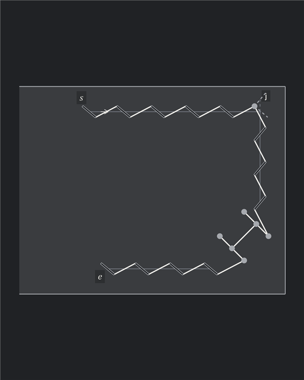
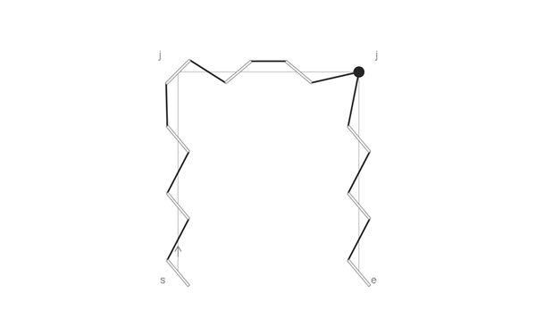
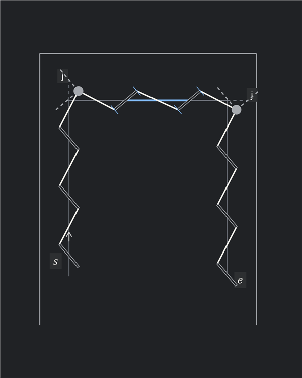
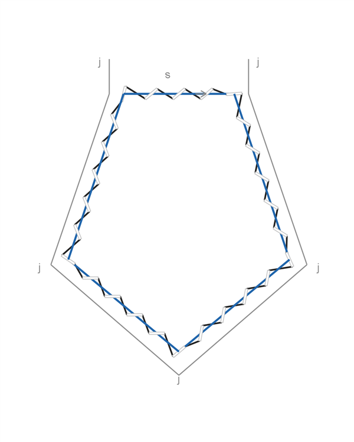
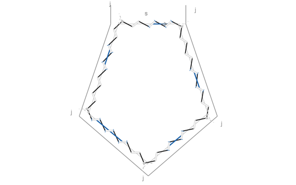
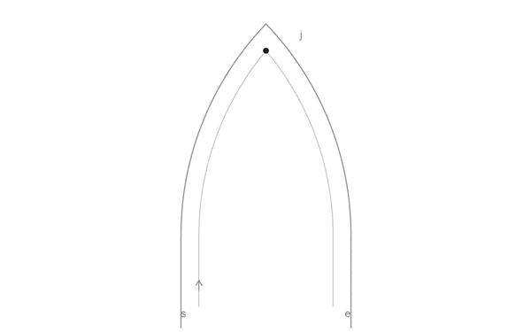
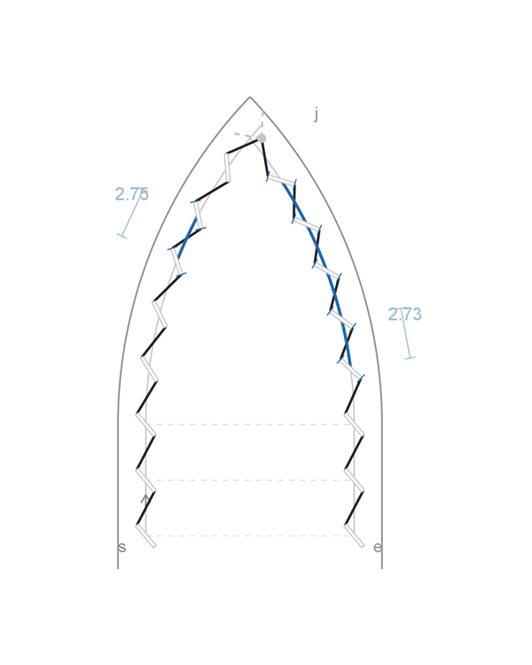

# Stitching examples

## Observed constructions

### Shared diagonal corner slit

- One real diagonal slit joins the two arms at the vertex
- Its angle can differ from the ordinary slits on either arm, changing the two adjoining stitches
- In the illustration, the shared slit bisects the corner

### Mixed front- and rear-style runs

- In the Sellier reconstruction, the top run uses rear-style slit lean; the vertical run uses front-style slit lean
- Their ordinary slit axes remain nearly parallel across the turn, although their lean relative to each arm differs

## Cases

### Hermès Sellier wallet

- Shared diagonal slit at the upper corner; decorative H at the lower corner
- The diagrams represent the H with six circular openings
- The stitches joining its legs continue the ordinary thread angle, with nominal centre spacing and no residual

**Reference construction** — mixed slit lean and a shared diagonal corner slit.

**Autostitch construction** — consistent rear-style lean and a round hole where the virtual slit tips meet.

### Loewe Mini Feather hanger

[Reference photograph](../../examples/counter_examples/loewe_mini_feather.jpg): the rectangular stitched strap directly below the swivel hook.

- One run goes up the left side, across the top and down the right side
- The left corner uses a shared slit; the right corner uses a round hole
- The middle thread across the top is horizontal

**Reference construction**

**Autostitch construction** — round holes at both corners, consistent slit lean and a bounded top-span adjustment.

### Louis Vuitton Speedy handle chape

The **handle chape** is the leather tab attaching the handle hardware to the bag. Louis Vuitton uses the term [chapes](https://us.louisvuitton.com/eng-us/products/nano-speedy-g81-nvprod7890132v/M29781) for these attachments.

[Reference photograph](../../examples/counter_examples/lv_speedy.png): the left handle chape.

- A closed pentagonal stitch line, with a shared slit at each corner
- One stitch handedness around the loop; no mirrored runs

**Reference construction**

**Autostitch construction** — five round-hole corners, fitted connecting spans and one continuous closure.

### Jaeger-LeCoultre / Casa Fagliano strap tip

[Reference photograph](../../examples/counter_examples/jaeger_lecoultre_fagliano.png): the pointed end of the right strap.

- The two straight runs have horizontally aligned holes and the same stitch handedness
- A round hole sits exactly at the vertex where the two curves meet
- Assume compression is confined to the curves, distributed equally across each arm's free gaps
- Symmetric guides and equal compression give the same curved chord on both sides: approximately $2.75\,\mathrm{mm}$ for $p=3\,\mathrm{mm}$

**Reference construction** — equal compression through each curve to the fixed vertex hole.

**Autostitch construction** — the same guides and straight rows. The virtual slit tips locate the hole slightly to the right of the vertex; adjust the fewest gaps within the pitch bounds.

- Left: one adjusted gap of approximately $2.75\,\mathrm{mm}$; the remaining gaps stay nominal
- Right: four adjusted gaps of approximately $2.73\,\mathrm{mm}$

## Interpretation

- Slit axes are inferred from the thread; the balanced corner angle is an assumption
- Front/rear style describes the slit lean here, not proof of which face was punched
- Dimensions are illustrative; the cases use $p=3\,\mathrm{mm}$

[Sources and reproduction](../../examples/counter_examples/README.md)
