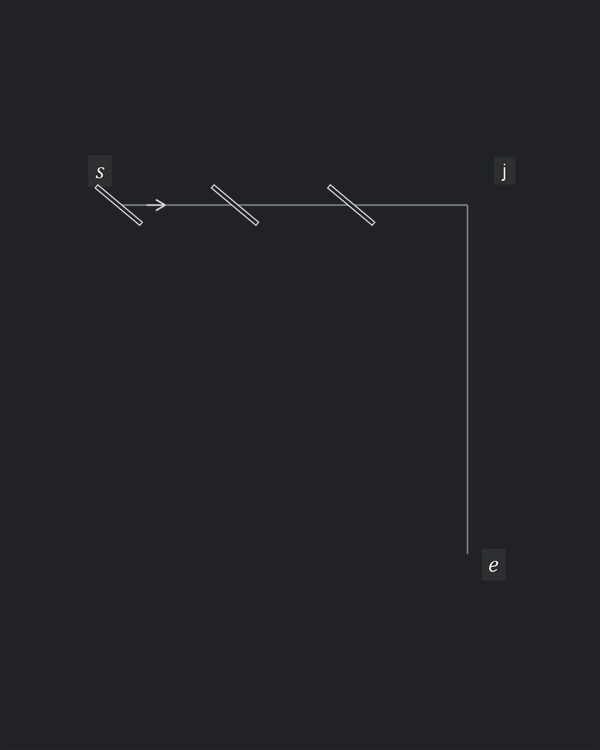
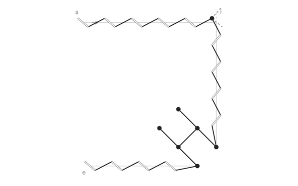

# Hermès Sellier wallet

## Top corner: one shared diagonal slit

- Infer openings from the thread entry and exit positions and the repeating pitch
- Ordinary stitches repeat along each arm; the final incoming stitch and first outgoing stitch change angle
- One real slit at the vertex joins both arms; its axis bisects the right angle
- The thread uses different tips as it turns through that slit
- The two affected stitches are drawn heavier

## Reduced wallet: Autostitch construction

- Retain the top, right and bottom guides and the H
- At the top corner, the selected virtual slit tips meet at one round hole
- Represent the H with six fixed circular openings and its connecting thread
- Choose guide extents in nominal steps; the approaches to the H have zero residual
- Every slit-to-slit gap and each H approach is $p=3\,\mathrm{mm}$; no redistribution

## Reconstruction assumptions

- Hole axes and thread connections are inferred from the photograph and annotated crop; the corner bisector is an educated choice
- Perspective is flattened; dimensions and tool profile are illustrative
- The photographed view is treated as the rear face. Its reconstructed rows have nearly parallel axes; their signed leans differ across the turn
- Autostitch instead keeps one signed local lean throughout the route. The two diagrams therefore compare different placement conventions
- The H is supplied decoration; arbitrary fixed decorative holes are outside the plugin behavior demonstrated here

[Source, parameters and reproduction](../../examples/counter_examples/README.md)
