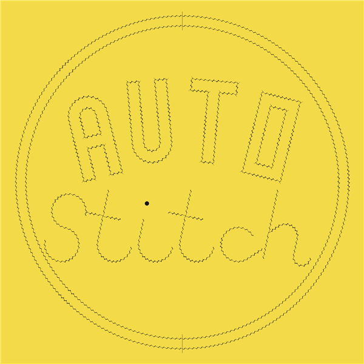

# Stitch specimen

[New artwork options: quilting and portrait lettering](studies/README.md).

Open [Autostitch-showcase.dwg](Autostitch-showcase.dwg). Save a copy before experimenting.

Three named views: **ROUND**, **ANGULAR**, **SQUARE**. Use BricsCAD's View Manager to switch. All use a $3\,\mathrm{mm}$ pitch: 51 guides, 30 letters, 32 stitch blocks and 28 independent sources.



The square emblem pairs arched AUTO outlines with script Stitch and two unstitched concentric pattern circles. The i has one separate $3\,\mathrm{mm}$ round punch. [Unstitched artwork](autostitch-artwork.png) is retained for comparison.

The circles cross the S three times and the h once. Each crossing is a saved landmark centred in a nominal gap. Both circles remain plain drawing geometry; only the lettering is stitched.

## Inspect

- `SHOWCASE_GUIDES`: editable polylines.
- `AUTOSTITCH_UI`: turn on for IDs, landmarks, junctions and spacing values.
- `SHOWCASE_REFERENCES`: nonprinting reference ticks for the banner U landmarks.
- `SHOWCASE_CIRCLES`: unstitched pattern circles defining four lettering landmarks.
- `SHOWCASE_PATTERN`: the single round punch used for the i's dot.
- `AUTOSTITCH` and `AUTOSTITCH_STITCHES`: generated holes and thread.

The saved drawing hides editing labels. Generate turns them on again.
Landmarks store guide positions, not live links to reference objects.

| Letters | Coverage |
| --- | --- |
| A | Curved crown or pointed corner; two crossbar junctions |
| U | Straight-to-curve transitions or square corners; paired landmarks |
| T | T junction; repeated letters are matched guides in the two banners |
| O | Closed curved loop or rectangle |
| S | Reversed curvature or alternating square corners |
| I, H | Connected guides with two T junctions |
| C | Open curves or bevel corners |
| Script t / h | Connected crossbars and a sloping shoulder; tangent curve transitions |
| Pattern circles | Four landmarks on curved lettering; spacing fitted between fixed nominal gaps |

Adjusted spacing, round holes and dashed virtual slits appear where required. This drawing samples successful layouts; boundary failures, mirrored matches, ownership and Undo remain covered by focused tests in [the catalog](../tests/cases.json).

## Quick check

1. APPLOAD `AUTOSTITCH.lsp` from the repository root.
2. Load `examples/showcase.lsp`.
3. Run **ASTSHOWCASEREGEN**. Expect 28 sources and zero failures on the supplied drawing.
4. Inspect the three views. On a repeated T, **Select source** edits the shared layout; **Unlink guide** makes that T independent.

## Artwork first

In a new empty drawing, load the plugin and `showcase.lsp`, then run **ASTSHOWCASEART**. It creates the square artwork without fitting stitches. Review the guides, then **ASTSHOWCASEREGEN** fits those exact guides. **ASTSHOWCASEARTEXPORT** writes `output/native/showcase-art.jsonl` for rendering the guide proof.

### Centred three-circle study

[Artwork](autostitch-emblem-study.png) · [Editable DWG](Autostitch-emblem-study.dwg). The circles are centred vertically on the lettering and create 21 crossing landmarks. This is an unstitched design proposal: six of its 12 stitch lines do not yet fit at $3\,\mathrm{mm}$ pitch. The validated specimen above is unchanged.

Run **ASTSHOWCASEARTMORE** in an empty drawing to reproduce the study. Render its artwork export with `-SquareCenterY 7.07097512664247`.

## Reproduce

In an empty drawing, load the same files and run **ASTSHOWCASEBUILD**. It creates the editable guides, landmark references and stitches. Save as a new DWG. The checked-in DWG also includes named views and hidden editing labels.

Run **ASTSHOWCASEEXPORT**, then from the repository root:

```powershell
./examples/render-showcase.ps1
```

The renderer reads actual generated CAD entities, producing SVG and PNG files for each view. The square PNG is 600 × 600. Build/export reports use `output/native/`; create that folder first in a fresh checkout. The renderer uses Windows .NET, with no added packages.
