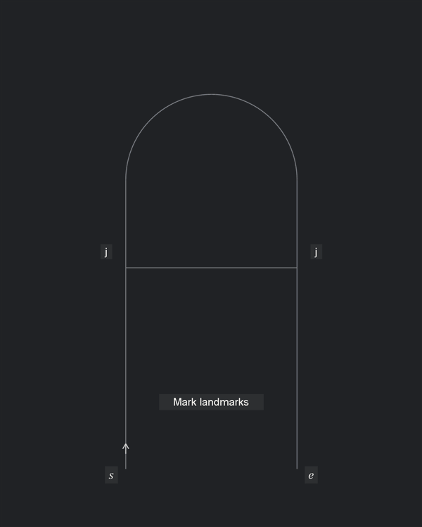
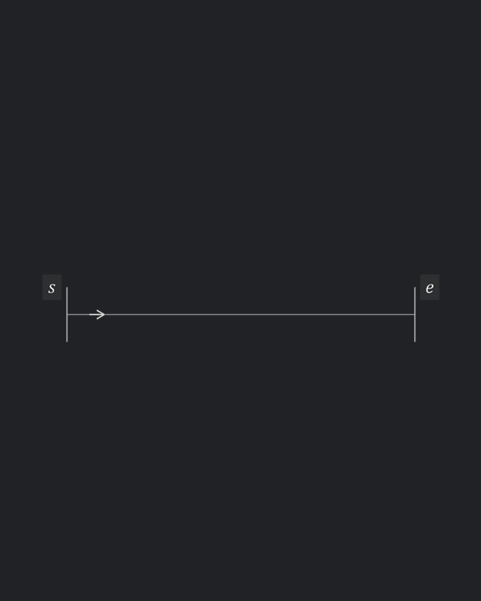
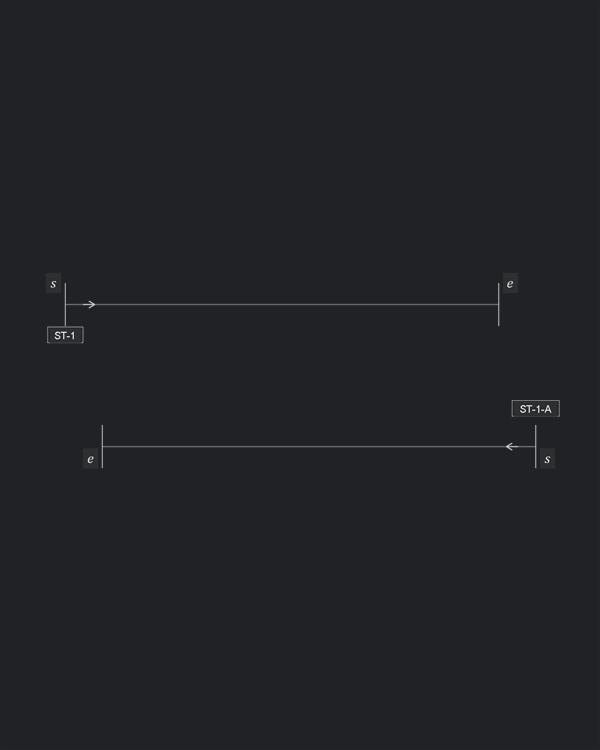
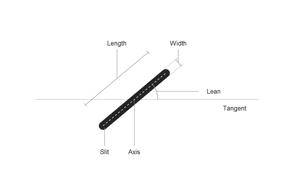
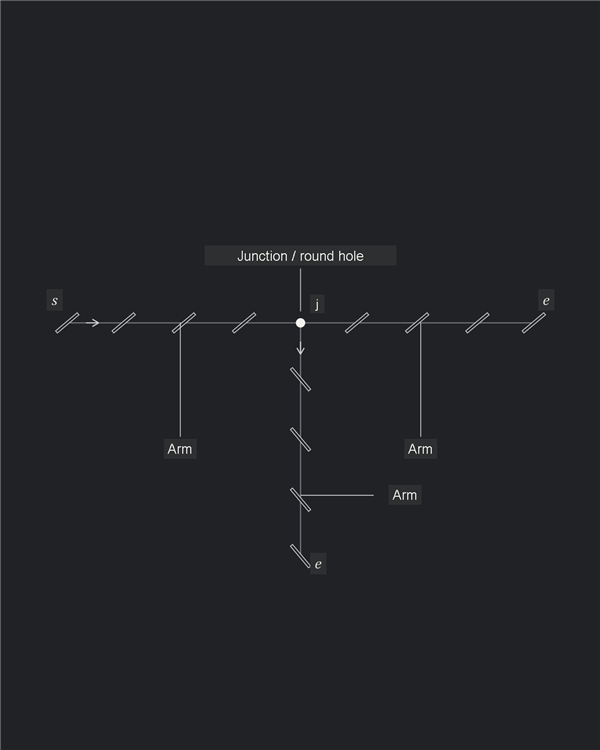
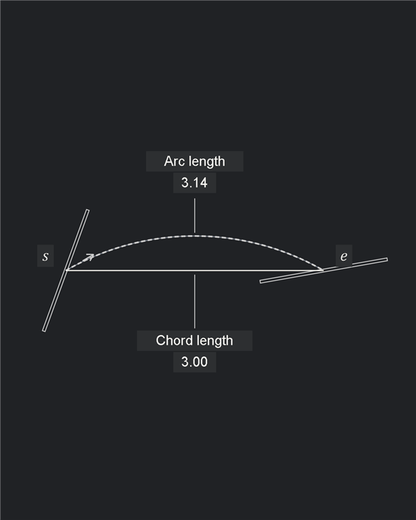

# Illustrated examples

Supporting figures for [the pitch](../../docs/PITCH_skeleton.md).

## Format and colour studies

- All figures export at $600\times750$ px (4:5 portrait). Geometry scales uniformly; related comparisons share one fixed camera across every frame.
- [Sixteen colour options](palettes/index.html): eight light and eight dark backgrounds, using the same Vertex point corner. [Contact sheet](palettes/contact-sheet.png).
- [colors.json](colors.json) is the single colour and typography file. `documentationTheme` selects **graphite** for both the pitch and counter-example diagrams.
- Each theme defines thread, construction, faded measurements, guides, leather edges, angles/residuals and adjusted-gap colours. `text` sets normal font colour; `textBackground` sets the label box colour. Semantic red/blue text and the Stitch fade retain their roles.
- `typography` sets `fontFamily`, `sizeScale`, label-box `paddingX`/`paddingY`, and `background` (set `false` to omit boxes). Font sizes scale from the existing label hierarchy. Use an installed font and preview it at the intended display size.
- Start/end markers use math italics $s$ and $e$; landmarks use $l_n$ with upright subscript digits. `notationFontFamily` (Cambria) and `notationSizeScale` control these markers in every output format.
- Thread, measurements and angle labels meet a minimum $4.5:1$ contrast against their background. The same theme resolves every SVG, PNG and GIF frame, including slit interiors and the fade.
- Rebuild the documentation figures after changing the selected theme or typography:

```powershell
./examples/illustrated/build.ps1
./examples/illustrated/build.ps1 -SceneScript ./examples/counter_examples/scenes.mjs -OutputDirectory ./examples/counter_examples/assets
```

Use `-Theme porcelain` (or any key in `colors.json`) to override the selection for a build. Use a separate `-OutputDirectory` for previews. Rebuild the palette gallery and contact sheet:

```powershell
./examples/illustrated/build.ps1 -SceneScript ./examples/illustrated/palettes.mjs -OutputDirectory ./examples/illustrated/palettes -ContactSheet
```

## Animation phases

Use **Build → Adjustment → Stitch**, in that order.

| Phase | Geometry and motion | Display |
| --- | --- | --- |
| Build | Establish the guides, features and slit layout | No thread. Slits and relevant dimensions at normal contrast; virtual slits dashed. Start, end and junction notation visible from the outset |
| Adjustment | Slide, redistribute, mirror or otherwise revise the layout | No thread and no fading. Keep fixed features stationary; update affected dimensions with the geometry |
| Stitch | Reveal all thread segments together; freeze the geometry | Fade holes, virtual slits and length dimensions to the theme's secondary colours over $0.3\,\mathrm{s}$. Keep thread prominent, angle annotations red and unresolved conflicts visible. Hold for four seconds, then reset |

- Continue from the previous example's established layout; do not replay Build unnecessarily
- Skip Adjustment when nothing changes; do not invent corrections to fill a phase
- Bridge is an explicit final-phase comparison: retain faded slits and visible thread throughout movement; update length and red angles live, with four-second holds at both positions
- Static stitched figures are the final Stitch state, including the same lightened measurements
- Clearance is a static construction view: no thread, no fade; retain the slit outlines, measurements and pass/fail marks
- Keep existing image paths working when changing animation to static. Vertex point and Clearance export single-frame GIFs alongside their PNG/SVG stills; these GIFs contain no animation or loop
- Use the same display rules in every example. Finer frame stages belong within these three phases; review the transitions and final still at $600\,\mathrm{px}$ width
- Adjusted gaps turn blue on the guide between slit centres, following the curve on circular guides. Marks and dimensions also turn blue. During Stitch, dimensions fade to light blue; guide segments and marks retain blue. Nominal measurements stay grey, residuals and angle annotations stay red

## Spacing setup

Each solution begins with the same nominal row and residual. `pitch-problem` is the shared setup fixture; the pitch compares only the three completed solutions.

## Even spacing

Distribute the openings evenly between the endpoints. It fits, but every gap departs from the tool's nominal spacing.


## End adjustment

Keep four gaps nominal and adjust the last one.


## Autostitch

Absorb the residual in the fewest adjusted gaps, centred between the fixed endpoints.


All four use `ILL-S02`: six slits on the same centred $15.3\,\mathrm{mm}$ guide, $3\,\mathrm{mm}$ pitch, $1.5\,\mathrm{mm}$ slits and $40^\circ$ lean. Even spacing has five $3.06\,\mathrm{mm}$ gaps. The other two have four nominal gaps and one $3.3\,\mathrm{mm}$ gap, at the end or in the centre. Slits remain solid; `I` marks identify adjusted spacing. Every gap value updates as the residual falls from $0.30\,\mathrm{mm}$ to zero.

Each solution starts at the problem's completed residual state and proceeds directly to redistribution. Motion compares layout revisions, not the movement of already-punched holes or the solver's execution order.

## The corner problem

`ILL-CORNER-PROBLEM`: the same right-angle guides, at $3\,\mathrm{mm}$ pitch with eight intervals per arm. Compare Vertex point, Bridge, Shared diagonal slit with mirrored lean, and Autostitch. The diagonal slit and Autostitch retain the outer endpoints. Vertex point and Bridge move their vertical rows, including the far endpoint, while retaining nominal spacing within both arms.


The common arm lengths are $L_i=np-c_i/2$, with $n=8$ and $c_i$ the signed shift from the guide vertex to the A6 virtual centre along each arm's incoming direction. This gives approximately $23.471688\,\mathrm{mm}$ and $23.953779\,\mathrm{mm}$. Vertex point keeps nominal arm spacing and shifts the vertical row to balance its corner connections. Vertex point absorbs the residual in the final connections to its fixed hole; Bridge joins the last nominal slits directly. A6 alone uses the minimum-adjustment selector and reserves a nominal step next to each virtual slit. The controlled balance is a fixture choice, not a general result for arbitrary endpoints.

Vertex point translates its vertical row upward by $0.4821\,\mathrm{mm}$. The fixed vertex hole then joins two equal $1.9574\,\mathrm{mm}$ visible stitches at $14.3^\circ$ to their respective arms. The final gaps into the hole are both $2.4717\,\mathrm{mm}$; internal arm gaps remain nominal. Move the outgoing virtual slit and end marker with the row. The still and compatibility GIF use this balanced layout.

Bridge translates the vertical run between visible thread lengths of $2.00\,\mathrm{mm}$ and $3.00\,\mathrm{mm}$. The corresponding angle pairs are $45.0^\circ/45.0^\circ$ and $61.9^\circ/28.1^\circ$. Hold each for four seconds and interpolate over $1.5\,\mathrm{s}$ each way. The still uses the $2.00\,\mathrm{mm}$ position. The whole row and its end marker move; guides and incoming row stay fixed. Length targets are stored in the test catalog.

The mirrored treatment reuses `diagonalCornerScene` with the Sellier construction parameters from `ILL-SELLIER-CORNER`, extended to the common arm lengths. Its rows stay nominal from the outer endpoints; only the final gaps into the vertex slit absorb the residuals. These are approximately $2.472\,\mathrm{mm}$ and $2.954\,\mathrm{mm}$; the first is below the Autostitch gap bound. Total absolute adjustment matches A6, but the adjusted-gap count does not. Both rows are present in the first frame; the vertical row immediately mirrors in place before the shared diagonal slit appears. Omit arm gap dimensions. Show only the two visible corner-thread lengths and red thread angles when the thread appears; length dimensions lighten with the slits.

The Autostitch solution starts with a nominal horizontal row. Its terminal virtual slit's lower tip locates the outgoing virtual slit and its nominal vertical row, initially beside the vertical guide. Keep the selected tips coincident and translate the entire vertical row sideways with the incoming virtual slit and its preceding real slit until the row reaches the guide. The horizontal motion opens a residual beside the incoming neighbour. Hold the corner construction, then distribute residual within both arms and restore the specified outer endpoints. Guides and endpoint targets stay fixed throughout the planning sequence. Omit arm gap dimensions throughout; show only the two corner thread lengths and red angles with the final thread. The final incoming arm has two $3.264\,\mathrm{mm}$ adjusted gaps; the outgoing arm has one $3.046\,\mathrm{mm}$ adjusted gap. `I` marks identify them. Reveal the thread together and hold for four seconds.


Motion shows planning revisions, not physical punching order; the analytic construction and fit selector do not execute the CAD plugin.

## Comparison notation and totals

- Vertex point is a static final thread view. Holes and length dimensions use the same secondary colours as the final animated views; angle annotations stay red. Length brackets measure visible thread between slit tips or the round-hole centre, in millimetres
- Corner thread angles use red wedges, arcs, leaders and values, with regular $13\,\mathrm{px}$ degree labels rounded to one decimal. Measure each visible thread against its arm direction; Bridge uses the same thread against both arms. Reveal them with the thread and retain their contrast during the final hold; they are annotations, not an aggregate score
- Gap values sit beneath their dimension brackets; numeric lengths use two decimals and regular 13 px text
- Residuals use a thick red line on the guide, without end ticks; their numbers are red and sit beside the gap values
- Static diagrams use the same final appearance; glossary figures without thread retain their contrast
- `pitchComparisonMetrics` calculates comparison totals for analysis; the pitch uses the diagrams and their corner measurements
- Spacing treatments share the initial residual, including the unfitted nominal row. The bridge uses its direct endpoint span rather than the abandoned path through the vertex. Autostitch corner steps are nominal and use virtual centres for pitch accounting
- Comparison totals include out-of-bound final gaps in the vertex treatments. The Bridge analysis totals and still use its $2.00\,\mathrm{mm}$ position. Visible thread-length deviation includes the actual connections to the Autostitch round hole

Recalculate totals from the repository root:

```powershell
node --input-type=module -e "import {createScenes,pitchComparisonMetrics} from './examples/illustrated/scenes.mjs'; for(const s of createScenes().filter(s=>s.name.startsWith('pitch-')||s.name.startsWith('problem-corner-'))) console.log(s.name,pitchComparisonMetrics(s));"
```

## Axioms in geometry

### Follow the guide; keep the slit profile: A1-A3

A slit follows the labelled local tangent without changing length or lean. The guide ends after five nominal $3\,\mathrm{mm}$ chords at radius $10\,\mathrm{mm}$; no adjusted gaps. Pitch is the direct chord between centres. `ILL-CURVE`, using the arc geometry from `A01`.


### Reserve a landmark pair: A4, A5, A7

Seven slits on each side of the central landmark. Extending the guide preserves the $0.50\,\mathrm{mm}$ residual per span while adding nominal runs around each adjustment block. Each free span has two central $3.25\,\mathrm{mm}$ gaps, with nominal gaps at its ends; the protected landmark gap remains $3\,\mathrm{mm}$. The animation moves the adjustments away from the feature while maintaining mirrored positions and fixed openings. `ILL-LANDMARK`: $40\,\mathrm{mm}$ guide, L1 at $20\,\mathrm{mm}$.


### Construct the corner hole: A6

Stitch towards the corner along one arm, ending at its dashed virtual slit. Approach from the other arm the same way. The two terminal virtual tips meet at one round hole. The `s`, `e` and `j` labels remain visible throughout. `J02`. Guide extents end at the outermost slits; all three steps on each arm are nominal.


### Share the smooth join: A8

The straight and curved portions use one slit at their common tangent. Revealing both portions does not add a second opening there. `A05`.


### Share the branching junction: A9

Four slits on each arm approach one shared round hole. Reveal all three arms together, one slit per arm at each step. Keep the endpoints and nominal junction neighbours fixed; split each $0.4\,\mathrm{mm}$ residual across two $3.20\,\mathrm{mm}$ gaps. `ILL-JUNCTION`.


The curved X example reserves one round hole and four nominal chord neighbours, then fits the free spans with fixed outer endpoints. Pitch is $3\,\mathrm{mm}$; the circular arm has radius $20\,\mathrm{mm}$. Its advances use chord lengths. Geometry and inputs are recorded in `ILL-JUNCTION-COMPARISON`.

Gap bounds, fixed neighbours, endpoint positions and opening clearance are checked. The thread appears after fitting and holds for four seconds. This is an analytic illustration, not a native solver run.


### Check the whole layout: A10

Two fixed arms meet at $6^\circ$. Two outer pairs pass, the next leaves only $0.04\,\mathrm{mm}$ clearance, and the nearest pair overlaps. Checks and crosses identify the result; numbers use the model's conservative clearance calculation in millimetres. Static construction view with sharp rectangular slits, no thread and no fading. With $w=0.3\,\mathrm{mm}$ and $m=0.2\,\mathrm{mm}$, the complete layout is invalid. `ILL-CLEARANCE`.


## Further model examples

### From fixed features to a fitted layout

`ILL-MODEL-SOLUTION` combines L1 on a straight arm, a two-arm corner, a curved T junction and L2 on its left curved arm, at $p=3\,\mathrm{mm}$. Reserve endpoint slits, both landmark pairs, corner neighbours and the T's three nominal neighbours before fitting.

Three straight free spans each measure $9.50\,\mathrm{mm}$ and fit with one nominal gap and two $3.25\,\mathrm{mm}$ gaps. Three circular free spans each have $9.50\,\mathrm{mm}$ arc length; their adjusted chords are approximately $3.24\,\mathrm{mm}$. Span dimensions follow the arcs; individual gap dimensions measure chords. Red guide segments identify the residuals; blue segments follow the adjusted guides.

Every frame runs at half speed, including the $0.6\,\mathrm{s}$ fade and eight-second thread hold. No final clearance annotation. Independent checks still cover fixed openings, chord lengths and all-pairs clearance at slit width $0.3\,\mathrm{mm}$, hole diameter $0.5\,\mathrm{mm}$ and margin $0.2\,\mathrm{mm}$. This is an analytic illustration, not native CAD output.



### No permitted fit

For a $7\,\mathrm{mm}$ span at $3\,\mathrm{mm}$ pitch, two equal gaps are too long and three are too short. Reject the span rather than move its fixed ends. `ILL-NOFIT`.



### Loop closure

Nominal spacing misses the reserved start on a $9.80\,\mathrm{mm}$ radius circle. A diameter supplies two opposite landmarks, L1 and L2. Reserve a nominal pair around each, then fit the two equal free arcs. Each half needs three exactly centred adjusted gaps of approximately $3.22\,\mathrm{mm}$; the blue intervals mirror across the diameter. Red arcs show the residual before fitting. The upper protected pair includes the closing gap; count the start opening once. `ILL-CLOSURE`.


### Matched guides

Solve one source, then reveal corresponding openings on its reflected copy. The copy retains the whole layout, including adjusted gaps and reflected slit axes. `ILL-MATCHED`.



### Curved corners

The same approach along each arm applies to an arc/line pair and an arc/arc pair. Each virtual slit continues the position and orientation of its row. `A03`, `A04`.


### Shallow curved corner

The outgoing corner step increases to approximately $3.21\,\mathrm{mm}$ to bring its neighbour onto the finite arc. `J08`.


## Glossary close-ups

The [glossary](../../docs/GLOSSARY.md) uses four static figures with aligned labels and horizontal or vertical leaders.


`ILL-TERMS-LAYOUT`: the full `F02` layout, with nominal, adjusted and protected gaps identified.



`ILL-TERMS-SLIT`: magnified profile with $\ell=1.5\,\mathrm{mm}$, $w=0.15\,\mathrm{mm}$ and $\alpha=40^\circ$.



`ILL-TERMS-JUNCTION`: the same T junction as `ILL-JUNCTION`, with each arm identified.



`ILL-TERMS-CHORD`: a nominal $3\,\mathrm{mm}$ chord on a $3\,\mathrm{mm}$ radius. The corresponding arc length is $\pi\,\mathrm{mm}$.

## Reproduce

From the repository root, using Node and Windows PowerShell with built-in `System.Drawing` and WPF. No packages or CAD session are needed.

```powershell
./examples/illustrated/build.ps1
node tests/validate-illustrated.mjs
node tests/validate-cases.mjs
```

- `scenes.mjs`: catalog inputs, analytic constructions, diagram elements and reveal timing.
- `build.ps1`: renders those elements and encodes the frames. Temporary files stay under `output/illustrated/`.
- `assets/<name>.gif`: looping illustration. Matching `.svg` and `.png` files contain the final state. Glossary figures (`terms-*`) use only SVG/PNG.
- `tests/cases.json`: source cases and stable illustration IDs. The validator checks drawn geometry, constraints, GIF frame counts, delays and looping.

### Notation

- `s`, `e`: extent and direction of the stitch line; closed loops reuse `s`.
- `j`: shared slit or round hole at a junction.
- `L1`: landmark reference; `I` crossbars mark adjusted spacing.
- Boxed `ST-1` / `ST-1-A`: source and matched-copy IDs.

### Updating after plugin changes

1. Update the affected canonical cases and run their native solver checks.
2. Align `scenes.mjs` constructions and the independent `tests/fit-oracle.mjs` selector with the changed rules. Keep comparison inputs identical.
3. Run the build and validation commands above; inspect the rebuilt GIFs and commit the sources and assets together.

The builder reads catalog inputs and analytic JavaScript scene recipes. It does not load the production LISP solver. Its thread connections follow `ast:cad-write-thread`: positive slit tip to the next negative tip, or the centre of a round hole. Native artwork regeneration uses [the demo commands](../demo.md).

## Figure rules

- Fixed $600\times750$ px canvas and framing throughout each loop.
- Geometry on a plain background. No headings, scorecards, counters, banners or duplicate prose inside the image.
- Only local dimensions and feature labels needed to follow the current step.
- Follow the [animation phases](#animation-phases); show only the construction and adjustment needed for the example.
- Keep comparison geometry and tool profile identical. Do not exaggerate small pitch changes.
- Use movement to explain construction and decisions; do not merely fade in a finished infographic.
- Animation is the primary example. Keep a still fallback and editable vector elements.
- Use light rectangular slit outlines and heavier thread. Clearance examples retain the specified physical slit width.
