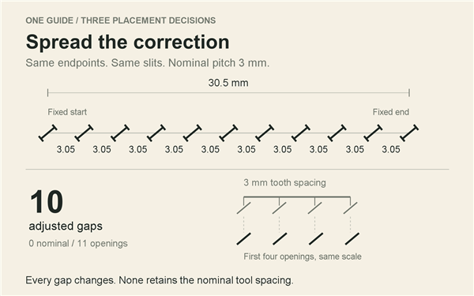
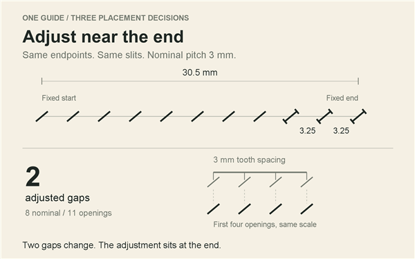
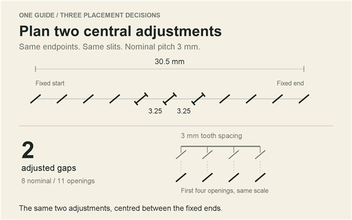

# Illustrated pitch demos

Small examples for [the pitch](../../docs/PITCH.md). Each shows one geometric problem or placement decision. The opening comparison has static SVG/PNG proofs; the remaining scripts are plans.

## Current proof set

| Equal redistribution | End adjustment | Central adjustment |
| --- | --- | --- |
| [SVG](assets/pitch-spread.svg) / [PNG](assets/pitch-spread.png) | [SVG](assets/pitch-end.svg) / [PNG](assets/pitch-end.png) | [SVG](assets/pitch-centre.svg) / [PNG](assets/pitch-centre.png) |







These are analytic diagrams of `S02` at $3\,\mathrm{mm}$ pitch, not exported CAD output. All three satisfy the spacing bounds. The central arrangement agrees with the independent fit selector. Stroke weight is graphical; no finite-width physical clearance claim is made. The lower schematic shows four teeth above the first four openings, at the same scale as the main guide.

Rebuild from the repository root using Windows PowerShell and its built-in `System.Drawing` support; no packages or CAD session are needed:

```powershell
./examples/illustrated/build.ps1
node tests/validate-illustrated.mjs
node tests/validate-cases.mjs
```

`build.ps1` reads the catalog guide and emits editable SVG elements plus PNG proofs. `-OutputDirectory` selects a temporary export directory. The validator measures the emitted SVG slit geometry, spacing and adjustment marks, compares the central layout with the independent selector, and checks PNG dimensions. Native qualification and animation remain pending.

## Canvas and layout

- Use a **600 × 375 px landscape canvas**, with a **16:10 aspect ratio**, for every example and animation frame.
- Compose for viewing at 600 px wide. Keep captions, spacing labels and opening details readable at that size without zooming.
- Give each frame one primary geometric view. Compare approaches in successive frames or separate examples using the same scale and framing.
- Reserve room for captions, measurements and any overshooting proposal before setting the view; keep that view fixed throughout the sequence.
- Still-frame sequences use the same 600 × 375 px canvas for each frame.

## Diagram elements and web delivery

- Compose each example as an independent diagram built from primary elements: guides, individual slits and round holes, fixed-feature markers, virtual slits, gap brackets, measurements and captions.
- Reuse those elements to compose the states and animation frames.
- Keep **SVG masters**, export **PNG stills**, and optionally generate **GIF or silent WebM animation**, at 600 × 375 px. Prove the static composition before animating it.
- Animations play automatically and loop, with a readable hold on the result before resetting. No playback or replay controls and no interactive diagram UI.
- Generate the animation from diagram elements, rather than recording CAD or the screen.
- Always provide a readable still; the explanation must work without animation.

## How to compose an example

- Start with the smallest guide that makes the point: a line, an arc, one landmark or one junction. Save composite artwork for the pitch's final challenge.
- State the point in one sentence before describing the sequence. The visible result should support that sentence without requiring a long caption.
- Use the same guide, endpoints, pitch, tool profile and constraints when comparing approaches. Keep the scale and view fixed. Change only the placement decision being illustrated.
- Show the guide and required features first, then the openings and the consequence of their placement. Reveal annotations when they become relevant.
- Keep the guide quiet and the openings clear. Distinguish proposed openings, accepted openings, construction and invalid placement consistently; use labels or line treatment as well as colour.
- Keep slit dimensions fixed as spacing changes. Show the actual slit lean and round holes where they matter; centre dots alone cannot explain tool geometry or clearance.
- Use short captions that name the decision: "Keep nominal pitch", "Past the end", "Spread the correction", "Adjust two central gaps". Avoid command transcripts and full application chrome in these close-ups.
- Keep the geometric examples independent of a CAD brand. Use a separate application view when the point is native CAD editing or integration.
- Follow the [glossary](../../docs/GLOSSARY.md), [axioms](../../docs/AXIOMS.md), [model](../../docs/MODEL.md) and [junction construction](../../docs/JUNCTIONS.md). Identify deliberate failures as failures of the illustrated approach.

## Progressive reveal and animation

1. Establish the guide, travel direction, fixed features and nominal pitch.
2. Reveal openings in order so the viewer can follow the placement rule. Hold a few early gaps long enough to establish the rhythm; later repeated placements may advance faster.
3. Pause at the first consequential mismatch. Leave the fixed target visible and show the attempted next opening as a proposal, including an overshoot beyond the guide if needed.
4. Show the response: redistribute, leave an end correction, plan a central adjustment block, or reject the fit. Keep the original target fixed so the consequence is visible.
5. Hold the final state with the essential measurements and one takeaway. A loop should visibly reset to the empty guide.

Animation is optional. A static version can show the key states as separate PNGs: setup, placement, conflict and result.

Treat progressive stitching as an explanatory reveal. It does not prescribe a sewing itinerary or claim that Autostitch solves greedily as each opening appears. When positions change, show a planning revision: proposed geometry may move; already-punched holes cannot. For an Autostitch reveal, establish its planned fixed features and adjustment block before filling the remaining gaps.

## What each script records

- **Pitch location and point:** where it belongs and the single idea it demonstrates.
- **Setup:** guide geometry, extent and direction, tool profile, nominal pitch and required features; reuse a catalog case and identify its variant where available.
- **Elements:** the independent geometric and annotation elements used by the diagram, including which are reused across states.
- **Beats:** what appears, moves or stays fixed; where to pause; the few words or measurements shown at each step.
- **Final state:** the result or rejection and the viewer's takeaway.
- **Source and status:** canonical case/rule references, unresolved choices and what still needs native verification.

Script names identify illustrations. Test-catalog IDs identify reusable geometry; several comparison scripts may share one case. Reuse existing IDs from [the catalog](../../tests/cases.json). If later implementation adds or changes a test scenario, update the catalog then. A text script is a proposal, not a new test pass.

## Opening comparison: one line, three decisions

Shared setup: catalog `S02`, the $3\,\mathrm{mm}$ pitch variant. Straight guide from $(0,0)$ to $(30.5,0)\,\mathrm{mm}$, left to right, both endpoint centres fixed, no landmarks. Use the same fixed slit profile in all three scripts; nominal slit length $1.5\,\mathrm{mm}$ and lean $40^\circ$. Width and clearance margin must be selected and recorded before native clearance review. The quantities below describe spacing; they are not a clearance certification.

### Spread the correction

**Pitch location:** Current State / Equal redistribution. **Point:** equal redistribution reaches the endpoint by changing every gap.

1. Show the empty guide, fixed endpoints and "Nominal pitch: 3 mm".
2. Reveal proposed openings at $0,3,6,\ldots,30\,\mathrm{mm}$, establishing nominal spacing.
3. Ghost the next opening at $33\,\mathrm{mm}$, outside the guide. Pause with "Past the end"; show the $0.5\,\mathrm{mm}$ remainder from the opening at $30\,\mathrm{mm}$ to the fixed end.
4. Withdraw the overshooting proposal. In planning view, redistribute the eleven openings between the fixed endpoints: ten equal gaps of $3.05\,\mathrm{mm}$. Keep the two endpoints stationary while the intermediate openings move.
5. Hold the comparison with "10 adjusted gaps". This fit stays within the spacing allowance; the comparison concerns how many gaps depart from nominal pitch.

**Final state:** ten equal adjusted gaps. **Takeaway:** fitting the line evenly gives up nominal spacing throughout.

### Adjust near the end

**Pitch location:** Current State / Local adjustment. **Point:** two adjusted gaps can absorb the remainder near the end, preserving nominal spacing elsewhere.

1. Reset to the same empty guide and fixed endpoints.
2. Plan eight nominal gaps to $24\,\mathrm{mm}$, leaving $6.5\,\mathrm{mm}$ before the fixed end.
3. Divide the remainder into two $3.25\,\mathrm{mm}$ gaps. Both satisfy the same spacing allowance as the central solution.
4. Reveal all eleven openings, with adjustment marks on the last two gaps.
5. Hold with "2 adjusted gaps; 8 nominal gaps". Compare the location of the adjustment with the central layout.

**Final state:** eight nominal gaps followed by two equal adjusted gaps. **Takeaway:** the number of adjustments and their placement are separate decisions. This layout satisfies the spacing rule; Autostitch prefers a central block.

Optional failure beat: continuing at nominal pitch to $30\,\mathrm{mm}$ and then adding the fixed endpoint creates a $0.5\,\mathrm{mm}$ gap. Label it invalid, not a representative manual solution. The permitted adjusted range is $2.7$ to $3.3\,\mathrm{mm}$.

### Plan two central adjustments

**Pitch location:** Autostitch / Model and solution. **Point:** fix the endpoint and distribute the remainder over the fewest permitted adjusted gaps.

1. Reset to the same empty guide, with both endpoint openings already reserved. Show "Plan the fit".
2. Show that ten nominal gaps cover $30\,\mathrm{mm}$ and leave $0.5\,\mathrm{mm}$ to absorb. One adjusted gap can add at most $0.3\,\mathrm{mm}$; two are needed.
3. Preview the central pair of gaps at $3.25\,\mathrm{mm}$ each and the other eight gaps at $3\,\mathrm{mm}$. Keep the fixed endpoint visible throughout.
4. Reveal the planned intermediate openings from left to right. Pause on the two central adjusted gaps, then continue at nominal pitch to the reserved end.
5. Hold with "2 adjusted gaps; 8 nominal gaps". Reveal the adjusted-placement marks and their spacing labels at the central block.

**Final state:** four nominal gaps, two equal adjusted gaps, four nominal gaps; eleven openings including the endpoints. **Takeaway:** the correction is bounded, local and explicit before execution.

### Show the physical consequence

Use the same four-tooth chisel diagram at $3\,\mathrm{mm}$ pitch in each comparison. Align its first tooth with an opening; the remaining teeth show whether that run retains the tool spacing. Keep slit length and lean fixed. The overlay explains pitch correspondence only, not tool-body clearance or a punching sequence.

At 600 px, the difference between $3$ and $3.05\,\mathrm{mm}$ is subtle. Show adjustment marks and counts; do not exaggerate hole positions to make the difference visible. Central placement is the chosen balance policy, not the only valid fit or a claim of universal visual superiority.

**Source and status for all three:** `S02` supplies the shared guide and Autostitch's expected two adjusted gaps; `ILL-S02` indexes the static assets. The first two scripts deliberately apply different placement policies to that guide. Static SVG geometry is checked against [the model](../../docs/MODEL.md#span-fitting) and the independent selector; animation, tool-width choices and native output review remain to be done.

## Next small scripts

These are prompts to develop using the same script structure, not completed demos.

First batch: the straight comparison, a landmark, corner construction (including a shallow turn), a shared junction and a rejected fit. Establish one static proof before expanding the set. Composite artwork follows those explanations.

| Subject | Progressive reveal and point | Starting reference |
| --- | --- | --- |
| Exact straight fit | Reach the fixed end at nominal pitch without a correction; establish the control before the three-way comparison. | `S01`, $3\,\mathrm{mm}$ variant |
| Landmark | Reveal the landmark and its fixed nominal gap first; fit the approach and remainder without moving the pair. | `F02` |
| Circular guide | Keep each slit at its specified lean relative to the local tangent; bracket direct chord spacing and show the endpoint fit. | `A01` |
| Straight corner | Show the two arms, virtual slits and meeting tips; replace the construction with the shared round hole and reveal real neighbours. | `J02`; junction construction |
| Curved corner | Repeat the corner construction with an arc/line pair, then an arc/arc pair, as separate examples. | `A03`, `A04` |
| Smooth join | Reveal one shared slit at the specified lean to the common tangent where curvature changes; contrast with an uninterrupted same-geometry continuation. | `A05`, `J01` |
| T or X junction | Reserve the shared intersection hole and nominal neighbours before filling each arm; use separate T and X examples. | Axiom A9; select catalog scenarios before implementation |
| Closed loop | Approach the reserved start and reveal the closure fit, counting the start opening once. | `L01`, `L02` |
| No permitted fit | Show the fixed targets and spacing allowance; end with rejection rather than a squeezed-in opening. | Model's $7\,\mathrm{mm}$ straight-span example; select catalog scenario before implementation |
| Whole-layout clearance | Reveal a locally fitted span, then the nearby opening that makes the complete layout fail clearance. | Axiom A10; select catalog scenario before implementation |
| Matched guides | Solve one source, then transfer the complete layout to a rotated or reflected piece; highlight corresponding adjusted gaps. | Model / Matched guides; select catalog scenario before implementation |

Keep each script focused on its own decision. The pitch's final composite example can then bring those decisions together without explaining them all again.
