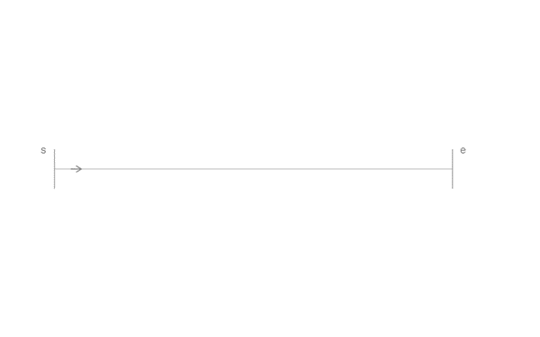
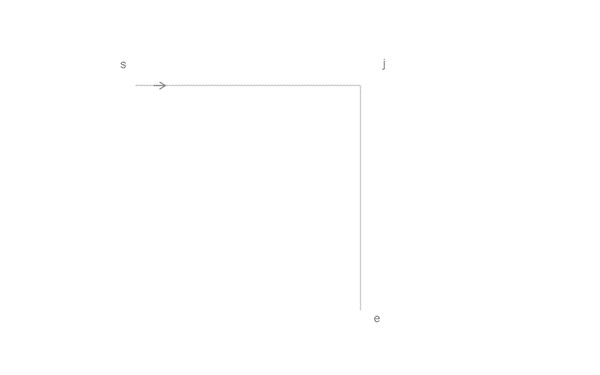
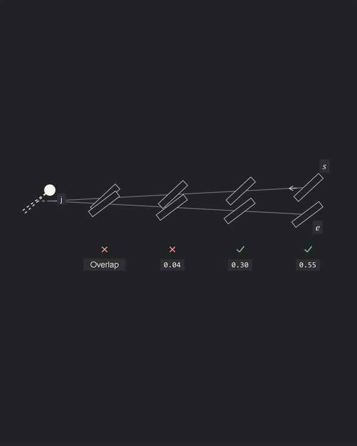

# Illustrated examples

Supporting figures for [the pitch](../../docs/PITCH_skeleton.md).

## Spacing setup

Each solution begins with the same nominal row and residual. `pitch-problem` is the shared setup fixture; the pitch compares only the three completed solutions.

## Even spacing

Distribute the openings evenly between the endpoints. It fits, but every gap departs from the tool's nominal spacing.


## End adjustment

Keep four gaps nominal and adjust the last one.


## Central adjustment (Autostitch)

Absorb the residual in the fewest adjusted gaps, centred between the fixed endpoints.



All four use `ILL-S02`: six slits on the same centred $15.3\,\mathrm{mm}$ guide, $3\,\mathrm{mm}$ pitch, $1.5\,\mathrm{mm}$ slits and $40^\circ$ lean. Even spacing has five $3.06\,\mathrm{mm}$ gaps. The other two have four nominal gaps and one $3.3\,\mathrm{mm}$ gap, at the end or in the centre. Slits remain solid; `I` marks identify adjusted spacing. Every gap value updates as the residual falls from $0.30\,\mathrm{mm}$ to zero.

Each solution starts at the problem's completed residual state and proceeds directly to redistribution. Motion compares layout revisions, not the movement of already-punched holes or the solver's execution order.

## The corner problem

`ILL-CORNER-PROBLEM`: the same right-angle guides, at $3\,\mathrm{mm}$ pitch with eight intervals per arm. Compare a vertex hole, a thread bridge, a shared diagonal slit with mirrored lean, and a shared tip hole. Each treatment retains the same outer endpoints. The bridge bypasses the vertex and has one off-pitch gap outside the adjustment bounds.




The common arm lengths are $L_i=np-c_i/2$, with $n=8$ and $c_i$ the signed shift from the guide vertex to the A6 virtual centre along each arm's incoming direction. This gives approximately $23.471688\,\mathrm{mm}$ and $23.953779\,\mathrm{mm}$. Vertex and A6 fits have equal and opposite residuals; both use the same minimum-adjustment selector and reserve a nominal step next to their corner opening or virtual slit. The controlled balance is a fixture choice, not a general result for arbitrary endpoints.

The mirrored treatment reuses `diagonalCornerScene` with the Sellier construction parameters from `ILL-SELLIER-CORNER`, extended to the common arm length. The top row starts punched; the vertical row mirrors in place before the shared diagonal slit appears.

The Autostitch solution starts at the completed crossing state. Move the terminal virtuals and their nominally spaced real neighbours until the selected tips meet (A6), then fit the free spans while keeping the outer endpoints, neighbours and hole fixed. Gap values update; provisional gaps outside the bounds are red. The final incoming arm has two $3.264\,\mathrm{mm}$ adjusted gaps; the outgoing arm has one $3.046\,\mathrm{mm}$ adjusted gap. `I` marks identify them. Reveal the thread together and hold for four seconds.


Motion shows planning revisions, not physical punching order; the analytic construction and fit selector do not execute the CAD plugin.

## Comparison notation and totals

- Gap values sit beneath their dimension brackets; numeric lengths use two decimals and regular 13 px text
- Residuals use a thick red line on the guide, without end ticks; their numbers are red and sit beside the gap values
- Thread reveal lightens the holes and measurement annotations over $0.3\,\mathrm{s}$, then holds for four seconds. Unresolved red residuals remain visible
- Static diagrams use the same final appearance; glossary figures without thread retain their contrast
- The tables in the pitch exclude the setup fixture and are calculated by `pitchComparisonMetrics` and checked by `tests/validate-illustrated.mjs`
- Spacing treatments share the initial residual, including the unfitted nominal row. The bridge uses its direct endpoint span rather than the abandoned path through the vertex. Autostitch corner steps are nominal and use virtual centres for pitch accounting

Recalculate totals from the repository root:

```powershell
node --input-type=module -e "import {createScenes,pitchComparisonMetrics} from './examples/illustrated/scenes.mjs'; for(const s of createScenes().filter(s=>s.name.startsWith('pitch-')||s.name.startsWith('problem-corner-'))) console.log(s.name,pitchComparisonMetrics(s));"
```

## Axioms in geometry

### Follow the guide; keep the slit profile: A1-A3

A slit follows the local tangent without changing length or lean. Pitch is a direct chord between centres, not distance along the curve. `A01`.


### Reserve a landmark pair: A4, A5, A7

Five slits on each side of the central landmark. Each free span has two central $3.25\,\mathrm{mm}$ gaps, with nominal gaps at its ends; the protected landmark gap remains $3\,\mathrm{mm}$. The animation moves the adjustments away from the feature while maintaining mirrored positions and fixed openings. `ILL-LANDMARK`: $28\,\mathrm{mm}$ guide, L1 at $14\,\mathrm{mm}$.


### Construct the corner hole: A6

Stitch towards the corner along one arm, ending at its dashed virtual slit. Approach from the other arm the same way. The two terminal virtual tips meet at one round hole. The `s`, `e` and `j` labels remain visible throughout. `J02`.


### Share the smooth join: A8

The straight and curved portions use one slit at their common tangent. Revealing both portions does not add a second opening there. `A05`.


### Share the branching junction: A9

Reserve one round hole and its nominal neighbours before filling the arms. `ILL-JUNCTION`.


### Check the whole layout: A10

Two fixed arms meet at $6^\circ$. Stitching approaches the junction from the wide end: two pairs pass, the next leaves only $0.04\,\mathrm{mm}$ clearance, and the nearest pair overlaps. Checks and crosses identify the result; numbers are edge-to-edge clearance in millimetres. Light envelopes show the required allowance. With $w=0.3\,\mathrm{mm}$ and $m=0.2\,\mathrm{mm}$, the complete layout is invalid. `ILL-CLEARANCE`.



## Further model examples

### No permitted fit

For a $7\,\mathrm{mm}$ span at $3\,\mathrm{mm}$ pitch, two equal gaps are too long and three are too short. Reject the span rather than move its fixed ends. `ILL-NOFIT`.


### Loop closure

Twenty nominal chord gaps return to the reserved start. Count that opening once. `ILL-CLOSURE`.


### Matched guides

Solve one source, then reveal corresponding openings on its reflected copy. The copy retains the whole layout, including adjusted gaps and reflected slit axes. `ILL-MATCHED`.


### Curved corners

The same approach along each arm applies to an arc/line pair and an arc/arc pair. Each virtual slit continues the position and orientation of its row. `A03`, `A04`.


### Shallow curved corner

The outgoing corner step increases to approximately $3.21\,\mathrm{mm}$ to bring its neighbour onto the finite arc. `J08`.


## Glossary close-ups

The [glossary](../../docs/GLOSSARY.md) uses four static figures with aligned labels and horizontal or vertical leaders.


`ILL-TERMS-LAYOUT`: the full `F02` layout, with nominal, adjusted and protected gaps identified.


`ILL-TERMS-SLIT`: magnified profile with $\ell=1.5\,\mathrm{mm}$, $w=0.15\,\mathrm{mm}$ and $\alpha=40^\circ$.


`ILL-TERMS-JUNCTION`: the same T junction as `ILL-JUNCTION`, with each arm identified.


`ILL-TERMS-CHORD`: a nominal $3\,\mathrm{mm}$ chord on a $3\,\mathrm{mm}$ radius. The corresponding arc length is $\pi\,\mathrm{mm}$.

## Reproduce

From the repository root, using Node and Windows PowerShell with built-in `System.Drawing` and WPF. No packages or CAD session are needed.

```powershell
./examples/illustrated/build.ps1
node tests/validate-illustrated.mjs
node tests/validate-cases.mjs
```

- `scenes.mjs`: catalog inputs, analytic constructions, diagram elements and reveal timing.
- `build.ps1`: renders those elements and encodes the frames. Temporary files stay under `output/illustrated/`.
- `assets/<name>.gif`: looping illustration. Matching `.svg` and `.png` files contain the final state. Glossary figures (`terms-*`) use only SVG/PNG.
- `tests/cases.json`: source cases and stable illustration IDs. The validator checks drawn geometry, constraints, GIF frame counts, delays and looping.

### Notation

- `s`, `e`: extent and direction of the stitch line; closed loops reuse `s`.
- `j`: shared slit or round hole at a junction.
- `L1`: landmark reference; `I` crossbars mark adjusted spacing.
- Boxed `ST-1` / `ST-1-A`: source and matched-copy IDs.

### Updating after plugin changes

1. Update the affected canonical cases and run their native solver checks.
2. Align `scenes.mjs` constructions and the independent `tests/fit-oracle.mjs` selector with the changed rules. Keep comparison inputs identical.
3. Run the build and validation commands above; inspect the rebuilt GIFs and commit the sources and assets together.

The builder reads catalog inputs and analytic JavaScript scene recipes. It does not load the production LISP solver. Its thread connections follow `ast:cad-write-thread`: positive slit tip to the next negative tip, or the centre of a round hole. Native artwork regeneration uses [the demo commands](../demo.md).

## Figure rules

- Fixed $600\times375$ px canvas and framing throughout each loop.
- Geometry on a plain background. No headings, scorecards, counters, banners or duplicate prose inside the image.
- Only local dimensions and feature labels needed to follow the current step.
- Show guide, constraint, attempted placement, consequence and response. Hold the result, then visibly reset.
- Keep comparison geometry and tool profile identical. Do not exaggerate small pitch changes.
- Use movement to explain construction and decisions; do not merely fade in a finished infographic.
- Animation is the primary example. Keep a still fallback and editable vector elements.
- Reveal all thread segments together after the slit layout. Fade real and virtual holes to light grey over $0.3\,\mathrm{s}$, then hold for four seconds. Static stitched diagrams use the same final colours. Rejected candidates keep their rejection marks.
- Use light rectangular slit outlines and heavier thread. Clearance examples retain the specified physical slit width.
