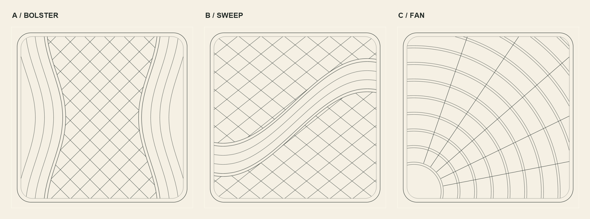
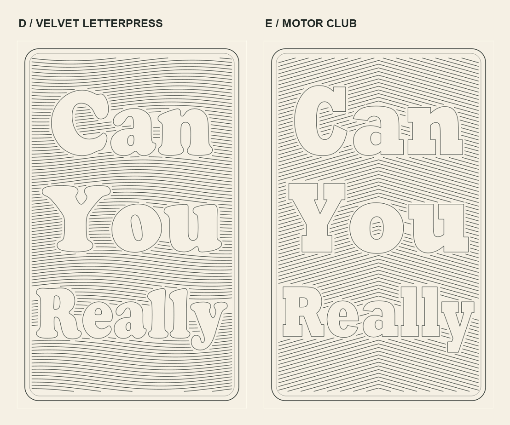

# Artwork options

Guide drawings for design review. No generated stitch holes yet.

## Square quilting



| Option | Direction | CAD |
| --- | --- | --- |
| [A — Bolster](quilt-a-bolster.png) | Diamond centre panel; curved side channels. | [DXF](quilt-a-bolster.dxf) |
| [B — Sweep](quilt-b-sweep.png) | An S-shaped ribbon interrupts the diamond field. | [DXF](quilt-b-sweep.dxf) |
| [C — Fan](quilt-c-fan.png) | Paired sweeping arcs crossed by straight ribs. | [DXF](quilt-c-fan.dxf) |

Each square is $240\times240\,\mathrm{mm}$, exported at 720 × 720 pixels.

## Portrait lettering



| Option | Direction | CAD |
| --- | --- | --- |
| [D — Velvet letterpress](banner-a.png) | Rounded Cooper Black lettering; flowing background rows. | [DXF](banner-a.dxf) |
| [E — Motor club](banner-b.png) | Rockwell Extra Bold lettering; chevron background rows. | [DXF](banner-b.dxf) |

Portrait proportions are $10:16$: $200\times320\,\mathrm{mm}$, exported at 600 × 960 pixels. Background guides stop outside the letters, leaving a $2\,\mathrm{mm}$ separation. Letter outlines are pattern references, not stitch guides.

## Next pass

Choose a quilting direction and a lettering direction. Prepare their curves and junctions, fit the stitches, then inspect the result. These draft DXFs use sampled polylines; they are not solver-qualified routes. Shading fragments shorter than $5\,\mathrm{mm}$ are omitted.

The [centred three-circle emblem](../autostitch-emblem-study.png) is a separate proposal; its current fit status is recorded in the [specimen notes](../README.md#centred-three-circle-study).

## Reproduce

```powershell
./examples/design-studies.ps1
```

Produces PNG, SVG and DXF for each option, plus the two comparison sheets. Requires Windows System.Drawing, Cooper Black and Rockwell Extra Bold. Exported lettering is outlined, so viewing the files does not require those fonts.
